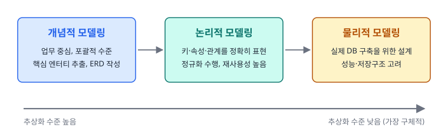
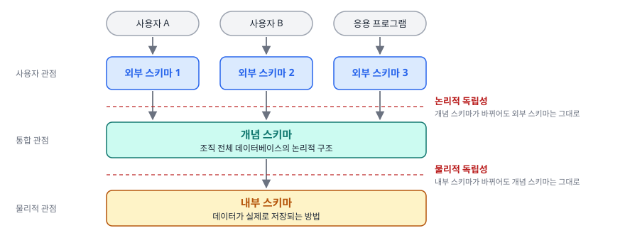

# 1과목 1장. 데이터 모델링의 이해

데이터 모델의 이해 · 관계형 데이터베이스 개요 · 엔터티 · 속성 · 관계 · 식별자

SQLD 핵심정리노트 · 이광호 · 주영아 강사

---

## #01. 핵심 요약

| 주제 | 핵심 |
|:--|:--|
| 데이터 모델링 | 현실 세계의 데이터를 추상화해 표현하는 기법, **개념적 → 논리적 → 물리적** 단계로 진행 |
| 핵심 구성요소 | **엔터티**(실체), **속성**(특성), **관계**(연관성) |
| 관계형 데이터베이스 | SQL로 데이터를 정의(DDL)·조작(DML)·제어(DCL), 데이터 중복 최소화 |
| 엔터티 | 업무에 필요한 정보 집합, 유형·개념·사건 엔터티로 나뉨, **식별자와 속성 필수** |
| 속성 | 엔터티를 설명하는 최소 데이터 단위, 기본·설계·파생 속성과 PK·FK·일반 속성으로 구분 |
| 관계 | 엔터티 간 연관성, 1:1·1:M·N:M 카디널리티와 필수·선택 참여 특성을 가짐 |
| 식별자 | 인스턴스를 구분하는 속성, 주·보조 / 내부·외부 / 단일·복합 식별자 등으로 분류 |
| 좋은 데이터 모델 | 완전성, 중복 배제, 업무 규칙 반영, 데이터 재사용성, 명확한 의사소통, 통합성 |

---

## #02. 데이터 모델의 이해

<Grid cols="2">

#### 1.1 모델링의 정의

| 구분 | 설명 |
|:--|:--|
| 모델링(Modeling) | 현실 세계의 복잡한 현상이나 사물을 단순화하여 표현하는 기법 |
| 데이터진흥원 정의 | 사람이 접하는 다양한 현상(사람, 사물, 개념 등)을 약속된 방식(수식, 그림 등)으로 표현하는 것 |

#### 1.2 모델링의 종류

| 구분 | 설명 |
|:--|:--|
| 정보시스템 모델링 | 정보 모델링, 데이터 모델링, 프로세스 모델링 등 |
| 수리 모델링 | 수학적 공식으로 현상을 표현 |
| 확률/통계 모델링 | 통계적 방법론으로 미래를 예측 |
| 회로 모델링 | 전자회로를 설계하고 구성 |

</Grid>

---

### #02-1. 모델링의 특징 · 정보시스템 모델링의 세 가지 관점

<Grid cols="2">

#### 1.3 모델링의 특징

| 구분 | 설명 |
|:--|:--|
| 추상화 | 현실 세계를 일정한 형식에 맞추어 간략하게 표현 |
| 단순화 | 복잡한 현실을 기호, 문자, 그림 등으로 쉽게 이해할 수 있게 함 |
| 명확화 | 애매모호함을 제거하고 명확하게 현상을 기술 |

#### 1.4 정보시스템 모델링의 세 가지 관점

| 구분 | 설명 |
|:--|:--|
| 데이터 관점 (What, Data) | 업무가 어떤 데이터와 관련되는지 모델링 |
| 프로세스 관점 (How, Process) | 업무가 실제로 처리하는 일을 모델링 |
| 데이터와 프로세스의 상관 관점 | 업무 처리 방식에 따라 데이터가 어떤 영향을 주고받는지 모델링 |

</Grid>

---

### #02-2. 데이터 모델링의 정의

- **데이터 모델링**: 정보시스템 구축을 위해 데이터 관점에서 업무를 분석하고 현실 세계의 데이터를 약속된 표기법으로 표현하는 과정

데이터 모델이 제공하는 기능

- 시스템 가시화 지원
- 시스템 구조와 행동 명세화
- 구조화된 틀 제공
- 문서화
- 다양한 관점 제공
- 상세 수준의 구체화

---

### #02-3. 데이터 모델링의 중요성 및 유의점 (1/2)

| 구분 | 설명 |
|:--|:--|
| 데이터 설계의 중요성 | 시스템 구축에서 매우 중요한 요소 복잡한 정보 요구사항을 간결하게 표현 데이터 중복/비유연성/비일관성을 줄여 품질 향상 |
| 데이터 모델링 시 유의점 | 중복된 데이터 요소 최소화 변화 가능성 고려 (업무 변화에 유연하게 대응) 데이터 모델의 단순화 추구 데이터 재사용성 고려 일관성과 통합성 유지 |

---

### #02-4. 데이터 모델링의 중요성 및 유의점 (2/2)

<Callout kind="tip" icon="➕" title="유의점 (보완)">

- 데이터의 정의를 프로세스와 분리해 **유연성**을 높임
- **프로그램과 테이블 간의 연계성을 낮춤**
  - 연계성이 높으면 사소한 업무 변화에도 데이터 모델이 크게 바뀌어 유연성이 떨어짐

</Callout>

---

### #02-5. 데이터 모델링의 3단계 (1/3)

---

### #02-6. 데이터 모델링의 3단계 (2/3)

| 구분 | 설명 |
|:--|:--|
| 개념적 데이터 모델링 | 추상화 수준이 높고 업무 중심적, 포괄적 수준의 모델링 전사적 관점에서 기업의 데이터 모델링 진행 주로 ERD 산출물 생성 |
| 논리적 데이터 모델링 | 시스템 구축을 위한 키, 속성, 관계 등을 정확하게 표현 재사용성이 높은 설계가 가능 정규화를 통해 데이터 모델 품질 향상 |
| 물리적 데이터 모델링 | 실제 DB 구축을 위한 설계 단계 성능, 저장 등을 고려한 실제적 구현 방법 제시 인덱스, 역정규화 등의 기법 사용 |

---

### #02-7. 데이터 모델링의 3단계 (3/3)

<Callout kind="tip" icon="➕" title="단계별 특징 (보완)">

| 단계 | 추상화 수준 | 보완 내용 |
|:--|:--|:--|
| 개념적 모델링 | **가장 높음** | 업무를 분석해 핵심 엔터티를 추출하는 단계, 핵심 엔터티 간의 관계를 표현하려고 **ERD 작성** |
| 논리적 모델링 |  | 개념적 모델링의 결과를 토대로 세부 속성·식별자·관계를 표현 같은 형태의 데이터를 쓰는 업무나 프로젝트에서 재사용 가능(쿼리도 재사용) 재사용성이 높으면 유지보수가 쉬움 |
| 물리적 모델링 | **가장 낮음**(가장 구체적) | 논리 모델을 직접 물리적으로 생성하는 과정 성능, 디스크 저장구조, 하드웨어 보안성, 가용성 고려 |

</Callout>

---

### #02-8. 데이터 독립성 (Three-Schema Architecture) (1/4)

---

### #02-9. 데이터 독립성 (Three-Schema Architecture) (2/4)

| 구분 | 설명 |
|:--|:--|
| 외부 스키마 (External Schema) | 사용자 관점의 스키마 개인적인 데이터베이스 뷰 응용 프로그램이 접근하는 영역 |
| 개념 스키마 (Conceptual Schema) | 통합 관점의 스키마 조직 전체의 데이터베이스를 기술 전체 데이터베이스의 구조 정의 |
| 내부 스키마 (Internal Schema) | 물리적 저장구조 실제 데이터가 저장되는 방법 정의 |

---

### #02-10. 데이터 독립성 (Three-Schema Architecture) (3/4)

독립성 종류

| 구분 | 설명 |
|:--|:--|
| 논리적 독립성 | 개념 스키마가 변경되어도 외부 스키마에 영향 없음 |
| 물리적 독립성 | 내부 스키마가 변경되어도 개념 스키마에 영향 없음 |

- **매핑(사상)**: 상위 단계와 하위 단계 사이의 대응 관계

---

### #02-11. 데이터 독립성 (Three-Schema Architecture) (4/4)

<Callout kind="tip" icon="➕" title="스키마 간 독립성 (보완)">

| 구분 | 독립 관계 | 특징 | 예시 |
|:--|:--|:--|:--|
| 논리적 독립성 | **외부 스키마 ↔ 개념 스키마** | 논리 구조(테이블, 관계)를 바꿔도 애플리케이션이나 사용자 뷰에 영향 없음 데이터베이스 유지보수가 쉬워짐 | 테이블 구조가 바뀌어도 사용자 뷰는 그대로 |
| 물리적 독립성 | **개념 스키마 ↔ 내부 스키마** | 물리적 저장 방식(인덱싱, 파일 시스템)을 바꿔도 논리 구조에 영향 없음 데이터베이스 성능 최적화 지원 | 저장 파일 구조를 바꿔도 테이블이나 관계는 그대로 |

</Callout>

---

### #02-12. 데이터 모델링의 세 가지 핵심 요소

| 구분 | 설명 |
|:--|:--|
| 엔터티 (Entity) | 업무에 필요하고 유용한 정보를 저장하는 집합적 실체 |
| 속성 (Attribute) | 엔터티를 구성하는 최소 데이터 단위 |
| 관계 (Relationship) | 엔터티 간의 논리적인 연관성 |

---

### #02-13. ERD (Entity-Relationship Diagram)

- **ERD 정의**: 엔터티와 엔터티 간의 관계를 그림으로 표현한 것

ERD 작성 순서

<Flow>
<li>엔터티 도출</li>
<li>엔터티 간 관계 정의</li>
<li>관계명 기술</li>
<li>관계의 참여도 기술</li>
<li>관계 필수여부 기술</li>
</Flow>

ERD 표기법 종류

| 구분 | 설명 |
|:--|:--|
| Chen 표기법 | 가장 오래된 표기법, 관계를 마름모꼴로 표시 |
| IE (Information Engineering) 표기법 | 까마귀발 표기법이라고도 함, 관계를 선으로 표시 |
| Barker 표기법 | 엔터티에 주식별자를 표기하지 않음, 관계는 선으로 표시 |

---

### #02-14. 좋은 데이터 모델링의 특징

| 구분 | 설명 |
|:--|:--|
| 완전성 | 업무에 필요한 모든 데이터를 담아야 함 |
| 중복 배제 | 데이터 중복을 최소화하여 일관성 유지 |
| 업무 규칙 반영 | 현업의 업무 규칙을 정확히 표현 |
| 데이터 재사용 | 데이터 재사용이 용이하도록 설계 |
| 의사소통 | 비즈니스 요구사항을 명확히 전달 |
| 통합성 | 전체 데이터의 통합된 시각을 제공 |

---

## #03. 관계형 데이터베이스 개요

<Grid cols="2">

#### 2.1 데이터베이스의 정의

- 데이터의 집합으로 조직적으로 구성된 데이터들의 모임

여러 관점의 정의

| 구분 | 설명 |
|:--|:--|
| 법적 정의 | 저작물의 소재를 체계적으로 배열 또는 구성한 편집물 |
| 기술적 정의 | 관련된 데이터의 모음으로, 중복을 통제하는 체계 |
| 산업적 정의 | 조직체의 정보 요구를 지원하는 공유 데이터 자원 |

#### 2.2 데이터베이스의 발전 과정

| 구분 | 설명 |
|:--|:--|
| 1960년대 | 파일 시스템 (파일 간 데이터 중복, 일관성/무결성 보장 어려움) |
| 1970년대 | 계층형/망형 DBMS (자료 간 관계가 복잡, 유연성 부족) |
| 1980년대 | 관계형 DBMS 등장 (오라클, DB2 등) |
| 1990년대 | 객체 관계형 DBMS로 발전 |

</Grid>

---

### #03-1. 관계형 데이터베이스의 특징

| 구분 | 설명 |
|:--|:--|
| 데이터 중복 최소화 | 정규화를 통한 중복 제거 |
| 동시성 관리 | 다중 사용자 환경에서 데이터 일관성 보장 |
| 병행제어 | 동시에 여러 사용자가 데이터 처리할 때 일관성 유지 |
| 메타데이터 관리 | 데이터에 관한 데이터(데이터 사전) 관리 |
| 보안/무결성/장애복구 기능 | 데이터 보호와 안정성 보장 |
| SQL 사용 | 표준 질의어를 통한 데이터 정의/조작/제어 |

---

### #03-2. SQL (Structured Query Language)

| 구분 | 설명 |
|:--|:--|
| SQL의 정의 | 관계형 데이터베이스에서 사용하는 표준 질의어 |
| SQL 표준화 | ANSI SQL을 통한 표준화 |

SQL 명령어 유형

| 구분 | 설명 |
|:--|:--|
| DML (Data Manipulation Language) | SELECT, INSERT, UPDATE, DELETE |
| DDL (Data Definition Language) | CREATE, ALTER, DROP, TRUNCATE |
| DCL (Data Control Language) | GRANT, REVOKE |
| TCL (Transaction Control Language) | COMMIT, ROLLBACK, SAVEPOINT |

---

### #03-3. 테이블 구조와 데이터 타입 (1/2)

테이블 구성 요소

| 구분 | 설명 |
|:--|:--|
| 컬럼 (Column) | 속성, 필드 |
| 행 (Row) | 레코드, 튜플 |
| 필드 (Field) | 컬럼과 행이 만나는 지점, 실제 데이터가 저장됨 |

---

### #03-4. 테이블 구조와 데이터 타입 (2/2)

주요 데이터 타입

| 구분 | 설명 |
|:--|:--|
| 숫자형 | INTEGER, NUMBER, DECIMAL 등 |
| 문자형 | CHAR, VARCHAR, TEXT 등 |
| 날짜형 | DATE, TIMESTAMP |
| 이진형 | BLOB, BINARY |
| 불리언형 | BOOLEAN |

- **CHAR vs VARCHAR**: CHAR은 고정길이, VARCHAR는 가변길이 문자열 저장

---

## #04. 엔터티

<Grid cols="2">

#### 3.1 엔터티의 정의

- **엔터티**: 업무에 필요하고 유용한 정보를 저장하고 관리하기 위한 집합적인 실체 또는 객체
- 데이터베이스에서는 테이블로 구현됨

#### 3.2 엔터티의 특징

| 구분 | 설명 |
|:--|:--|
| 업무적 필요성 | 반드시 업무에서 필요하고 관리할 가치가 있어야 함 |
| 식별자 | 유일한 식별자(예: 학번, 사번)로 식별 가능해야 함 |
| 인스턴스 집합 | 2개 이상의 인스턴스(행)를 포함해야 함 |
| 업무 프로세스 참여 | 실제 업무 프로세스에 활용되어야 함 |
| 속성 포함 | 반드시 속성을 가져야 함 |
| 관계 존재 | 다른 엔터티와 최소 1개 이상의 관계가 필요 |

</Grid>

---

### #04-1. 엔터티의 분류

유무형에 따른 분류

| 구분 | 설명 | 예시 |
|:--|:--|:--|
| 유형 엔터티 | 물리적 형태가 있음 | 학생, 사원, 강사 |
| 개념 엔터티 | 개념적인 정보 | 조직, 보험상품 |
| 사건 엔터티 | 업무 수행에 따라 발생 | 주문, 청구 |

발생시점에 따른 분류

| 구분 | 설명 | 예시 |
|:--|:--|:--|
| 기본 엔터티 | 독립적으로 생성 가능 | 고객, 상품 |
| 중심 엔터티 | 기본 엔터티로부터 생성 | 계약, 주문 |
| 행위 엔터티 | 두 엔터티 간의 행위로 생성 | 주문목록, 사원변경이력 |

---

### #04-2. 엔터티 명명 규칙 (1/2)

- 현업업무에서 사용하는 용어 사용
- 약어 사용 지양
- 단수 명사 사용
- 모든 엔터티에서 유일한 이름 부여
- 생성 의미가 부여된 이름 사용

명명 방식

| 구분 | 설명 | 예시 |
|:--|:--|:--|
| CamelCase | 각 단어의 첫 글자를 대문자로 표기 | CustomerOrder |
| SnakeCase | 단어 사이에 언더바(_) 사용 | customer_order |

---

### #04-3. 엔터티 명명 규칙 (2/2)

<Callout kind="tip" icon="➕" title="엔터티 점검 (보완)">

- 사용되지 않는 **고립 엔터티**는 추후 제거 고려
- 누락된 프로세스는 이후에 추가하거나 수정 가능

</Callout>

---

## #05. 속성

#### 속성의 정의

- **속성**: 업무에서 필요로 하는 최소한의 데이터 단위로, 더 이상 분리되지 않는 정보
- 엔터티를 설명하는 데이터 요소

---

### #05-1. 속성의 특성

| 구분 | 설명 |
|:--|:--|
| 업무 필요성 | 해당 업무에서 필요하고 관리해야 할 정보여야 함 |
| 함수적 종속성 | 정규화 이론에 따라 주식별자에 함수적 종속성을 가져야 함 |
| 단일값 원칙 | 하나의 속성은 한 개의 값만을 가짐 |
| 도메인 | 속성이 가질 수 있는 값의 범위를 정의 |

<Callout kind="tip" icon="➕" title="속성의 특성 (보완)">

- 하나의 속성에 값이 여러 개인 **다중값**이면 **별도의 엔터티로 분리**
- 엔터티에 대한 자세하고 구체적인 정보를 나타냄, 추상적인 값은 속성이 아님

</Callout>

---

### #05-2. 속성의 분류 (1/4)

특성에 따른 분류

| 구분 | 설명 | 예시 |
|:--|:--|:--|
| 기본 속성 | 업무 분석 단계에서 바로 정의되는 속성 | 상품이름 |
| 설계 속성 | 업무 규칙화, DB 설계 과정에서 도출되는 속성 | 예금분류코드 |
| 파생 속성 | 다른 속성에서 계산이나 변형으로 생성되는 속성 | 이자 |

엔터티 내 역할에 따른 분류

| 구분 | 설명 |
|:--|:--|
| PK(Primary Key) 속성 | 엔터티를 식별하는 속성 |
| FK(Foreign Key) 속성 | 다른 엔터티와의 관계에서 포함된 속성 |
| 일반 속성 | PK나 FK가 아닌 일반적인 속성 |

---

### #05-3. 속성의 분류 (2/4)

<Callout kind="tip" icon="➕" title="특성에 따른 분류의 예 (보완)">

| 구분 | 예시 |
|:--|:--|
| 기본 속성 | 회원 ID, 이름, 계좌번호, 주문일자, 원금 |
| 설계 속성 | 일련번호, 주문번호, 상품코드, 지점코드 |
| 파생 속성 | 합계, 평균, 전체 수 |

- 파생 속성은 조회 성능을 위해 원래 속성의 값을 계산해 저장하는 속성, **가급적 적게 정의**

</Callout>

---

### #05-4. 속성의 분류 (3/4)

<Callout kind="tip" icon="➕" title="속성값 수에 따른 분류 (보완)">

| 구분 | 설명 | 예시 |
|:--|:--|:--|
| 단일값 속성 | 하나의 값만 가지는 속성 | 나이, 이름 |
| 다중값 속성 | 여러 개의 값을 가지는 속성 | 취미 |

- 다중값 속성은 "속성은 하나의 속성값을 가져야 한다"에 어긋남, **1차 정규화**를 하거나 별도의 엔터티로 만들어 관계로 연결

</Callout>

---

### #05-5. 속성의 분류 (4/4)

<Callout kind="tip" icon="➕" title="분리 가능성에 따른 분류 (보완)">

| 구분 | 설명 | 예시 |
|:--|:--|:--|
| 단순 속성 | 다른 속성으로 구성될 수 없는 속성 | 시, 구, 동, 번지, 이름, 나이 |
| 복합 속성 | 여러 속성으로 구성된 속성 | 주소 |

</Callout>

---

### #05-6. 속성의 명명 규칙

- 현업에서 사용하는 이름 사용
- 약어 사용 지양
- 전체 시스템에서 유일한 이름 사용
- 명사형 사용
- 이름만으로도 의미 파악 가능하게

---

## #06. 관계

#### 5.1 관계의 정의

- **관계**: 엔터티의 인스턴스 간에 논리적인 연관성을 가지는 형태나 행위
- 엔터티 간의 업무적 연관성을 표현

#### 5.2 관계의 표현

- 2개의 엔터티 사이의 관계는 2개의 관계명을 가짐
  - 예: 고객은 주문을 생성한다 / 주문은 고객에 의해 생성된다

---

### #06-1. 관계의 분류 (1/2)

종류

| 구분 | 설명 | 예시 |
|:--|:--|:--|
| 존재에 의한 관계 | 항상 존재하는 관계 | 사원은 부서에 속한다 |
| 행위에 의한 관계 | 특정 행위로 발생하는 관계 | 고객이 상품을 구매 |

카디널리티(참여자 수)

| 구분 | 설명 |
|:--|:--|
| 1:1 관계 | 양쪽 엔터티의 인스턴스가 1:1로 대응 |
| 1:M 관계 | 한쪽 엔터티 인스턴스가 여러 인스턴스와 관계 |
| N:M 관계 | 양쪽 엔터티의 인스턴스가 다대다 관계 |

---

### #06-2. 관계의 분류 (2/2)

<Callout kind="tip" icon="➕" title="상호배타적 관계 (보완)">

- 개인회원 또는 법인회원 **둘 중 하나로만** 주문할 수 있을 때, 고객과 주문 엔터티의 관계

</Callout>

<Callout kind="tip" icon="➕" title="관계 관련 용어 (보완)">

| 용어 | 뜻 |
|:--|:--|
| 관계 | 엔터티 간의 연관성을 나타내는 개념, 페어링의 집합 |
| 관계의 차수 | 한 엔터티의 레코드가 다른 엔터티의 레코드와 연결되는 방식 |
| 관계의 페어링 | 엔터티 안의 인스턴스가 개별적으로 관계를 가지는 것 |

</Callout>

---

### #06-3. 관계의 선택성

| 구분 | 설명 |
|:--|:--|
| 필수적 관계 | 반드시 관계를 가져야 함 (실선으로 표시) |
| 선택적 관계 | 관계를 가질 수도 있고 아닐 수도 있음 (점선으로 표시) |

<Callout kind="tip" icon="➕" title="표기법별 표현 (보완)">

| 표기법 | 필수적 관계 | 선택적 관계 |
|:--|:--|:--|
| 바커 표기법 | 실선 | 점선 |
| IE 표기법 | 원을 그리지 않음 | 관계선 끝에 원을 그림 |

- 두 엔터티의 관계가 서로 필수적이면 **하나의 트랜잭션**을 형성
- 두 엔터티가 서로 독립적으로 수행될 수 있으면 선택적 관계로 표현

</Callout>

---

### #06-4. 관계명 표기 규칙 · 관계 도출 점검 항목 (보완)

<Grid cols="2">

#### 5.5 관계명 표기 규칙

- 관계의 이름은 현재형 동사 사용
- 관계 참여자의 관점에서 능동적으로 명명
- 관계는 양방향으로 명명 (능동/수동)

#### 5.6 관계 도출 점검 항목 (보완)

- 두 엔터티 사이에 **정보의 조합**이 발생하는지
- 두 엔터티 사이에 관련 있는 **연관 규칙**이 존재하는지
- 업무기술서나 장표에 관계 연결에 대한 **규칙이 서술**되어 있는지
- 업무기술서나 장표에 관계 연결을 가능하게 하는 **동사**가 있는지

</Grid>

---

## #07. 식별자

<Grid cols="2">

#### 6.1 식별자의 정의

- **식별자**: 엔터티 내에서 인스턴스를 구별하는 속성 또는 속성 조합
- 논리 모델링에서는 '식별자', 물리 모델링에서는 '키(Key)'라는 용어 사용

#### 6.2 식별자의 특성

| 구분 | 설명 |
|:--|:--|
| 유일성 | 인스턴스를 유일하게 구분할 수 있어야 함 |
| 최소성 | 필요 최소한의 속성으로 구성 |
| 불변성 | 값이 변하지 않아야 함 |
| 존재성 | 반드시 값이 존재해야 함 (NULL 허용 안됨) |

</Grid>

---

### #07-1. 식별자의 분류 (1/3)

대표성에 따른 분류

| 구분 | 설명 | 예시 |
|:--|:--|:--|
| 주식별자 | 엔터티를 대표하는 식별자 | 사원번호 |
| 보조식별자 | 대체 식별 가능한 식별자 | 주민등록번호 |

생성 방식에 따른 분류

| 구분 | 설명 | 예시 |
|:--|:--|:--|
| 내부식별자 | 엔터티 내에서 스스로 생성되는 식별자 | 고객번호 |
| 외부식별자 | 다른 엔터티로부터 받아오는 식별자 | 주문의 고객번호 |

---

### #07-2. 식별자의 분류 (2/3)

속성의 수에 따른 분류

| 구분 | 설명 | 예시 |
|:--|:--|:--|
| 단일식별자 | 하나의 속성으로 구성된 식별자 | 고객번호 |
| 복합식별자 | 여러 속성의 조합으로 구성된 식별자 | 주문번호+상세순번 |

대체 가능성에 따른 분류

| 구분 | 설명 | 예시 |
|:--|:--|:--|
| 본질식별자 | 업무적으로 자연 발생한 식별자 | 주민등록번호 |
| 인조식별자 | 시스템에서 임의로 부여한 식별자 | 일련번호 |

---

### #07-3. 식별자의 분류 (3/3)

<Callout kind="tip" icon="➕" title="키의 종류 (보완)">

| 키 | 설명 |
|:--|:--|
| 후보키(Candidate Key) | 각 행을 유일하게 식별할 수 있는 속성들의 집합, **유일성과 최소성** 모두 만족 |
| 기본키(Primary Key) | 후보키 중 엔터티를 대표하도록 선정된 키 |
| 수퍼키(Super Key) | 유일성은 만족하지만 **최소성은 만족하지 않는** 키 |
| 대체키(Alternative Key) | 후보키 중 기본키로 선정되지 않고 남은 키 |

</Callout>

---

### #07-4. 식별자 도출 기준

- 업무에서 자주 사용되는 속성 우선
- 명칭이나 내역과 같은 서술형 속성은 지양
- 속성의 수가 적은 것 우선
- 향후 변경 가능성이 적은 속성 우선

---

### #07-5. 식별자 관계와 비식별자 관계

| 구분 | 설명 |
|:--|:--|
| 식별자 관계 | 부모 엔터티의 주식별자가 자식 엔터티의 주식별자에 포함되는 관계 실선으로 표시 |
| 비식별자 관계 | 부모 엔터티의 주식별자가 자식 엔터티의 일반 속성으로 포함되는 관계 점선으로 표시 |
| 관계 설정 기준 | 자식 인스턴스가 부모 없이 독립적 존재 가능 → 비식별자 관계 자식 인스턴스의 존재가 부모에 종속적 → 식별자 관계 복합식별자가 너무 많아지면 → 비식별자 관계 고려 객체 재사용 필요시 → 비식별자 관계 고려 이력 관리 엔터티 → 식별자 관계 고려 |

---
layout: cover
hideInToc: true
---

# 감사합니다

질문과 토론 환영

SQLD 핵심정리노트 · 이광호 · 주영아 강사

