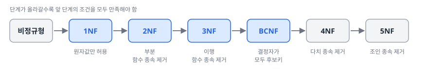

# 1과목 2장. 데이터 모델과 SQL

정규화 · 반정규화 · 트랜잭션 · NULL · 본질식별자 vs. 인조식별자 · 계층형 데이터 모델

SQLD 핵심정리노트 · 이광호 · 주영아 강사

---

## #01. 핵심 요약

| 주제 | 핵심 |
|:--|:--|
| 정규화 | 데이터 중복을 없애고 이상 현상을 막기 위해 테이블을 분해하는 과정, **1NF(원자값) → 2NF(부분종속 제거) → 3NF(이행종속 제거) → BCNF(결정자 = 후보키)** 순으로 진행 |
| 반정규화 | 성능 향상을 위해 정규화된 모델에 중복·통합·분리를 적용하는 기법, **다른 대안(뷰, 인덱스, 파티셔닝 등)을 먼저 검토**한 뒤 적용 |
| 트랜잭션 | **ACID**(원자성, 일관성, 고립성, 영속성) 특성을 가짐, 전부 수행되거나 전부 취소되는 논리적 작업 단위 |
| NULL | '값이 없음'을 뜻함, 산술 연산 결과는 NULL, 비교 연산 결과는 Unknown, NVL·NULLIF·COALESCE 등의 함수로 처리 |
| 집계 함수와 NULL | SUM·AVG·MAX·MIN·COUNT(컬럼)은 NULL을 제외하고 연산, **COUNT(\*)만 NULL을 포함**해 전체 행 수를 셈 |
| 식별자 | 본질식별자는 업무에서 자연 발생한 식별자, 인조식별자는 시스템 편의를 위해 인위적으로 부여한 식별자, **인조식별자 남용 시 중복 데이터 발생 위험** |

---

### #01-1. 핵심 요약 (2/2)

| 주제 | 핵심 |
|:--|:--|
| 계층형 데이터 모델 | 자기 자신과의 관계를 가짐, 셀프 조인이나 계층형 쿼리(START WITH / CONNECT BY, CTE)로 조회 |
| 정규화와 반정규화의 균형 | 정규화는 입력·수정·삭제 성능 향상, 반정규화는 조회 성능 향상 대신 데이터 무결성 위험 |

---

## #02. 정규화

<Grid cols="2">

#### 1.1 정규화의 정의

- **정규화(Normalization)**: 데이터의 일관성, 최소한의 데이터 중복, 최대한의 데이터 유연성을 확보하기 위한 데이터 분해 과정
- 엔터티를 상호 독립적인 관계로 분리하여 이상 현상(Anomaly)을 제거하는 것이 목적
- **함수적 종속성(Functional Dependency)**: 데이터 간의 종속 관계를 기반으로 정규화를 수행

#### 1.2 이상 현상 (Anomaly)

| 구분 | 설명 |
|:--|:--|
| 삽입 이상(Insert Anomaly) | 불필요한 데이터를 함께 삽입해야만 원하는 데이터를 추가할 수 있는 현상 |
| 갱신 이상(Update Anomaly) | 중복 데이터 중 일부만 수정하여 데이터 불일치가 발생하는 현상 |
| 삭제 이상(Delete Anomaly) | 필요한 데이터까지 함께 삭제되는 현상 |

</Grid>

---

### #02-1. 정규화 단계 (1/3)

제1정규형 (1NF)

- 모든 속성의 값이 **원자값**(Atomic Value)이어야 함
- 반복 그룹이나 다중값 속성을 제거
- 하나의 속성에는 하나의 값만 존재해야 함

---

### #02-2. 정규화 단계 (2/3)

제2정규형 (2NF)

- 1NF를 만족하면서 **부분 함수 종속**(Partial Dependency)을 제거
- 모든 비식별 속성이 주식별자 전체에 완전 함수 종속이어야 함
- 복합 식별자의 일부에만 종속되는 속성을 분리

제3정규형 (3NF)

- 2NF를 만족하면서 **이행 함수 종속(Transitive Dependency)** 을 제거
- 비식별 속성 간의 종속 관계를 제거
- A → B → C에서 A → C의 간접 종속이 존재하면 분리

BCNF (Boyce-Codd Normal Form)

- 3NF를 만족하면서 **결정자**(Determinant)가 모두 후보키이어야 함
- 후보키가 아닌 속성이 결정자인 경우를 제거
- 모든 결정자가 후보키인 상태

---

### #02-3. 정규화 단계 (3/3)

제4정규형 (4NF)

- **다치 종속**(Multi-Valued Dependency)을 제거
- 하나의 속성이 여러 개의 독립적인 다중값과 관련되는 경우를 분리

제5정규형 (5NF)

- **조인 종속**(Join Dependency)을 제거
- 분해된 테이블을 다시 조인했을 때 원래의 테이블과 동일해야 함

<Callout kind="tip" icon="➕" title="정규화 (보완)">

- 정규화는 **논리 모델링 단계**에서 진행
- 제1정규형: 각 컬럼은 같은 종류나 타입의 값을 가지고, 유일한 이름을 가져야 함

</Callout>

---

### #02-4. 정규화와 성능

- **정규화는 조회 성능을 저하시킬 수도, 향상시킬 수도 있음**
- 정규화를 하면 조인이 증가하여 조회 성능이 떨어질 수 있음
- 반면, 중복이 제거되어 데이터 일관성 유지 → 특정 조회 성능 향상
- **입력/수정/삭제 성능은 일반적으로 향상됨** (중복 데이터 감소로 처리량 감소)

---

## #03. 반정규화

<Grid cols="2">

#### 2.1 반정규화의 정의

- **반정규화(Denormalization)**: 정규화된 엔터티, 속성, 관계에 대해 성능 향상과 개발 운영의 단순화를 위해 **중복, 통합, 분리** 등을 수행하는 데이터 모델링 기법
- 데이터 무결성이 깨질 수 있는 위험성이 있으므로 신중한 판단 필요

#### 2.2 반정규화 적용 시 고려사항

반정규화 전에 먼저 고려할 사항

- 뷰(View) 활용으로 해결 가능한지 검토
- 인덱스 조정으로 해결 가능한지 검토
- 클러스터링 적용으로 해결 가능한지 검토
- 파티셔닝이나 캐시 적용 등 다른 방안 검토

- **위 방안으로도 해결되지 않을 때 반정규화를 적용**

</Grid>

---

### #03-1. 반정규화 기법 (1/3)

테이블 반정규화

- **테이블 병합**: 1:1 관계 또는 1:M 관계의 테이블을 하나로 합침

테이블 분할

| 구분 | 설명 |
|:--|:--|
| 수직 분할 | 컬럼 단위로 테이블을 나눔 (자주 사용하는 컬럼과 그렇지 않은 컬럼을 분리) |
| 수평 분할 | 행 단위로 테이블을 나눔 (지역별, 기간별 등으로 분리) |

테이블 추가

---

### #03-2. 반정규화 기법 (2/3)

테이블 반정규화 (계속)

| 구분 | 설명 |
|:--|:--|
| 중복 테이블 추가 | 다른 업무이거나 서버가 다른 경우 중복 테이블 생성 |
| 통계 테이블 추가 | 통계 데이터를 미리 계산하여 별도 테이블에 저장 |
| 이력 테이블 추가 | 변경 이력을 관리하기 위한 테이블 추가 |
| 부분 테이블 추가 | 자주 사용하는 컬럼만 모아 별도 테이블 생성 |

---

### #03-3. 반정규화 기법 (3/3)

컬럼 반정규화

| 구분 | 설명 |
|:--|:--|
| 중복 컬럼 추가 | 조인 감소를 위해 다른 테이블의 컬럼을 중복 저장 |
| 파생 컬럼 추가 | 계산값을 미리 저장하여 조회 성능 향상 (예: 합계, 평균) |
| 이력 테이블 컬럼 추가 | 최신 데이터를 빠르게 조회하기 위한 컬럼 추가 |
| PK에 의한 컬럼 추가 | PK에 포함된 정보를 별도 컬럼으로 저장하여 인덱스 접근 편의 제공 |
| 응용시스템 오동작을 위한 컬럼 추가 | 이전 데이터와의 비교를 위한 컬럼 |

관계 반정규화

- **중복 관계 추가**: 조인 경로를 단축시키기 위해 이미 존재하는 관계를 중복으로 추가

---

## #04. 트랜잭션

<Grid cols="2">

#### 3.1 트랜잭션의 정의

- **트랜잭션(Transaction)**: 데이터베이스의 상태를 변환시키는 하나의 논리적 작업 단위
- 하나의 업무 단위로 묶여 있어, 전체가 수행되거나 전체가 취소되어야 함

#### 3.2 트랜잭션의 특성 (ACID)

| 구분 | 설명 |
|:--|:--|
| 원자성(Atomicity) | 트랜잭션의 연산은 전부 실행되거나 전부 취소되어야 함 (All or Nothing) 일부만 수행되어서는 안 됨 |
| 일관성(Consistency) | 트랜잭션 수행 전후로 데이터베이스의 상태가 일관되어야 함 데이터 무결성 제약 조건을 항상 만족 |
| 고립성(Isolation) | 하나의 트랜잭션이 실행 중일 때 다른 트랜잭션이 접근할 수 없음 각 트랜잭션은 독립적으로 수행 |
| 영속성(Durability) | 트랜잭션이 성공적으로 완료되면 그 결과는 영구적으로 반영 시스템 장애가 발생하더라도 결과는 보존 |

</Grid>

---

### #04-1. 트랜잭션과 데이터 모델링

- 하나의 트랜잭션에 관련된 데이터는 가능하면 하나의 엔터티에 배치
- 트랜잭션의 단위가 데이터 모델의 엔터티 도출에 영향을 줌

<Callout kind="tip" icon="➕" title="트랜잭션 처리 원칙 (보완)">

- 순차적으로 수행되는 작업 A와 B가 하나의 트랜잭션일 때, A만 실행되고 시스템 장애가 나면 **A를 ROLLBACK**
- 하나의 트랜잭션으로 구성된 작업은 **부분 COMMIT 불가**

</Callout>

---

## #05. NULL

#### NULL의 정의

| 구분 | 설명 |
|:--|:--|
| NULL | 아직 정의되지 않은 값, 값이 존재하지 않는 상태 |
| NULL ≠ 공백(빈 문자열) | NULL은 '값이 없음'이고, 공백은 '길이가 0인 문자열' |
| NULL ≠ 0 | NULL은 '값이 없음'이고, 0은 숫자 0이라는 값 |

---

### #05-1. NULL의 특성

| 구분 | 설명 |
|:--|:--|
| 산술 연산 | NULL이 포함된 산술 연산의 결과는 항상 NULL 예: 100 + NULL = NULL, NULL × 3 = NULL |
| 비교 연산 | NULL과의 비교 결과는 항상 Unknown(알 수 없음) 예: NULL = NULL → Unknown, NULL > 0 → Unknown |
| 논리 연산 | NULL은 3가지 값 논리(Three-Valued Logic)에 따름 TRUE AND Unknown = Unknown FALSE AND Unknown = FALSE TRUE OR Unknown = TRUE FALSE OR Unknown = Unknown NOT Unknown = Unknown |

---

### #05-2. NULL 관련 함수 (1/2)

| 구분 | 설명 |
|:--|:--|
| NVL(Oracle) / ISNULL(SQL Server) | NULL을 지정한 값으로 치환 NVL(컬럼, 대체값): 컬럼이 NULL이면 대체값 반환 |
| NULLIF | 두 값이 같으면 NULL 반환, 다르면 첫 번째 값 반환 NULLIF(값1, 값2): 값1 = 값2이면 NULL, 아니면 값1 |
| COALESCE | 인수 중 첫 번째로 NULL이 아닌 값을 반환 COALESCE(값1, 값2, 값3, ...): 왼쪽부터 순서대로 NULL이 아닌 첫 번째 값 반환 |

---

### #05-3. NULL 관련 함수 (2/2)

<Callout kind="tip" icon="➕" title="함수별 결과 비교 (보완)">

| COMM | NVL(COMM, 100) | NVL2(COMM, COMM, 100) | NULLIF(COMM, 100) | ISNULL(COMM, 100) |
|:--|:--|:--|:--|:--|
| 0 | 0 | 0 | 0 | 0 |
| NULL | 100 | 100 | NULL | 100 |
| 100 | 100 | 100 | NULL | 100 |

- NVL(인수1, 인수2)의 **두 인수는 타입이 같아야 함**, `NVL(100, 'NULL')`은 실행 불가
- DECODE는 기본값을 지정하지 않으면 NULL 반환

</Callout>

---

### #05-4. 집계 함수와 NULL

| 구분 | 설명 |
|:--|:--|
| SUM, AVG, COUNT(컬럼), MAX, MIN | NULL 값을 제외하고 연산 |
| COUNT(*) | NULL 포함 전체 행 수를 카운트 |
| AVG 주의 | NULL을 제외한 행의 평균이므로, 전체 행의 평균과 다를 수 있음 |

<Callout kind="tip" icon="➕" title="집계와 비교의 예외 (보완)">

- COUNT(DISTINCT 컬럼)은 NULL을 제외하고 셈, **NULL만 있으면 0** 반환
- NULL 한 건만 있는 컬럼의 SUM은 NULL 반환
- NULL은 =, <, >, ≠, ≥, ≤ 같은 비교 연산자로 비교할 수 없음, 비교하려면 **IS NULL** 또는 **IS NOT NULL** 사용

</Callout>

---

## #06. 본질식별자 vs. 인조식별자

<Grid cols="2">

#### 5.1 본질식별자

- **본질식별자(Natural Identifier)**: 업무에 의해 자연적으로 만들어진 식별자
- 업무적 의미를 가지고 있어 데이터의 의미를 직관적으로 파악 가능
- 예: 주민등록번호, 사업자등록번호, 수강신청(학번+과목번호)

#### 5.2 인조식별자

- **인조식별자(Surrogate Identifier)**: 인위적으로 부여한 식별자
- 업무적 의미는 없으나 시스템 관리를 위해 생성
- 주로 자동 증가(Auto Increment) 번호나 시퀀스를 사용
- 예: 수강신청번호(시퀀스), 주문번호(자동채번)

</Grid>

---

### #06-1. 인조식별자 사용 시 고려사항

| 구분 | 설명 |
|:--|:--|
| 불필요한 인조식별자 남용 주의 | 본질식별자만으로 충분한 경우 인조식별자 추가 지양 |
| 중복 데이터 발생 위험 | 인조식별자만으로는 업무적 중복을 방지하기 어려움 예: 수강신청번호만 PK로 설정 시, 동일 학생이 같은 과목을 중복 신청 가능 본질식별자를 유니크 제약조건으로 설정하거나 PK에 포함 필요 |
| 불필요한 인덱스 증가 | 인조식별자를 추가하면 관련 인덱스도 추가 필요 |
| 인조식별자가 적합한 경우 | 본질식별자가 너무 많은 컬럼으로 구성된 복합식별자일 때 자식 엔터티로 식별자가 계속 전이되어 관리가 복잡한 경우 본질식별자의 값이 너무 길어 인덱스 성능에 영향을 줄 때 |

---

## #07. 계층형 데이터 모델

<Grid cols="2">

#### 6.1 계층형 데이터 모델의 정의

- 엔터티 내에서 **자기 자신과의 관계(Self-Relationship)** 를 가지는 데이터 모델
- 조직도, 카테고리, 메뉴 구조 등 트리(Tree) 구조의 데이터를 표현
- 하나의 테이블 내에서 상위-하위 관계를 부모키(FK)로 표현

#### 6.2 셀프 조인 (Self Join)

- **셀프 조인**: 같은 테이블을 두 번 이상 참조하여 조인하는 방식
- 계층형 데이터에서 상위-하위 관계를 조회할 때 사용
- 테이블에 별칭(Alias)을 부여하여 마치 다른 테이블처럼 사용
- 예: 사원 테이블에서 사원과 해당 사원의 관리자 정보를 함께 조회

</Grid>

---

### #07-1. 계층형 SQL · 계층형 데이터 모델 설계 시 고려사항

<Grid cols="2">

#### 6.3 계층형 SQL

| 구분 | 설명 |
|:--|:--|
| Oracle의 계층형 쿼리 | START WITH: 계층의 시작점(루트) 지정 CONNECT BY PRIOR: 부모-자식 관계의 방향 지정 LEVEL: 현재 계층의 깊이(레벨) 반환 ORDER SIBLINGS BY: 같은 레벨 내에서 정렬 |
| SQL Server의 계층형 쿼리 | CTE(Common Table Expression)와 재귀 쿼리를 사용하여 구현 WITH RECURSIVE 구문 활용 |

#### 6.4 계층형 데이터 모델 설계 시 고려사항

- 순환 참조(Cycle)가 발생하지 않도록 주의
- 루트 노드의 부모키는 NULL로 설정
- 계층의 깊이가 깊어지면 조회 성능 저하 가능
- 필요 시 경로(PATH) 컬럼을 추가하여 탐색 성능 향상

</Grid>

---
layout: cover
hideInToc: true
---

# 감사합니다

질문과 토론 환영

SQLD 핵심정리노트 · 이광호 · 주영아 강사

