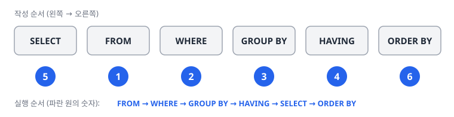

# 2과목 1장. SQL 기본

SELECT 문 · 함수 · WHERE 절 · GROUP BY 절, HAVING 절, ORDER BY 절 · JOIN

<p class="sub">SQLD 핵심정리노트 · 이광호 · 주영아 강사</p>

---

## #01. 핵심 요약

| 주제 | 핵심 |
|:--|:--|
| SELECT 문 실행 순서 | **FROM → WHERE → GROUP BY → HAVING → SELECT → ORDER BY**, 순서를 알아야 복잡한 쿼리에서 오류를 피함 |
| 함수 | 단일행·다중행으로 구분, 단일행 함수는 행별 결과를, 집계 함수는 그룹 전체 결과를 반환 |
| WHERE와 HAVING | WHERE는 **그룹화 이전** 필터, HAVING은 **그룹화 이후** 필터, 집계 함수 조건은 HAVING에 작성 |
| JOIN | **INNER JOIN은 교집합**, OUTER JOIN은 한쪽 테이블의 행을 모두 유지하고 없는 값은 NULL로 채움, 조인 조건 칼럼에 인덱스가 있으면 성능 개선 |
| 작성 패턴 | 동적 쿼리는 **WHERE 1=1 패턴**으로 조건을 쉽게 추가·제거, 별칭·CASE·서브쿼리로 가독성과 재사용성 확보 |
| SQL의 쓰임 | 데이터 통합·보고·품질 관리 등 거의 모든 데이터 작업의 공통 언어, 핵심 문법과 패턴은 BI·ETL·데이터 분석 도구에서도 그대로 쓰임 |

---

## #02. SELECT 문

#### SELECT 문과 SELECT DISTINCT (1/3)

<span class="kicker">SELECT 문의 기본 구조</span>

```sql
SELECT [ALL/DISTINCT] 대상 칼럼명1, 대상 칼럼명2, ...
FROM 대상 칼럼들이 있는 테이블명;
```

| 구분 | 설명 |
|:--|:--|
| ALL | 기본 옵션으로, 중복된 데이터가 있어도 모두 출력 (생략 가능) |
| DISTINCT | 중복된 데이터가 있을 때 1건으로 처리하여 출력 |
| `*` | 애스터리스크(star)로, FROM 절의 테이블에 있는 모든 칼럼을 조회 |

---

### #02-1. SELECT 문과 SELECT DISTINCT (2/3)

<span class="kicker">예시</span>

```sql
-- 특정 칼럼만 조회
SELECT EMPNO, ENAME, JOB FROM EMP;

-- 모든 칼럼 조회
SELECT * FROM EMP;

-- 중복 제거하여 조회 (JOB 칼럼의 고유 값만 출력)
SELECT DISTINCT JOB FROM EMP;
```

---

### #02-2. SELECT 문과 SELECT DISTINCT (3/3)

<Callout kind="tip" icon="➕" title="SELECT 문 유의점 (보완)">

- 오라클에서는 **FROM 절 생략 불가**
- SELECT 절에서 `*`와 컬럼명을 함께 쓸 수 없음

</Callout>

---

### #02-3. 별칭(ALIAS) 사용하기 (1/2)

- 칼럼이나 테이블에 임시 이름을 지정하는 기능
- 칼럼 이름이 길거나 이해하기 어려울 때 쿼리 결과를 더 명확하게 하기 위해 사용

```sql
-- AS 키워드 사용
SELECT EMPNO AS 사원번호, ENAME AS 사원이름 FROM EMP;

-- 공백이 있는 별칭은 큰따옴표 사용 (오라클)
SELECT EMPNO AS "사원 번호", ENAME AS "사원 이름" FROM EMP;

-- SQL Server에서는 대괄호 사용
SELECT EMPNO AS [사원 번호], ENAME AS [사원 이름] FROM EMP;
```

---

### #02-4. 별칭(ALIAS) 사용하기 (2/2)

<Callout kind="tip" icon="➕" title="별칭 유의점 (보완)">

- 컬럼 별칭의 **AS는 생략 가능**, "항상 AS를 사용한다"는 틀린 설명
- FROM 절에서 테이블 별칭을 선언했으면 **반드시 별칭으로만** 컬럼을 구분

```sql
SELECT T.COL1 C1, TABLE1.COL2 AS C2
  FROM TABLE1 T
 WHERE TABLE1.COL2 = 'A' -- TABLE1을 T로 선언했으므로 T로 구분해야 함
 ORDER BY 1, 2;
```

</Callout>

---

### #02-5. 산술 연산자와 문자 합성 연산자 (1/4)

<span class="kicker">산술 연산자</span>

| 구분 | 설명 |
|:--|:--|
| `+` | 덧셈 |
| `-` | 뺄셈 |
| `*` | 곱셈 |
| `/` | 나눗셈 |
| `%` | 나머지 (오라클에서는 MOD 함수 사용) |

---

### #02-6. 산술 연산자와 문자 합성 연산자 (2/4)

<span class="kicker">산술 연산자 (계속)</span>

```sql
-- 월급과 커미션 합산
SELECT ENAME, SAL, COMM, (SAL + NVL(COMM, 0)) AS TOTAL_COMP FROM EMP;

-- 월급에서 커미션 차감
SELECT ENAME, SAL, COMM, (SAL - NVL(COMM, 0)) AS NET_SAL FROM EMP;

-- 연봉 계산 (월급 * 12)
SELECT ENAME, SAL, (SAL * 12) AS ANNUAL_SAL FROM EMP;

-- 주급 계산 (월급 / 4)
SELECT ENAME, SAL, (SAL / 4) AS WEEKLY_SAL FROM EMP;
```

---

### #02-7. 산술 연산자와 문자 합성 연산자 (3/4)

<span class="kicker">산술 연산자 (계속)</span>

```sql
-- 짝수/홀수 판별 (오라클)
SELECT ENAME, EMPNO,
  CASE WHEN MOD(EMPNO, 2) = 0 THEN '짝수' ELSE '홀수' END AS ID_TYPE
FROM EMP;
```

---

### #02-8. 산술 연산자와 문자 합성 연산자 (4/4)

<span class="kicker">문자 합성 연산자</span>

- 오라클: `||` (두 개의 버티컬 라인)
- SQL Server: `+` 연산자

```sql
-- 오라클에서 문자열 합성
SELECT ENAME || ' is a ' || JOB AS EMPLOYEE_INFO FROM EMP;

-- SQL Server에서 문자열 합성
SELECT ENAME + ' is a ' + JOB AS EMPLOYEE_INFO FROM EMP;

-- CONCAT 함수 사용 (공통)
SELECT CONCAT(ENAME, CONCAT(' is a ', JOB)) AS EMPLOYEE_INFO FROM EMP;
```

---

## #03. 함수

#### SQL 내장 함수 개요

- 데이터베이스에 미리 정의된 함수, 단일행 함수와 다중행 함수로 나뉨

| 구분 | 설명 |
|:--|:--|
| 단일행 함수 | 각 행에 대해 하나의 결과값을 반환<br>문자형, 숫자형, 날짜형, 변환형 함수 등 |
| 다중행 함수 | 여러 행의 데이터를 집계하여 하나의 결과값을 반환<br>집계 함수, 그룹 함수, 윈도우 함수 등 |

---

### #03-1. 문자형 함수 (1/3)

| 함수 | 설명 | 예시 |
|:--|:--|:--|
| LOWER | 문자열을 소문자로 변환 | `SELECT LOWER('HELLO WORLD')` → 'hello world' |
| UPPER | 문자열을 대문자로 변환 | `SELECT UPPER('hello world')` → 'HELLO WORLD' |
| SUBSTR | 문자열의 일부분을 추출 | `SELECT SUBSTR('Hello World', 1, 5)` → 'Hello' |
| LENGTH | 문자열의 길이를 반환 | `SELECT LENGTH('Hello World')` → 11 |
| TRIM | 문자열의 양쪽 공백을 제거 | `SELECT TRIM(' Hello World ')` → 'Hello World' |
| LTRIM | 문자열의 왼쪽 공백을 제거 | `SELECT LTRIM(' Hello World')` → 'Hello World' |
| RTRIM | 문자열의 오른쪽 공백을 제거 | `SELECT RTRIM('Hello World ')` → 'Hello World' |
| CONCAT | 두 문자열을 연결 | `SELECT CONCAT('Hello', ' World')` → 'Hello World' |

---

### #03-2. 문자형 함수 (2/3)

<Callout kind="tip" icon="➕" title="문자형 함수 예제 (보완)">

| 식 | 결과 | 설명 |
|:--|:--|:--|
| `LPAD('X', 5, 'X')` | 'XXXXX' | 왼쪽에 X를 붙여 최종 5글자로 반환 |
| `LTRIM('AABABAA', 'A')` | 'BABAA' | 왼쪽부터 다른 글자를 만날 때까지 A를 지움 |
| `RTRIM('ABCAA', 'A')` | 'ABC' | 오른쪽에서 A를 지우다가 A가 아닌 문자를 만나면 멈춤 |
| `UPPER('Sql Developer')` | 'SQL DEVELOPER' | 대문자로 변환 |
| `SUBSTR('Sql Developer', -5, 2)` | 'lo' | 뒤에서 5번째 위치부터 2글자 |
| `TO_CHAR(1000, '9,999')` | '1,000' | 천 단위 콤마 |

</Callout>

---

### #03-3. 문자형 함수 (3/3)

<Callout kind="tip" icon="➕" title="문자형 함수 예제 (보완) (계속)">

- SUBSTR은 문자형 함수, **항상 문자로 반환**
- CASE 문의 축약형 문법은 비교 대상과 비교 상수의 **데이터 타입이 같아야** 함
  - `CASE SUBSTR(JUMIN, 7, 1) WHEN 1 THEN '남자' ELSE '여자' END`는 문자와 숫자를 비교하므로 오류

</Callout>

---

### #03-4. 숫자형 함수 (1/3)

| 함수 | 설명 | 예시 |
|:--|:--|:--|
| ABS | 숫자의 절댓값을 반환 | `SELECT ABS(-15)` → 15 |
| SIGN | 숫자의 부호를 반환 | `SELECT SIGN(-10), SIGN(0), SIGN(10)` → -1, 0, 1 |
| ROUND | 숫자를 반올림 | `SELECT ROUND(3.14159, 2)` → 3.14 |
| TRUNC | 숫자를 절삭 | `SELECT TRUNC(3.14159, 2)` → 3.14 |
| CEIL | 숫자보다 크거나 같은 최소 정수 | `SELECT CEIL(4.3)` → 5 |
| FLOOR | 숫자보다 작거나 같은 최대 정수 | `SELECT FLOOR(4.7)` → 4 |
| MOD | 나눗셈 후 나머지 | `SELECT MOD(17, 5)` → 2 |
| POWER | 거듭제곱 | `SELECT POWER(2, 3)` → 8 |
| SQRT | 제곱근 | `SELECT SQRT(9)` → 3 |

---

### #03-5. 숫자형 함수 (2/3)

<Callout kind="tip" icon="➕" title="CEIL과 FLOOR의 음수 처리 (보완)">

| 값 | CEIL | FLOOR |
|:--|:--|:--|
| 5 | 5 | 5 |
| 0.5 | 1 | 0 |
| 1.2 | 2 | 1 |
| 1.8 | 2 | 1 |
| 2.5 | 3 | 2 |
| -5 | -5 | -5 |
| -0.5 | 0 | -1 |
| -1.2 | -1 | -2 |

</Callout>

---

### #03-6. 숫자형 함수 (3/3)

<Callout kind="tip" icon="➕" title="CEIL과 FLOOR의 음수 처리 (보완) (계속)">

| 값 | CEIL | FLOOR |
|:--|:--|:--|
| -1.8 | -1 | -2 |
| -2.5 | -2 | -3 |

- CEIL: 소수점 값이 있으면 **무조건 올림**, 0.5 미만이어도 올림, 정수는 그대로 반환
- FLOOR: 소수점 값이 있으면 **내림**, 양수에서는 TRUNC와 비슷하게 소수점을 버림
- 음수에 FLOOR를 쓰면 **절댓값이 커지므로** 주의

</Callout>

---

### #03-7. 날짜형 함수 (1/6)

| 함수 | 설명 | 예시 |
|:--|:--|:--|
| SYSDATE | 현재 날짜와 시각 반환 | `SELECT SYSDATE FROM DUAL` |
| ADD_MONTHS | 지정한 개월 수 만큼 날짜를 더함 | `SELECT ADD_MONTHS(SYSDATE, 3)` |
| MONTHS_BETWEEN | 두 날짜 사이의 개월 수를 계산 | `SELECT MONTHS_BETWEEN(SYSDATE, '2024-01-01')` |
| NEXT_DAY | 지정한 날짜 이후의 특정 요일 날짜 | `SELECT NEXT_DAY('2024-07-20', '월요일')` |
| LAST_DAY | 해당 월의 마지막 날짜 | `SELECT LAST_DAY(SYSDATE)` |
| EXTRACT | 날짜에서 특정 부분 추출 | `SELECT EXTRACT(YEAR FROM SYSDATE)` |

---

### #03-8. 날짜형 함수 (2/6)

<Callout kind="tip" icon="➕" title="날짜 ROUND와 TRUNC (보완)">

- ROUND(날짜, 'MONTH'): 월 단위로 반올림
- TRUNC(날짜): **옵션이 없으면 시간을 절사**
- TRUNC(날짜, 옵션): 옵션으로 지정한 단위까지 남기고 나머지는 초기화

</Callout>

---

### #03-9. 날짜형 함수 (3/6)

<Callout kind="tip" icon="➕" title="날짜 ROUND와 TRUNC (보완) (계속)">

```sql
WITH temp AS (
  SELECT TO_DATE('2018-12-13 22:10:59', 'YYYY-MM-DD HH24:MI:SS') dt
    FROM dual
)
SELECT dt
     , TRUNC(dt, 'YEAR')  -- 월, 일 초기화
     , TRUNC(dt, 'MONTH') -- 일 초기화
     , TRUNC(dt, 'DAY')   -- 요일 초기화 (일요일)
  FROM temp;
```

</Callout>

---

### #03-10. 날짜형 함수 (4/6)

<Callout kind="tip" icon="➕" title="날짜 ROUND와 TRUNC (보완) (계속)">

```sql
SELECT TRUNC(TO_DATE('2024/05/14', 'YYYY/MM/DD'), 'MONTH') FROM DUAL; -- 2024/05/01
SELECT ROUND(TO_DATE('2024/05/14', 'YYYY/MM/DD'), 'MONTH') FROM DUAL; -- 2024/05/01
SELECT TO_DATE('2024/05', 'YYYY/MM') FROM DUAL;                       -- 2024/05/01
SELECT LAST_DAY(TO_DATE('2024/05/14', 'YYYY/MM/DD')) FROM DUAL;       -- 2024/05/31
```

</Callout>

---

### #03-11. 날짜형 함수 (5/6)

<Callout kind="tip" icon="➕" title="HH24와 HH (보완)">

- HH24는 24시간 표현식, HH는 12시간 표현식
- 날짜를 ROUND하면 **정오를 기준으로** '일'의 자리가 바뀜

```sql
SELECT ROUND(TO_DATE('2024-08-24 12:00:00', 'YYYY-MM-DD HH24:MI:SS')) COL1, -- 2024-08-25
       ROUND(TO_DATE('2024-08-24 12:00:01', 'YYYY-MM-DD HH:MI:SS')) COL2    -- 2024-08-25
  FROM DUAL;
```

</Callout>

---

### #03-12. 날짜형 함수 (6/6)

<Callout kind="tip" icon="➕" title="TO_DATE의 생략된 부분 (보완)">

오늘 날짜가 2024년 11월 17일일 때의 결과

| 식 | 결과 | 설명 |
|:--|:--|:--|
| `TO_DATE('12', 'MM')` | 2024/12/01 | 일을 1일로 초기화 |
| `TO_DATE('2024/12', 'YYYY/MM')` | 2024/12/01 | 일을 1일로 초기화 |
| `TO_DATE('2024', 'YYYY')` | 2024/11/01 | 현재 날짜의 월을 반영 |
| `TO_DATE('12', 'DD')` | 2024/11/12 | 현재 날짜의 연·월을 반영 |

</Callout>

---

### #03-13. 변환형 함수 · NULL 관련 함수

<Grid cols="2">
<div>

#### 2.5 변환형 함수

| 함수 | 설명 | 예시 |
|:--|:--|:--|
| TO_CHAR | 날짜/숫자를 문자열로 변환 | `SELECT TO_CHAR(SYSDATE, 'YYYY-MM-DD')` |
| TO_DATE | 문자열을 날짜로 변환 | `SELECT TO_DATE('2024-07-21', 'YYYY-MM-DD')` |
| TO_NUMBER | 문자열을 숫자로 변환 | `SELECT TO_NUMBER('12345')` |
| CAST | 데이터 타입 변환 | `SELECT CAST('12345' AS NUMBER)` |

</div>
<div>

#### 2.6 NULL 관련 함수

| 함수 | 설명 | 예시 |
|:--|:--|:--|
| NVL (오라클) | NULL인 경우 지정한 값으로 대체 | `SELECT ENAME, NVL(COMM, 0) FROM EMP` |
| COALESCE | 최초의 NULL이 아닌 값 반환 | `SELECT COALESCE(COMM, SAL, 0) FROM EMP` |
| NULLIF | 두 값이 같으면 NULL, 다르면 첫 번째 값 | `SELECT NULLIF(COMM, 0) FROM EMP` |

</div>
</Grid>

---

### #03-14. CASE 문 (1/2)

- 조건에 따라 다른 값을 반환하는 조건문

```sql
-- 간단 CASE 문
SELECT ENAME, JOB,
  CASE JOB
    WHEN 'CLERK' THEN 'Clerk Job'
    WHEN 'SALESMAN' THEN 'Sales Job'
    WHEN 'MANAGER' THEN 'Manager Job'
    ELSE 'Other Job'
  END AS JOB_DESCRIPTION
FROM EMP;
```

---

### #03-15. CASE 문 (2/2)

```sql
-- 검색 CASE 문
SELECT ENAME, SAL,
  CASE
    WHEN SAL < 1000 THEN 'Low Salary'
    WHEN SAL BETWEEN 1000 AND 3000 THEN 'Medium Salary'
    WHEN SAL > 3000 THEN 'High Salary'
    ELSE 'Unknown'
  END AS SALARY_GRADE
FROM EMP;
```

---

## #04. WHERE 절

#### WHERE 절의 개념

- SQL 쿼리에서 특정 조건을 만족하는 행만 선택하기 위해 사용
- 데이터베이스에서 원하는 데이터를 필터링하는 데 필수적
- FROM 절 다음에 위치

```sql
SELECT * FROM EMP WHERE SAL > 2000 AND DEPTNO = 10;
```

---

### #04-1. 연산자 종류와 사용법 (1/7)

<span class="kicker">비교 연산자</span>

| 구분 | 설명 |
|:--|:--|
| `=` | 같다 |
| `<>`, `!=`, `^=` | 같지 않다 |
| `>`, `<`, `>=`, `<=` | 크다, 작다, 크거나 같다, 작거나 같다 |

---

### #04-2. 연산자 종류와 사용법 (2/7)

<span class="kicker">비교 연산자 (계속)</span>

```sql
-- 급여가 3000인 직원
SELECT ENAME, JOB, SAL FROM EMP WHERE SAL = 3000;

-- 급여가 3000이 아닌 직원
SELECT ENAME, JOB, SAL FROM EMP WHERE SAL <> 3000;

-- 급여가 2000 이상인 직원
SELECT ENAME, JOB, SAL FROM EMP WHERE SAL >= 2000;
```

---

### #04-3. 연산자 종류와 사용법 (3/7)

<span class="kicker">SQL 연산자</span>

| 구분 | 설명 |
|:--|:--|
| BETWEEN a AND b | a와 b 사이의 값 |
| IN (list) | 목록에 있는 값 중 하나와 일치 |
| LIKE '패턴' | 패턴과 일치하는 문자열 |
| IS NULL | NULL 값 |
| NOT BETWEEN, NOT IN, IS NOT NULL | 위 조건들의 부정형 |

---

### #04-4. 연산자 종류와 사용법 (4/7)

<span class="kicker">SQL 연산자 (계속)</span>

```sql
-- 급여가 1500에서 3000 사이인 직원
SELECT ENAME, JOB, SAL FROM EMP WHERE SAL BETWEEN 1500 AND 3000;

-- 부서 번호가 10, 20, 30인 직원
SELECT ENAME, JOB, DEPTNO FROM EMP WHERE DEPTNO IN (10, 20, 30);

-- 이름이 'S'로 시작하는 직원
SELECT ENAME FROM EMP WHERE ENAME LIKE 'S%';

-- 이름에 'R'이 포함된 직원
SELECT ENAME FROM EMP WHERE ENAME LIKE '%R%';
```

---

### #04-5. 연산자 종류와 사용법 (5/7)

<span class="kicker">SQL 연산자 (계속)</span>

```sql
-- 이름의 두 번째 글자가 'A'인 직원
SELECT ENAME FROM EMP WHERE ENAME LIKE '_A%';

-- 커미션이 NULL인 직원
SELECT ENAME, COMM FROM EMP WHERE COMM IS NULL;
```

<span class="kicker">논리 연산자</span>

| 구분 | 설명 |
|:--|:--|
| AND | 모든 조건이 참 |
| OR | 하나 이상의 조건이 참 |
| NOT | 조건의 부정 |

---

### #04-6. 연산자 종류와 사용법 (6/7)

<span class="kicker">논리 연산자 (계속)</span>

```sql
-- 급여가 2000 이상이고 매니저인 직원
SELECT ENAME, SAL, JOB FROM EMP WHERE SAL >= 2000 AND JOB = 'MANAGER';

-- 급여가 2000 초과이거나 부서가 20인 직원
SELECT ENAME, SAL, DEPTNO FROM EMP WHERE SAL > 2000 OR DEPTNO = 20;

-- 급여가 1000 이하가 아니거나 매니저인 직원
SELECT ENAME, SAL, JOB FROM EMP WHERE NOT SAL <= 1000 OR JOB = 'MANAGER';
```

---

### #04-7. 연산자 종류와 사용법 (7/7)

<Callout kind="tip" icon="➕" title="문자열 비교 (보완)">

- 문자는 **왼쪽부터** 한 글자씩 비교, 값이 달라지는 자리에서 더 큰 쪽이 큰 문자열
- 길이가 다르고 짧은 쪽이 끝날 때까지 같으면 **긴 쪽이 큼**
- 길이가 더 길다고 무조건 큰 값은 아님

| 비교 | 결과 | 이유 |
|:--|:--|:--|
| 'BAA' > 'B' | 참 | 첫 글자가 같고 'BAA'가 더 김 |
| 'BI' > 'B' | 참 | 첫 글자가 같고 'BI'가 더 김 |
| 'ABC' > 'B' | 거짓 | 길이는 길지만 첫 글자 'A'가 'B'보다 작음 |
| 'AA' > 'B' | 거짓 | 첫 글자 'A'가 'B'보다 작음 |

</Callout>

---

### #04-8. 연산자 우선순위와 괄호 사용

<Steps>
<li>괄호 <code>()</code></li>
<li>산술 연산자</li>
<li>문자열 연산자</li>
<li>비교/SQL 연산자</li>
<li>NOT</li>
<li>AND</li>
<li>OR</li>
</Steps>

```sql
-- 괄호를 사용한 복잡한 조건
SELECT ENAME, SAL, DEPTNO FROM EMP
WHERE (SAL > 2000 AND DEPTNO = 10) OR (SAL BETWEEN 1500 AND 3000);
```

---

### #04-9. 이스케이프 문자 · 실무 팁: WHERE 1=1 사용

#### 3.4 이스케이프 문자

- LIKE 검색에서 %, _ 등의 특수문자를 값으로 검색할 때 사용

```sql
-- 파일 이름에 '%2024'가 포함된 파일 검색
SELECT FILE_NAME FROM FILES WHERE FILE_NAME LIKE 'report\%2024%' ESCAPE '\';
```

#### 3.5 실무 팁: WHERE 1=1 사용

- 동적 쿼리 생성 시 조건절을 쉽게 추가/제거할 수 있게 하는 기법

```sql
SELECT * FROM EMP
WHERE 1=1
AND SAL > 2000
AND DEPTNO = 10;
-- 조건 추가/제거가 용이함
```

---

## #05. GROUP BY 절, HAVING 절, ORDER BY 절

#### 집계 함수 개요 (1/3)

- 여러 행의 데이터를 하나의 결과값으로 집계하는 데 사용되는 함수임

| 구분 | 설명 |
|:--|:--|
| SUM | 합계 |
| AVG | 평균 |
| COUNT | 개수 |
| MAX | 최댓값 |
| MIN | 최솟값 |

---

### #05-1. 집계 함수 개요 (2/3)

```sql
-- 전체 급여 합계
SELECT SUM(SAL) FROM EMP;

-- 평균 급여
SELECT AVG(SAL) FROM EMP;

-- 직원 수
SELECT COUNT(*) FROM EMP;

-- 최고 급여
SELECT MAX(SAL) FROM EMP;
```

---

### #05-2. 집계 함수 개요 (3/3)

```sql
-- 최저 급여
SELECT MIN(SAL) FROM EMP;
```

---

### #05-3. GROUP BY 절 (1/2)

- 데이터를 그룹화하여 집계 함수를 각 그룹에 적용할 수 있게 함

```sql
-- 부서별 급여 합계와 평균
SELECT DEPTNO, SUM(SAL) AS TOTAL_SAL, AVG(SAL) AS AVG_SAL
FROM EMP
GROUP BY DEPTNO;

-- 부서와 직무별 급여 합계
SELECT DEPTNO, JOB, SUM(SAL) AS TOTAL_SAL
FROM EMP
GROUP BY DEPTNO, JOB
ORDER BY DEPTNO;
```

---

### #05-4. GROUP BY 절 (2/2)

<span class="kicker">주의사항</span>

- GROUP BY 절에서는 ALIAS를 사용할 수 없음
- SELECT 절에 GROUP BY 절에 없는 칼럼은 사용할 수 없음(집계 함수 제외)

<Callout kind="tip" icon="➕" title="GROUP BY와 NULL (보완)">

- GROUP BY 절은 NULL로만 구성된 **NULL 그룹도 반환**

</Callout>

---

### #05-5. HAVING 절 (1/2)

- GROUP BY로 그룹화된 결과에 조건을 적용할 때 사용함

```sql
-- 평균 급여가 2000을 초과하는 부서 조회
SELECT DEPTNO, AVG(SAL) AS AVG_SAL
FROM EMP
GROUP BY DEPTNO
HAVING AVG(SAL) > 2000;

-- 직원이 3명 이상인 직무 조회
SELECT JOB, COUNT(*) AS EMP_COUNT
FROM EMP
GROUP BY JOB
HAVING COUNT(*) >= 3;
```

---

### #05-6. HAVING 절 (2/2)

<span class="kicker">WHERE 절과 HAVING 절의 차이</span>

| 구분 | 설명 |
|:--|:--|
| WHERE | 그룹화 전 개별 행을 필터링 (집계 함수 사용 불가) |
| HAVING | 그룹화 후 그룹을 필터링 (집계 함수 사용 가능) |

```sql
-- WHERE와 HAVING 절 함께 사용
SELECT DEPTNO, AVG(SAL) AS AVG_SAL
FROM EMP
WHERE SAL >= 1000  -- 개별 급여 1000 이상인 직원만 대상
GROUP BY DEPTNO
HAVING AVG(SAL) > 2000;  -- 그 중 평균 급여 2000 초과 부서만 선택
```

---

### #05-7. ORDER BY 절 (1/3)

- 쿼리 결과를 특정 칼럼 기준으로 정렬할 때 사용함

```sql
-- 오름차순 정렬 (ASC 생략 가능)
SELECT ENAME, SAL
FROM EMP
ORDER BY SAL ASC;

-- 내림차순 정렬
SELECT ENAME, SAL
FROM EMP
ORDER BY SAL DESC;
```

---

### #05-8. ORDER BY 절 (2/3)

```sql
-- 여러 열로 정렬 (부서번호 오름차순, 동일 부서 내 급여 내림차순)
SELECT ENAME, JOB, SAL, DEPTNO
FROM EMP
ORDER BY DEPTNO ASC, SAL DESC;
```

---

### #05-9. ORDER BY 절 (3/3)

<span class="kicker">SQL 실행 순서</span>



<Flow>
<li>FROM</li>
<li>WHERE</li>
<li>GROUP BY</li>
<li>HAVING</li>
<li>SELECT</li>
<li>ORDER BY</li>
</Flow>

---

## #06. JOIN

#### 5.1 JOIN의 개념

- 두 개 이상의 테이블에서 관련된 데이터를 결합해 새로운 결과 집합을 만드는 과정
- 기본 목적: 테이블 간의 관계를 이용해 필요한 정보를 효율적으로 검색

#### 5.2 JOIN의 기본 문법

```sql
SELECT 별칭1.칼럼명, 별칭2.칼럼명
FROM 테이블1 AS 별칭1
JOIN 테이블2 AS 별칭2
ON 별칭1.칼럼명 = 별칭2.칼럼명;
```

---

### #06-1. JOIN의 종류 (1/5)


---

### #06-2. JOIN의 종류 (2/5)

<span class="kicker">INNER JOIN</span>

- 두 테이블에서 공통된 값을 가진 행만 반환함

```sql
SELECT E.EMPNO, E.ENAME, D.DNAME
FROM EMP E INNER JOIN DEPT D
ON E.DEPTNO = D.DEPTNO;
```

---

### #06-3. JOIN의 종류 (3/5)

<span class="kicker">LEFT OUTER JOIN</span>

- 왼쪽 테이블의 모든 행과 오른쪽 테이블의 일치하는 행을 반환함
- 일치하는 행이 없으면 NULL로 표시됨

```sql
SELECT E.EMPNO, E.ENAME, D.DNAME
FROM EMP E LEFT OUTER JOIN DEPT D
ON E.DEPTNO = D.DEPTNO;

-- 오라클 문법
SELECT E.EMPNO, E.ENAME, D.DNAME
FROM EMP E, DEPT D
WHERE E.DEPTNO = D.DEPTNO(+);
```

---

### #06-4. JOIN의 종류 (4/5)

<span class="kicker">RIGHT OUTER JOIN</span>

- 오른쪽 테이블의 모든 행과 왼쪽 테이블의 일치하는 행을 반환함

```sql
SELECT E.EMPNO, E.ENAME, D.DNAME
FROM EMP E RIGHT OUTER JOIN DEPT D
ON E.DEPTNO = D.DEPTNO;
```

---

### #06-5. JOIN의 종류 (5/5)

<span class="kicker">FULL OUTER JOIN</span>

- 양쪽 테이블의 모든 행을 반환함
- 일치하지 않는 행은 NULL로 표시됨

```sql
SELECT E.EMPNO, E.ENAME, D.DNAME
FROM EMP E FULL OUTER JOIN DEPT D
ON E.DEPTNO = D.DEPTNO;
```

<span class="kicker">CROSS JOIN</span>

- 두 테이블 간의 모든 행을 조합함(카티시안 곱)

```sql
SELECT E.ENAME, D.DNAME
FROM EMP E CROSS JOIN DEPT D;
```

---

### #06-6. 등가 JOIN과 비등가 JOIN

<span class="kicker">등가 JOIN (EQUI JOIN)</span>

- `=` 연산자를 사용하여 두 테이블의 칼럼이 같은 값인 경우를 조인함

```sql
SELECT E.ENAME, D.DNAME
FROM EMP E JOIN DEPT D
ON E.DEPTNO = D.DEPTNO;
```

<span class="kicker">비등가 JOIN (NON-EQUI JOIN)</span>

- `=` 외의 연산자(>, <, BETWEEN 등)를 사용하여 조인함

```sql
SELECT E.ENAME, E.SAL, S.GRADE
FROM EMP E JOIN SALGRADE S
ON E.SAL BETWEEN S.LOSAL AND S.HISAL;
```

---

### #06-7. NATURAL JOIN과 USING 조건절

<span class="kicker">NATURAL JOIN</span>

- 두 테이블에 동일한 이름을 가진 모든 칼럼에 대해 자동으로 조인함

```sql
SELECT ENAME, DNAME
FROM EMP NATURAL JOIN DEPT;
```

<span class="kicker">USING 조건절</span>

- 조인할 특정 칼럼을 명시함
- 동일한 이름의 칼럼이 하나 이상 있을 때 유용함

```sql
SELECT ENAME, DNAME, DEPTNO
FROM EMP JOIN DEPT USING (DEPTNO);
```

---

### #06-8. 3개 이상 테이블 JOIN · 실무 주의사항

#### 5.6 3개 이상 테이블 JOIN

```sql
SELECT E.ENAME, D.DNAME, L.CITY
FROM EMP E
JOIN DEPT D ON E.DEPTNO = D.DEPTNO
JOIN LOCATIONS L ON D.LOC_ID = L.LOC_ID;
```

#### 5.7 실무 주의사항

- JOIN 시 카디널리티(유일성)가 낮은 칼럼으로 조인하면 결과 행 수가 급격히 증가할 수 있음
- 적절한 인덱스가 있는 칼럼으로 JOIN해야 성능이 좋음
- 대용량 테이블 JOIN 시 실행 계획을 확인하고 최적화해야 함

---
layout: cover
hideInToc: true
---

# 감사합니다

질문과 토론 환영

<p class="sub">SQLD 핵심정리노트 · 이광호 · 주영아 강사</p>
