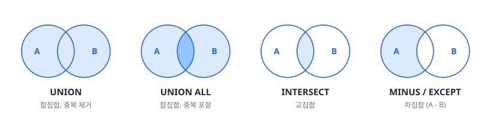
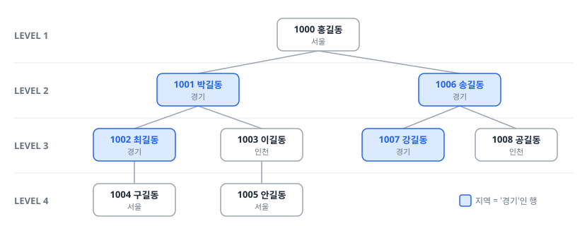

# 2과목 2장. SQL 활용

서브쿼리 · 집합 연산자 · 그룹 함수 · 윈도우 함수 · Top N 쿼리 · 셀프 조인과 계층형 질의 · PIVOT 절과 UNPIVOT 절 · 정규표현식

<p class="sub">SQLD 핵심정리노트 · 이광호 · 주영아 강사</p>

---

## #01. 핵심 요약

| 주제 | 핵심 |
|:--|:--|
| 서브쿼리 | **위치(SELECT·FROM·WHERE·HAVING)마다 역할이 다름**, 인라인 뷰는 복잡한 조인 대신 임시 테이블처럼 써서 가독성을 높임 |
| 집합 연산자 | **칼럼 수와 데이터형이 일치**해야 함, UNION ALL은 UNION보다 빠르지만 중복을 제거하지 않음, ORDER BY는 전체 결과에 마지막 한 번만 작성 |
| 그룹 함수 | **ROLLUP은 계층적 합계, CUBE는 모든 조합 합계, GROUPING SETS는 선택적 합계**, GROUPING 함수로 '총계' 표시를 제어 |
| 윈도우 함수 | **행을 지우지 않고 통계 열을 추가**, ORDER BY만 있고 PARTITION BY가 없으면 전체 행을 한 그룹으로 봄, 프레임 범위도 성능에 영향 |
| Top N 쿼리 | **ROWNUM은 정렬 후에 매겨야 정확**, 표준 SQL의 FETCH FIRST n ROWS ONLY를 쓰면 DBMS 이식성 확보 |
| 셀프 조인과 계층형 질의 | 셀프 조인은 한 테이블 안의 부모·자식 관계나 시간대별 이전 상태 비교에 필요, 계층형 질의에서는 LEVEL·SYS_CONNECT_BY_PATH 등 의사 컬럼 사용 |

---

### #01-1. 핵심 요약 (2/2)

| 주제 | 핵심 |
|:--|:--|
| PIVOT과 정규표현식 | **PIVOT/UNPIVOT은 집계 함수가 필수**, 열 이름은 IN 절에 미리 명시, 정규표현식은 오라클의 REGEXP_LIKE·REGEXP_REPLACE·REGEXP_SUBSTR과 함께 데이터 정제에 사용 |

---

## #02. 서브쿼리

#### 서브쿼리 개요

<span class="kicker">서브쿼리의 기초 개념</span>

- 쿼리(Query)는 하나의 명령 문장을 의미하며, 이를 메인쿼리(Mainquery)라고 함
- 그 명령 문장 안에 또 다른 쿼리가 있는데, 이를 서브쿼리(Subquery) 또는 부질의라고 함
- 메인쿼리 내부에 괄호로 감싸진 형태로 존재하며, 다양한 절(WHERE, FROM, SELECT 등)에서 사용될 수 있음

<span class="kicker">서브쿼리 사용 시점</span>

- 복잡한 조건 필터링
- 계산된 칼럼 생성
- 임시 테이블(INLINE-VIEW) 활용
- 조인보다 간단한 존재 여부 판정(예: EXISTS, IN)

---

### #02-1. 서브쿼리 종류 (1/6)

<span class="kicker">동작 방식에 따른 분류</span>

<span class="kicker ai">연관 서브쿼리(Correlated Subquery)</span>

- 메인 쿼리의 각 행과 관련되어 처리
- 메인 쿼리 한 행을 읽을 때마다 서브 쿼리가 실행됨

```sql
SELECT ENAME, DEPTNO, SAL
FROM EMP E1
WHERE SAL > (SELECT AVG(SAL)
             FROM EMP E2
             WHERE E1.DEPTNO = E2.DEPTNO);
```

<span class="kicker ai">비연관 서브쿼리(Un-Correlated Subquery)</span>

- 메인 쿼리와 독립적으로 실행
- 한 번만 실행되어 결과를 메인 쿼리에 전달

---

### #02-2. 서브쿼리 종류 (2/6)

<span class="kicker">동작 방식에 따른 분류 (계속)</span>

```sql
SELECT ENAME, SAL
FROM EMP
WHERE SAL > (SELECT AVG(SAL) FROM EMP);
```

---

### #02-3. 서브쿼리 종류 (3/6)

<span class="kicker">반환 형태에 따른 분류</span>

<span class="kicker ai">단일행 서브쿼리(Single Row Subquery)</span>

- 하나의 행만 반환
- 단일행 비교 연산자(=, >, <, >=, <=, <>) 사용

```sql
SELECT ENAME, SAL
FROM EMP
WHERE SAL > (SELECT AVG(SAL) FROM EMP);
```

<span class="kicker ai">다중행 서브쿼리(Multiple Row Subquery)</span>

- 여러 행을 반환
- 다중행 비교 연산자(IN, ANY, ALL, EXISTS) 사용

---

### #02-4. 서브쿼리 종류 (4/6)

<span class="kicker">반환 형태에 따른 분류 (계속)</span>

```sql
SELECT ENAME, SAL
FROM EMP
WHERE DEPTNO IN (SELECT DEPTNO FROM DEPT WHERE LOC = 'NEW YORK');
```

<span class="kicker ai">다중칼럼 서브쿼리(Multiple Column Subquery)</span>

- 여러 칼럼을 반환
- 복합 조건 비교에 사용

```sql
SELECT *
FROM EMP
WHERE (JOB, DEPTNO) IN (SELECT JOB, DEPTNO FROM EMP WHERE ENAME = 'SMITH');
```

---

### #02-5. 서브쿼리 종류 (5/6)

<Callout kind="tip" icon="➕" title="서브쿼리 유의점 (보완)">

- 단일행 서브쿼리는 실행 결과가 **항상 한 건 이하**, 대소 비교 연산자뿐 아니라 다중행 서브쿼리 비교 연산자도 사용 가능
- 연관 서브쿼리는 **메인쿼리의 컬럼을 가지는** 서브쿼리, 보통 메인쿼리가 먼저 수행된 뒤 서브쿼리에서 조건이 맞는지 확인
- 비연관 서브쿼리는 메인쿼리의 컬럼을 갖지 않음, 메인쿼리에 값을 제공하는 목적으로 사용
- 스칼라 서브쿼리이면서 연관 서브쿼리일 수 있음

</Callout>

---

### #02-6. 서브쿼리 종류 (6/6)

<Callout kind="tip" icon="➕" title="서브쿼리와 NULL (보완)">

- NOT IN 서브쿼리의 결과에 **NULL이 포함되면 데이터가 출력되지 않음**
  - NULL을 비교하는 연산 때문에 전체 조건이 거짓이 됨
- 서브쿼리의 결과가 NULL이면 메인쿼리의 결과도 없음
- 서브쿼리가 NULL을 반환해도 메인쿼리에서 결과를 만들려면 **NOT EXISTS** 사용

```sql
SELECT DEPTNO, EMPNO
  FROM EMPLOYEE
 WHERE DEPTNO IN (SELECT DNO FROM EMPLOYEE WHERE EMPNO = 500); -- NOT IN도 같음
```

</Callout>

---

### #02-7. 서브쿼리 활용법 (1/4)

<span class="kicker">WHERE 절에서의 서브쿼리</span>

```sql
SELECT ENAME, SAL
FROM EMP
WHERE SAL > (SELECT AVG(SAL) FROM EMP)
ORDER BY SAL DESC;
```

<span class="kicker">HAVING 절에서의 서브쿼리</span>

```sql
SELECT DEPTNO, AVG(SAL)
FROM EMP
GROUP BY DEPTNO
HAVING AVG(SAL) > (SELECT AVG(SAL) FROM EMP);
```

---

### #02-8. 서브쿼리 활용법 (2/4)

<span class="kicker">SELECT 절에서의 서브쿼리</span>

```sql
SELECT ENAME, SAL,
       (SELECT AVG(SAL) FROM EMP) AS AVG_SAL
FROM EMP
ORDER BY SAL DESC;
```

<span class="kicker">FROM 절에서의 서브쿼리(인라인 뷰)</span>

```sql
SELECT E.ENAME, E.SAL, A.AVG_SAL
FROM EMP E,
     (SELECT AVG(SAL) AS AVG_SAL FROM EMP) A
WHERE E.SAL > A.AVG_SAL
ORDER BY SAL DESC;
```

---

### #02-9. 서브쿼리 활용법 (3/4)

<span class="kicker">DML에서의 서브쿼리 활용</span>

<span class="kicker ai">INSERT와 서브쿼리</span>

```sql
INSERT INTO EMP (EMPNO, ENAME, SAL)
VALUES ((SELECT MAX(EMPNO) + 1 FROM EMP), 'NEW_EMP', 3000);
```

<span class="kicker ai">UPDATE와 서브쿼리</span>

```sql
UPDATE EMP
SET SAL = SAL * 1.1
WHERE DEPTNO = (SELECT DEPTNO FROM DEPT WHERE DNAME = 'SALES');
```

<span class="kicker ai">DELETE와 서브쿼리</span>

---

### #02-10. 서브쿼리 활용법 (4/4)

<span class="kicker">DML에서의 서브쿼리 활용 (계속)</span>

```sql
DELETE FROM EMP
WHERE SAL < (SELECT AVG(SAL) FROM EMP);
```

---

### #02-11. 뷰(VIEW)의 개념과 활용법 (1/3)

<span class="kicker">뷰의 개념</span>

- 하나 이상의 테이블에 있는 데이터의 부분집합을 논리적으로 표현한 가상 테이블임
- 실제 데이터를 가지고 있지 않고, 데이터를 추출하는 SQL문을 저장하고 있음

<span class="kicker">뷰의 장점</span>

- 복잡한 쿼리 단순화
- 데이터 보안 강화(필요한 칼럼만 제공)
- 데이터 독립성 확보
- 동일 데이터에 대한 다양한 관점 제공

---

### #02-12. 뷰(VIEW)의 개념과 활용법 (2/3)

<span class="kicker">뷰의 생성과 활용</span>

```sql
CREATE VIEW EMP_DEPT_V AS
SELECT E.EMPNO, E.ENAME, D.DNAME, E.SAL
FROM EMP E, DEPT D
WHERE E.DEPTNO = D.DEPTNO;

-- 뷰 사용
SELECT * FROM EMP_DEPT_V WHERE SAL > 2000;
```

---

### #02-13. 뷰(VIEW)의 개념과 활용법 (3/3)

<Callout kind="tip" icon="➕" title="뷰의 특징 (보완)">

- 뷰를 생성한 뒤에는 **뷰 정의를 변경할 수 없음**(컬럼 정의 포함)
- 뷰를 통해 원본 테이블의 데이터를 변경할 수 있으나 제한이 있음
- 뷰에 **인덱스를 직접 생성할 수 없음**
- 서브쿼리나 조인을 사용한 복잡한 쿼리로도 뷰 생성 가능
- 가상의 테이블이라 물리적으로 구현되어 있지 않고 **저장공간을 차지하지 않음**
- 원본 테이블이 노출되지 않아 데이터를 안전하게 보호
- 뷰를 참조하는 또 다른 뷰 생성 가능
- 기본 테이블이 삭제되면 그 테이블을 참조해 만든 **뷰도 삭제**

</Callout>

---

## #03. 집합 연산자

#### 집합 연산자 개념

- 두 개 이상의 SELECT 문 결과를 하나의 결과로 결합하는 연산자
- 회계나 통계 분석에서 자주 사용

---

### #03-1. 집합 연산자 종류 (1/4)



---

### #03-2. 집합 연산자 종류 (2/4)

<span class="kicker">UNION (합집합, 중복 제거)</span>

- 두 개의 SELECT 문 결과를 하나로 합치고, 중복된 행은 제거함

```sql
SELECT DEPTNO, DNAME FROM DEPT
UNION
SELECT DEPTNO, JOB FROM EMP;
```

<span class="kicker">UNION ALL (합집합, 중복 포함)</span>

- 두 개의 SELECT 문 결과를 하나로 합치고, 중복된 행도 그대로 포함함

```sql
SELECT DEPTNO FROM DEPT
UNION ALL
SELECT DEPTNO FROM EMP;
```

---

### #03-3. 집합 연산자 종류 (3/4)

<span class="kicker">INTERSECT (교집합)</span>

- 두 SELECT 문의 결과에 모두 포함된 행만 반환함

```sql
SELECT DEPTNO FROM DEPT
INTERSECT
SELECT DEPTNO FROM EMP;
```

---

### #03-4. 집합 연산자 종류 (4/4)

<span class="kicker">MINUS / EXCEPT (차집합)</span>

- 첫 번째 SELECT 문의 결과에서 두 번째 SELECT 문의 결과에 포함된 행을 제외한 나머지를 반환함
- (Oracle은 MINUS, SQL Server는 EXCEPT 사용)

```sql
SELECT DEPTNO FROM DEPT
MINUS
SELECT DEPTNO FROM EMP;
```

---

### #03-5. 집합 연산자 사용 조건

- 각 SELECT 문의 칼럼 수가 동일해야 함
- 대응되는 칼럼의 데이터 타입이 같거나 호환 가능해야 함
- 결과는 첫 번째 SELECT 문의 칼럼 이름을 따름
- ORDER BY 절은 전체 결과에 대해 마지막에 한 번만 사용함

<Callout kind="tip" icon="➕" title="정렬 여부 (보완)">

| 연산자 | 정렬 |
|:--|:--|
| UNION | 정렬함 |
| UNION ALL | 정렬하지 않음 |

</Callout>

---

## #04. 그룹 함수

#### 그룹 함수 개념

- 데이터를 다차원으로 집계하는 함수
- GROUP BY 절과 함께 써서 그룹별 합계·소계·총계 같은 통계 정보를 산출

---

### #04-1. 다차원 집계 (1/5)

<span class="kicker">ROLLUP</span>

- GROUP BY 절과 함께 사용하여 지정된 칼럼의 소계와 총계를 자동으로 산출함
- 계층적 구조로 집계를 생성함

```sql
SELECT DEPTNO, JOB, SUM(SAL) AS TOTAL_SALARY
FROM EMP
GROUP BY ROLLUP(DEPTNO, JOB)
ORDER BY DEPTNO;
```

- 집계 그룹: 부서와 직무 조합, 부서별, 전체 총합

---

### #04-2. 다차원 집계 (2/5)

<span class="kicker">CUBE</span>

- ROLLUP과 유사하지만, 지정된 칼럼들의 가능한 모든 조합에 대해 집계를 수행함

```sql
SELECT DEPTNO, JOB, SUM(SAL)
FROM EMP
GROUP BY CUBE(DEPTNO, JOB);
```

- 집계 그룹: 부서와 직무 조합, 부서별, 직무별, 전체 총합

---

### #04-3. 다차원 집계 (3/5)

<span class="kicker">GROUPING SETS</span>

- 원하는 특정 그룹의 집계만 수행
- ROLLUP이나 CUBE의 일부 기능만 필요할 때 사용

```sql
SELECT DEPTNO, JOB, SUM(SAL)
FROM EMP
GROUP BY GROUPING SETS((DEPTNO, JOB), (DEPTNO), (JOB), ());
```

- 집계 그룹: 부서와 직무 조합, 부서별, 직무별, 전체 총합

---

### #04-4. 다차원 집계 (4/5)

<Callout kind="tip" icon="➕" title="그룹 함수 비교 (보완)">

| 표현식 | 출력값 | 인수 순서 |
|:--|:--|:--|
| ROLLUP(A, B) | A와 B별 소계, A별 소계, 총계 | **순서에 따라 결과가 달라짐**(계층 구조) |
| CUBE(A, B) | A와 B별 소계, A별 소계, B별 소계, 총계 | 순서 무관(평등 관계) |
| GROUPING SETS(A, B) | A별 소계, B별 소계 | 순서 무관(평등 관계) |
| GROUPING SETS(A, B, NULL) | A별 소계, B별 소계, 총계 | 순서 무관(평등 관계) |
| GROUPING SETS(A, B, ()) | A별 소계, B별 소계, 총계 | 순서 무관(평등 관계) |

</Callout>

---

### #04-5. 다차원 집계 (5/5)

<Callout kind="tip" icon="➕" title="그룹 함수 비교 (보완) (계속)">

- UNION ALL로 된 쿼리를 그룹 함수 쿼리로 바꾸는 문제에서는 **GROUP BY 절**을 확인
  - GROUP BY DEPTNO: DEPTNO 소계
  - GROUP BY DEPTNO, JOB: DEPTNO와 JOB으로 묶은 소계

</Callout>

---

### #04-6. GROUPING/CASE/DECODE 활용 (1/4)

<span class="kicker">GROUPING 함수</span>

- 특정 칼럼이 집계에 사용되었는지 여부를 반환함
- 집계에 사용되었으면 0, 그렇지 않으면 1을 반환함

```sql
SELECT
    CASE GROUPING(DEPTNO) WHEN 1 THEN '전체 부서' ELSE TO_CHAR(DEPTNO) END AS DEPTNO,
    CASE GROUPING(JOB) WHEN 1 THEN '전체 직무' ELSE JOB END AS JOB,
    SUM(SAL) AS TOTAL_SALARY
FROM EMP
GROUP BY ROLLUP(DEPTNO, JOB);
```

---

### #04-7. GROUPING/CASE/DECODE 활용 (2/4)

<span class="kicker">CASE와 DECODE 활용</span>

- CASE 표현식이나 DECODE 함수를 사용하여 집계 결과의 가독성을 높일 수 있음

```sql
-- Oracle DECODE 예시
SELECT
    DECODE(GROUPING(DEPTNO), 1, '전체 부서', TO_CHAR(DEPTNO)) AS DEPTNO,
    DECODE(GROUPING(JOB), 1, '전체 직무', JOB) AS JOB,
    SUM(SAL) AS TOTAL_SALARY
FROM EMP
GROUP BY ROLLUP(DEPTNO, JOB);
```

---

### #04-8. GROUPING/CASE/DECODE 활용 (3/4)

<span class="kicker">CASE와 DECODE 활용 (계속)</span>

```sql
-- CASE 문 예시
SELECT
    CASE
        WHEN GROUPING(DEPTNO) = 1 THEN '전체 부서'
        ELSE TO_CHAR(DEPTNO)
    END AS DEPTNO,
    CASE
        WHEN GROUPING(JOB) = 1 THEN '전체 직무'
        ELSE JOB
    END AS JOB,
    SUM(SAL) AS TOTAL_SALARY
```

---

### #04-9. GROUPING/CASE/DECODE 활용 (4/4)

<span class="kicker">CASE와 DECODE 활용 (계속)</span>

```sql
FROM EMP
GROUP BY ROLLUP(DEPTNO, JOB);
```

---

## #05. 윈도우 함수

#### 윈도우 함수 개념

- 행과 행 간의 관계를 쉽게 정의하기 위해 제공되는 함수임
- 특정 윈도우(파티션)에 대해 계산을 수행함
- 집계 함수와 달리 행이 그대로 유지되면서 값이 추가됨

---

### #05-1. 윈도우 함수 기본 구문 (1/2)

```sql
윈도우함수(인자) OVER (
    [PARTITION BY 칼럼]
    [ORDER BY 칼럼]
    [ROWS | RANGE BETWEEN 시작점 AND 끝점]
)
```

| 구분 | 설명 |
|:--|:--|
| PARTITION BY | 계산을 적용할 행 그룹 지정 |
| ORDER BY | 파티션 내에서 행 순서 지정 |
| ROWS \| RANGE | 프레임 지정(현재 행을 기준으로 계산할 범위) |

---

### #05-2. 윈도우 함수 기본 구문 (2/2)

<Callout kind="tip" icon="➕" title="ROWS와 RANGE (보완)">

| 구분 | 범위 기준 | 행 인식 |
|:--|:--|:--|
| ROWS | 조회된 데이터의 물리적 위치(ROWNUM) | 모든 행을 각각 1개의 행으로 인식 |
| RANGE | 윈도우 함수 안 ORDER BY 절에 명시된 컬럼으로 만든 논리적 행 집합 | 집합으로 묶인 그룹을 1개의 행으로 인식 |

</Callout>

---

### #05-3. 윈도우 함수 종류 (1/9)

<span class="kicker">순위 관련 함수</span>

<span class="kicker ai">ROW_NUMBER()</span>

- 파티션 내에서 순차적인 번호 부여(중복 값에도 순차적인 번호)

```sql
SELECT ENAME, SAL,
       ROW_NUMBER() OVER(ORDER BY SAL DESC) AS RN
FROM EMP;
```

<span class="kicker ai">RANK()</span>

- 파티션 내에서 순위를 매기되, 동일한 값은 동일한 순위(다음 순위는 건너뜀)

---

### #05-4. 윈도우 함수 종류 (2/9)

<span class="kicker">순위 관련 함수 (계속)</span>

```sql
SELECT ENAME, SAL,
       RANK() OVER(ORDER BY SAL DESC) AS RANK_SAL
FROM EMP;
```

<span class="kicker ai">DENSE_RANK()</span>

- RANK와 유사하나, 동일한 순위 다음에 순차적인 값을 부여(건너뛰지 않음)

```sql
SELECT ENAME, SAL,
       DENSE_RANK() OVER(ORDER BY SAL DESC) AS DENSE_RANK_SAL
FROM EMP;
```

---

### #05-5. 윈도우 함수 종류 (3/9)

<span class="kicker">집계 관련 함수</span>

<span class="kicker ai">SUM() OVER</span>

- 파티션별 합계 계산

```sql
SELECT ENAME, DEPTNO, SAL,
       SUM(SAL) OVER(PARTITION BY DEPTNO) AS DEPT_SUM
FROM EMP;
```

<span class="kicker ai">AVG() OVER</span>

- 파티션별 평균 계산

---

### #05-6. 윈도우 함수 종류 (4/9)

<span class="kicker">집계 관련 함수 (계속)</span>

```sql
SELECT ENAME, DEPTNO, SAL,
       AVG(SAL) OVER(PARTITION BY DEPTNO) AS DEPT_AVG
FROM EMP;
```

<span class="kicker ai">MAX() OVER, MIN() OVER</span>

- 파티션별 최댓값, 최솟값 계산

```sql
SELECT ENAME, DEPTNO, SAL,
       MAX(SAL) OVER(PARTITION BY DEPTNO) AS DEPT_MAX,
       MIN(SAL) OVER(PARTITION BY DEPTNO) AS DEPT_MIN
FROM EMP;
```

---

### #05-7. 윈도우 함수 종류 (5/9)

<span class="kicker">행 이동 관련 함수</span>

<span class="kicker ai">LAG()</span>

- 이전 행의 값을 참조

```sql
SELECT ENAME, HIREDATE, SAL,
       LAG(SAL) OVER(ORDER BY HIREDATE) AS PREV_SAL
FROM EMP;
```

<span class="kicker ai">LEAD()</span>

- 다음 행의 값을 참조

---

### #05-8. 윈도우 함수 종류 (6/9)

<span class="kicker">행 이동 관련 함수 (계속)</span>

```sql
SELECT ENAME, HIREDATE, SAL,
       LEAD(SAL) OVER(ORDER BY HIREDATE) AS NEXT_SAL
FROM EMP;
```

---

### #05-9. 윈도우 함수 종류 (7/9)

<span class="kicker">누적 관련 함수</span>

<span class="kicker ai">CUME_DIST()</span>

- 누적 분포 값을 계산(현재 행보다 작거나 같은 값의 누적 개수 / 전체 행 수)

```sql
SELECT ENAME, SAL,
       CUME_DIST() OVER(ORDER BY SAL) AS CUM_DIST
FROM EMP;
```

<span class="kicker ai">PERCENT_RANK()</span>

- 백분위 순위 계산((현재 행 순위 - 1) / (전체 행 수 - 1))

---

### #05-10. 윈도우 함수 종류 (8/9)

<span class="kicker">누적 관련 함수 (계속)</span>

```sql
SELECT ENAME, SAL,
       PERCENT_RANK() OVER(ORDER BY SAL) AS PCT_RANK
FROM EMP;
```

<Callout kind="tip" icon="➕" title="순위 함수 비교 (보완)">

| 함수 | 동점 처리 | 순위 예 |
|:--|:--|:--|
| RANK | 같은 등수 부여, 다음 순위는 동점인 수만큼 건너뜀 | 1, 1, 3 |
| DENSE_RANK | 같은 등수 부여, 다음 순위가 바로 이어짐 | 1, 1, 2 |
| ROW_NUMBER | 동점을 인정하지 않고 순서대로 번호 부여 | 1, 2, 3 |

</Callout>

---

### #05-11. 윈도우 함수 종류 (9/9)

<Callout kind="tip" icon="➕" title="비율 함수 (보완)">

| 함수 | 설명 |
|:--|:--|
| RATIO_TO_REPORT | 총합을 기준으로 해당 값이 차지하는 비율 |
| CUME_DIST | 순서대로 각 행의 상대적 **누적 위치** |
| PERCENT_RANK | 순서대로 각 행의 누적 분위수(0~1), 값의 상대적 비율이 아니라 **위치를 백분율로** 출력 |

</Callout>

---

## #06. Top N 쿼리

#### ROWNUM 슈도 칼럼

- Oracle에서 제공하는 가상 칼럼(pseudo column)으로 쿼리 결과의 각 행에 1부터 시작하는 순차적인 번호를 부여함

```sql
SELECT ROWNUM, ENAME, SAL
FROM EMP
WHERE ROWNUM <= 5;
```

---

### #06-1. Top N 쿼리 활용법 (1/4)

<span class="kicker">Oracle에서의 Top N 쿼리(ROWNUM 활용)</span>

```sql
-- 잘못된 방법 (원하는 결과가 나오지 않음)
SELECT ROWNUM, ENAME, SAL
FROM EMP
WHERE ROWNUM <= 5
ORDER BY SAL DESC;

-- 올바른 방법 (인라인 뷰 활용)
SELECT ROWNUM, E.*
FROM (SELECT ENAME, SAL
      FROM EMP
      ORDER BY SAL DESC) E
WHERE ROWNUM <= 5;
```

---

### #06-2. Top N 쿼리 활용법 (2/4)

<span class="kicker">SQL Server에서의 Top N 쿼리</span>

```sql
-- SQL Server의 TOP 사용
SELECT TOP 5 ENAME, SAL
FROM EMP
ORDER BY SAL DESC;
```

<span class="kicker">표준 SQL의 FETCH 절 사용</span>

```sql
-- 표준 SQL의 FETCH 문 사용(Oracle 12c 이상, SQL Server 2012 이상)
SELECT ENAME, SAL
FROM EMP
ORDER BY SAL DESC
FETCH FIRST 5 ROWS ONLY;
```

---

### #06-3. Top N 쿼리 활용법 (3/4)

<span class="kicker">페이징 처리</span>

```sql
-- 11~20번째 행 조회
SELECT *
FROM (
    SELECT ROWNUM AS RN, E.*
    FROM (SELECT * FROM EMP ORDER BY SAL DESC) E
    WHERE ROWNUM <= 20
)
WHERE RN >= 11;
```

---

### #06-4. Top N 쿼리 활용법 (4/4)

<Callout kind="tip" icon="➕" title="Top N 쿼리 유의점 (보완)">

- 윈도우 함수로도 상위 N개를 추출할 수 있으나 **단일 쿼리로는 표현 불가**
- FETCH 절을 쓰면 단일 쿼리로 정렬 순서대로 상위 N개 추출 가능
- SQL Server의 TOP(N)에 **WITH TIES**를 붙이면 동순위까지 포함해 N개보다 많은 행 추출 가능

</Callout>

<Callout kind="tip" icon="➕" title="OFFSET과 FETCH (보완)">

```sql
ORDER BY {정렬 대상 컬럼}
  OFFSET {건너뛸 행의 수} ROWS
  FETCH NEXT {가져올 행의 수} ROWS ONLY
```

- `OFFSET 2 ROWS`: 2개의 행을 건너뜀
- `FETCH FIRST 2 ROWS ONLY`: 그다음인 3번째 행부터 2개의 행을 가져옴

</Callout>

---

## #07. 셀프 조인과 계층형 질의

#### 셀프 조인 개념 및 활용 (1/2)

- 하나의 테이블을 마치 두 개의 테이블인 것처럼 조인하는 기법임
- 주로 계층적 관계나 순차적 관계를 조회할 때 사용됨

---

### #07-1. 셀프 조인 개념 및 활용 (2/2)

```sql
-- 사원과 관리자 정보 함께 조회
SELECT E.EMPNO, E.ENAME AS EMP_NAME,
       M.EMPNO AS MGR_EMPNO, M.ENAME AS MGR_NAME
FROM EMP E, EMP M
WHERE E.MGR = M.EMPNO;

-- 또는 JOIN 문법 사용
SELECT E.EMPNO, E.ENAME AS EMP_NAME,
       M.EMPNO AS MGR_EMPNO, M.ENAME AS MGR_NAME
FROM EMP E LEFT JOIN EMP M
ON E.MGR = M.EMPNO;
```

---

### #07-2. 계층형 질의 개념 및 문법 (1/7)

- 테이블에 저장된 계층적 구조의 데이터를 조회하는 방법임
- Oracle에서는 START WITH와 CONNECT BY 절을 사용함

```sql
-- 기본 구문
SELECT [컬럼 목록], LEVEL
FROM [테이블]
START WITH [최상위 조건]
CONNECT BY [PRIOR 부모키 = 자식키 | 자식키 = PRIOR 부모키];
```

---

### #07-3. 계층형 질의 개념 및 문법 (2/7)

<span class="kicker">계층형 질의 주요 요소</span>

| 구분 | 설명 |
|:--|:--|
| START WITH | 계층 구조의 시작점(루트 노드) 지정 |
| CONNECT BY | 부모-자식 관계를 정의 |
| LEVEL | 계층의 깊이를 나타내는 의사 컬럼 |
| CONNECT_BY_ROOT | 현재 행의 최상위 조상 노드를 반환 |
| SYS_CONNECT_BY_PATH | 루트부터 현재 노드까지의 경로를 문자열로 반환 |
| CONNECT_BY_ISLEAF | 현재 행이 리프 노드인지 여부(1 또는 0) |

---

### #07-4. 계층형 질의 개념 및 문법 (3/7)

<span class="kicker">계층형 질의 예제</span>

```sql
-- 조직도 조회(최상위 관리자부터)
SELECT ENAME, EMPNO, MGR, LEVEL,
       LPAD(' ', (LEVEL-1)*2) || ENAME AS ORG_CHART
FROM EMP
START WITH MGR IS NULL
CONNECT BY PRIOR EMPNO = MGR
ORDER SIBLINGS BY ENAME;
```

---

### #07-5. 계층형 질의 개념 및 문법 (4/7)

<Callout kind="tip" icon="➕" title="계층형 질의 전개 예 (보완)">



</Callout>

---

### #07-6. 계층형 질의 개념 및 문법 (5/7)

<Callout kind="tip" icon="➕" title="계층형 질의 전개 예 (보완) (계속)">

| 사원번호 | 이름 | 상위관리자코드 | 지역 | LEVEL |
|:--|:--|:--|:--|:--|
| 1000 | 홍길동 | NULL | 서울 | 1 |
| 1001 | 박길동 | 1000 | 경기 | 2 |
| 1002 | 최길동 | 1001 | 경기 | 3 |
| 1003 | 이길동 | 1001 | 인천 | 3 |
| 1004 | 구길동 | 1002 | 서울 | 4 |
| 1005 | 안길동 | 1003 | 서울 | 4 |
| 1006 | 송길동 | 1000 | 경기 | 2 |
| 1007 | 강길동 | 1006 | 경기 | 3 |

</Callout>

---

### #07-7. 계층형 질의 개념 및 문법 (6/7)

<Callout kind="tip" icon="➕" title="계층형 질의 전개 예 (보완) (계속)">

| 사원번호 | 이름 | 상위관리자코드 | 지역 | LEVEL |
|:--|:--|:--|:--|:--|
| 1008 | 공길동 | 1006 | 인천 | 3 |

| 순서 | 절 | 동작 |
|:--|:--|:--|
| 1 | `START WITH 상위관리자코드 IS NULL` | 상위관리자코드가 NULL인 1000 홍길동이 LEVEL 1 |
| 2 | `CONNECT BY 상위관리자코드 = PRIOR 사원번호` | 앞 단계 행의 사원번호를 상위관리자코드로 갖는 행을 차례로 출력 |
| 3 | `WHERE 지역 = '경기'` | 전개가 끝난 뒤 조건에 맞는 행만 출력, **LEVEL 값은 그대로** |

</Callout>

---

### #07-8. 계층형 질의 개념 및 문법 (7/7)

<Callout kind="tip" icon="➕" title="계층형 질의 전개 예 (보완) (계속)">

- 결과: 1001 박길동(2), 1002 최길동(3), 1006 송길동(2), 1007 강길동(3)
- START WITH 조건에 맞는 행이 여러 개면 **모두 LEVEL 1**
  - 예: 1001과 1006에서 시작해 상위 방향으로 전개하면 두 행 모두 1000 홍길동에 연결되어 **홍길동이 두 번 출력**
- 연결 조건에 맞는 다음 행이 없으면 LEVEL 1 행만 출력

</Callout>

---

## #08. PIVOT 절과 UNPIVOT 절

#### PIVOT 절 개념 및 문법 (1/2)

- 행을 열로 변환하는 기능
- 보고서 형태의 출력이나 교차 테이블을 만들 때 사용

```sql
-- 기본 구문
SELECT *
FROM (기준 테이블)
PIVOT (
    집계함수(집계대상컬럼)
    FOR 피벗컬럼 IN (피벗값1, 피벗값2, ...)
);
```

---

### #08-1. PIVOT 절 개념 및 문법 (2/2)

<span class="kicker">PIVOT 활용 예제</span>

```sql
-- 부서별, 직무별 사원 수 피벗 테이블
SELECT *
FROM (SELECT DEPTNO, JOB FROM EMP)
PIVOT (
    COUNT(*)
    FOR JOB IN ('CLERK' AS CLERK, 'MANAGER' AS MANAGER, 'ANALYST' AS ANALYST, 'SALESMAN' AS SALESMAN)
)
ORDER BY DEPTNO;
```

---

### #08-2. UNPIVOT 절 개념 및 문법 (1/2)

- PIVOT의 반대 기능으로, 열을 행으로 변환함

```sql
-- 기본 구문
SELECT *
FROM (피벗된 테이블)
UNPIVOT (
    값을_저장할_컬럼이름
    FOR 컬럼을_저장할_컬럼이름 IN (컬럼1, 컬럼2, ...)
);
```

---

### #08-3. UNPIVOT 절 개념 및 문법 (2/2)

<span class="kicker">UNPIVOT 활용 예제</span>

```sql
-- 피벗된 테이블을 다시 원래 형태로 변환
SELECT *
FROM (피벗된 테이블 또는 서브쿼리)
UNPIVOT (
    EMP_COUNT
    FOR JOB_TYPE IN (CLERK, MANAGER, ANALYST, SALESMAN)
);
```

---

## #09. 정규표현식

#### 8.1 정규표현식 개념

- 문자열에서 특정 패턴을 검색·추출·변환하는 데 쓰는 표현식

#### 8.2 정규표현식 연산자

| 연산자 | 설명 | 예시 |
|:--|:--|:--|
| . | 임의의 단일 문자 | 'a.c'는 'abc', 'adc' 등과 일치 |
| \| | OR 연산자 | 'a \|b'는 'a' 또는 'b'와 일치 |
| * | 앞 요소가 0회 이상 반복 | 'ab*'는 'a', 'ab', 'abb' 등과 일치 |
| + | 앞 요소가 1회 이상 반복 | 'ab+'는 'ab', 'abb' 등과 일치(단, 'a'는 미포함) |
| ? | 앞 요소가 0회 또는 1회 반복 | 'ab?'는 'a', 'ab'와 일치 |
| {n} | 앞 요소가 정확히 n회 반복 | 'ab{3}'는 'abbb'와 일치 |
| {n,} | 앞 요소가 n회 이상 반복 | |

---

### #09-1. 정규표현식 문자 클래스와 함수 (보완) (1/5)

<span class="kicker">문자 클래스와 위치 지정</span>

| 표현 | 뜻 | 예 |
|:--|:--|:--|
| `\w` | word, 알파벳·숫자·_ 중 한 문자 |  |
| `\W` | not word, 알파벳·숫자·_가 아닌 문자 |  |
| `\d` | digit, 숫자 |  |
| `\D` | non digit, 숫자가 아닌 것 |  |
| `\s` | space, 공백 문자 |  |
| `\S` | non space, 공백 문자가 아닌 것 |  |
| `^` | 문자열의 시작 | `^http`는 http로 시작할 때만 일치, ahttp는 불일치 |
| `$` | 문자열의 끝 | `tmp$`는 tmp로 끝날 때만 일치 |

---

### #09-2. 정규표현식 문자 클래스와 함수 (보완) (2/5)

<span class="kicker">문자 클래스와 위치 지정 (계속)</span>

| 표현 | 뜻 | 예 |
|:--|:--|:--|
| `+` | 1개 이상 | `n\d+`는 n 뒤에 숫자가 1개 이상 |
| `?` | 바로 앞 글자나 그룹이 0개 또는 1개 | `apples?`는 apple, apples 모두 일치 |

- `\w|\d+`에서 `+`의 범위는 `\d`에만 적용, 한 글자의 단어 또는 숫자의 연속을 뜻함

---

### #09-3. 정규표현식 문자 클래스와 함수 (보완) (3/5)

<span class="kicker">함수 형식</span>

| 함수 | 형식 |
|:--|:--|
| REGEXP_LIKE | `REGEXP_LIKE(문자열, 정규표현식, 일치옵션)` |
| REGEXP_SUBSTR | `REGEXP_SUBSTR(문자열, 정규표현식, 시작위치, 찾은횟수, 대소문자구분, 그룹순번)` |

- 시작위치부터 뒤의 항목은 필요 없으면 생략 가능
- `( )`로 묶은 서브 패턴에 매칭된 문자열을 **그룹**이라고 함

---

### #09-4. 정규표현식 문자 클래스와 함수 (보완) (4/5)

<span class="kicker">예제 해석</span>

| 식 | 해석 |
|:--|:--|
| `REGEXP_LIKE(COL1, '[XY-]+Z?')` | X, Y, - 중 하나가 여러 번 반복되고 그 뒤에 Z가 오거나 오지 않는 문자열을 가진 행 출력 |
| `REGEXP_LIKE(ID, '^A\|B.+A$')` | `^A\|B`는 A로 시작하거나 B로 시작, `.+`는 가운데 1개 이상의 문자, `A$`는 A로 끝남 |
| `REGEXP_REPLACE(COL1, 'A(X\|Y)+\.')` | A 뒤에 X 또는 Y가 여러 개 오고 맨 뒤에 점이 붙는 문자열을 제거 |
| `REGEXP_REPLACE('REGEXP \. ESCAPE CHARACTER, A\|B : A OR B', '[A-z\|0-9\. ]')` | A-z, 0-9, \|, \\, 점, 공백을 모두 지움, 결과에는 `,`와 `:`만 남음 |
| `REGEXP_SUBSTR('ORA-00933: SQL command not properly ended', '[A-z]+', 1, 3)` | 문자로 이루어진 부분을 시작점(1)부터 찾아 3번째 것을 반환, 결과는 command |

---

### #09-5. 정규표현식 문자 클래스와 함수 (보완) (5/5)

<span class="kicker">서브그룹 추출</span>

```sql
SELECT REGEXP_SUBSTR('123-234-4545-233', '((\d+)-(\d+))-((\d+)-(\d+))', 1, 1, NULL, 4)
  FROM DUAL;
```

- 패턴 구조: `((A)-(B))-((C)-(D))`
- 그룹 순서: (A)-(B) → (A) → (B) → (C)-(D) → (C) → (D)
- 시작점 1부터 1번째로 찾은 문자열에서 **4번째 그룹** (C)-(D)를 추출, 결과는 4545-233

---
layout: cover
hideInToc: true
---

# 감사합니다

질문과 토론 환영

<p class="sub">SQLD 핵심정리노트 · 이광호 · 주영아 강사</p>
