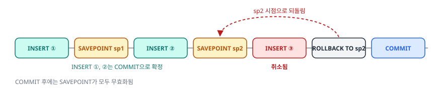
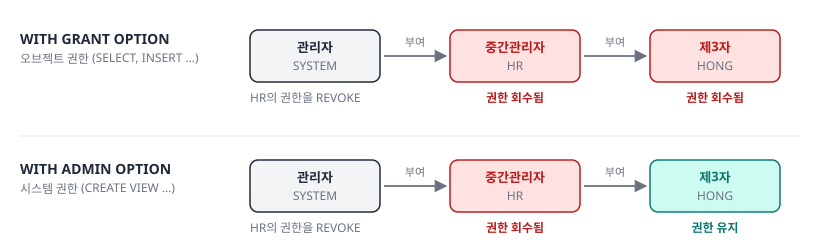

# 2과목 3장. 관리구문

DML (데이터 조작어) · TCL (트랜잭션 제어어) · DDL (데이터 정의어) · DCL (데이터 제어어)

<p class="sub">SQLD 핵심정리노트 · 이광호 · 주영아 강사</p>

---

## #01. 핵심 요약

| 주제 | 핵심 |
|:--|:--|
| DML | 행 단위 데이터 조작에 사용, **MERGE로 삽입·갱신을 한 번에 처리**, 대량 작업 시 서브쿼리·버퍼 캐싱을 쓰면 성능 향상 |
| TCL | 트랜잭션의 일관성 보장, **COMMIT은 변경사항을 영구 반영**, ROLLBACK은 트랜잭션 시작점 또는 SAVEPOINT까지 복원 |
| DDL | 객체 구조를 다룸, **TRUNCATE는 DELETE보다 빠르지만 롤백 불가**, DROP은 구조·데이터·연관 객체를 모두 제거 |
| DCL | 접근 제어 담당, GRANT로 권한 부여, REVOKE로 회수, ROLE로 여러 권한을 묶어 다수 사용자에게 일괄 적용 |
| 실무 원칙 | **권한 최소화 원칙**(Principle of Least Privilege)으로 보안 사고 예방, 트랜잭션 관리 규칙을 문서화해 데이터 무결성 유지 |

---

## #02. DML (데이터 조작어)

- 데이터베이스의 테이블에 데이터를 **추가**, **수정**, **삭제**하는 명령어임
- 주요 명령어로는 INSERT, UPDATE, DELETE, MERGE가 있음

---
class: dense tight
---

### #02-1. INSERT 문 (1/6)

- 데이터베이스 테이블에 새로운 데이터를 추가할 때 사용하는 SQL 명령어임

<span class="kicker">1.1.1 단일행 INSERT 문</span>

```sql
-- 기본 형식
INSERT INTO 테이블명 (칼럼1, 칼럼2, ...)
VALUES (값1, 값2, ...);
```

- 모든 칼럼에 값을 삽입할 경우 칼럼 이름을 생략할 수 있음

```sql
INSERT INTO 테이블명
VALUES (값1, 값2, ...);
```

---
class: dense tight
---

### #02-2. INSERT 문 (2/6)

<span class="kicker">1.1.1 단일행 INSERT 문 (계속)</span>

```sql
-- 특정 칼럼만 지정하여 삽입
INSERT INTO EMP (EMPNO, ENAME, JOB, HIREDATE)
VALUES (101, 'YONGMOON', 'MANAGER', '2023-08-01');

-- 모든 칼럼 값 지정하여 삽입
INSERT INTO EMP
VALUES (102, 'YONGMOON2', 'CLERK', '7902', '2023-08-03', 2000, NULL, 20);
```

<span class="kicker">1.1.2 서브쿼리를 이용한 다중행 INSERT 문</span>

- 다른 테이블에서 데이터를 추출해 새로운 테이블에 삽입할 때 유용함

---
class: dense tight
---

### #02-3. INSERT 문 (3/6)

<span class="kicker">1.1.2 서브쿼리를 이용한 다중행 INSERT 문 (계속)</span>

```sql
-- EMP_MNG 테이블 생성
CREATE TABLE EMP_MNG (
    EMPNO NUMBER(4,0),
    ENAME VARCHAR2(10),
    JOB VARCHAR2(9),
    MGR NUMBER(4,0),
    HIREDATE DATE,
    SAL NUMBER(7,2),
    COMM NUMBER(7,2),
    DEPTNO NUMBER(2,0)
);
```

---
class: dense tight
---

### #02-4. INSERT 문 (4/6)

<span class="kicker">1.1.2 서브쿼리를 이용한 다중행 INSERT 문 (계속)</span>

```sql
-- 서브쿼리를 이용한 다중행 INSERT
INSERT INTO EMP_MNG (
    EMPNO,
    ENAME,
    JOB,
    HIREDATE,
    DEPTNO
)
```

---
class: dense tight
---

### #02-5. INSERT 문 (5/6)

<span class="kicker">1.1.2 서브쿼리를 이용한 다중행 INSERT 문 (계속)</span>

```sql
SELECT
    EMPNO,
    ENAME,
    JOB,
    HIREDATE,
    DEPTNO
FROM
    EMP
WHERE
    DEPTNO = 20;
```

---

### #02-6. INSERT 문 (6/6)

<span class="kicker">1.1.2 서브쿼리를 이용한 다중행 INSERT 문 (계속)</span>

- 서브쿼리를 쓰면 조건에 맞는 여러 행을 한 번에 다른 테이블로 삽입 가능
- 위 예시는 부서 번호가 20인 사원 정보만 삽입

---

### #02-7. UPDATE 문 (1/5)

- 테이블에 이미 존재하는 데이터를 수정할 때 사용함

```sql
-- 기본 형식
UPDATE 테이블명
SET 칼럼1 = 값1, 칼럼2 = 값2, ...
WHERE 조건;
```

---

### #02-8. UPDATE 문 (2/5)

```sql
-- 여러 칼럼을 동시에 UPDATE
UPDATE EMP
SET SAL = 200, COMM = 300
WHERE ENAME = 'YONGMOON';

-- 서브쿼리를 이용한 UPDATE
UPDATE EMP
SET SAL = (SELECT AVG(SAL) FROM EMP WHERE DEPTNO = 10)
WHERE ENAME = 'YONGMOON';
```

- 두 번째 예시는 서브쿼리를 사용하여 DEPTNO가 10인 부서의 평균 급여를 계산하고, 그 값을 사용하여 YONGMOON의 SAL 값을 업데이트함

---

### #02-9. UPDATE 문 (3/5)

<Callout kind="tip" icon="➕" title="다중 컬럼 UPDATE (보완)">

- 여러 컬럼을 괄호로 묶어 한 번에 수정하는 UPDATE는 **서브쿼리로만** 가능

```sql
-- 1. 가능
UPDATE EMP
   SET SAL = 5000, COMM = 300
 WHERE ENAME = 'SMITH';

-- 2. 불가능
UPDATE EMP
   SET (SAL, COMM) = (5000, 300)
 WHERE ENAME = 'SMITH';
```

</Callout>

---

### #02-10. UPDATE 문 (4/5)

<Callout kind="tip" icon="➕" title="다중 컬럼 UPDATE (보완) (계속)">

```sql
-- 3. 가능
UPDATE EMP
   SET (SAL, COMM) = (SELECT MAX(SAL), MAX(COMM)
                        FROM EMP)
 WHERE ENAME = 'SMITH';
```

</Callout>

---

### #02-11. UPDATE 문 (5/5)

<Callout kind="tip" icon="➕" title="다중 컬럼 UPDATE (보완) (계속)">

```sql
-- 4. 가능
UPDATE EMP E1
   SET SAL = (SELECT MAX(SAL)
                FROM EMP
               WHERE DEPTNO = E1.DEPTNO)
 WHERE ENAME = 'SMITH';
```

</Callout>

---

### #02-12. DELETE 문 (1/2)

- 테이블의 특정 행을 삭제할 때 사용함

```sql
-- 기본 형식
DELETE FROM 테이블명
WHERE 조건;
```

```sql
DELETE FROM EMP
WHERE ENAME = 'YONGMOON2';
```

---

### #02-13. DELETE 문 (2/2)

<span class="kicker">DELETE와 TRUNCATE의 차이점</span>

| 특성 | DELETE | TRUNCATE |
|:--|:--|:--|
| 작동 방식 | 행 단위로 데이터를 삭제 | 테이블 구조를 유지한 채 모든 데이터를 한 번에 제거 |
| 속도 | 각 행을 개별적으로 삭제하므로 상대적으로 느림 | 전체 테이블을 한 번에 비우므로 일반적으로 더 빠름 |
| 트랜잭션 로그 | 각 삭제 작업을 트랜잭션 로그에 기록 | 최소한의 트랜잭션 로그만 생성 |
| 롤백 가능성 | 트랜잭션 내에서 롤백이 가능 | 일반적으로 롤백이 불가능 |
| WHERE 절 사용 | WHERE 절을 사용하여 특정 조건의 데이터만 삭제할 수 있음 | WHERE 절을 사용할 수 없으며, 항상 전체 테이블을 비움 |
| 인덱스 영향 | 인덱스를 유지 | 인덱스를 재설정 |

---

### #02-14. MERGE 문 (1/3)

- 데이터의 삽입·업데이트·삭제 작업을 하나의 명령문으로 처리하는 명령어
- 주로 소스 테이블의 데이터를 타깃 테이블에 반영할 때 사용

```sql
-- 기본 형식
MERGE INTO 타깃_테이블 타깃(별칭)
USING 소스_테이블 소스(별칭)
ON (타깃.조건_칼럼 = 소스.조건_칼럼)
WHEN MATCHED THEN
  UPDATE SET 타깃.칼럼1 = 소스.칼럼1, ...
WHEN NOT MATCHED THEN
  INSERT (칼럼1, 칼럼2, ...)
  VALUES (소스.칼럼1, 소스.칼럼2, ...);
```

---

### #02-15. MERGE 문 (2/3)

```sql
MERGE INTO EMP_MNG M
USING EMP E
ON (M.EMPNO = E.EMPNO)
WHEN MATCHED THEN
  UPDATE SET
    M.SAL = E.SAL,
    M.COMM = E.SAL
WHEN NOT MATCHED THEN
  INSERT (EMPNO, ENAME, JOB, MGR, HIREDATE, SAL, COMM, DEPTNO)
  VALUES (E.EMPNO, E.ENAME, E.JOB, E.MGR, E.HIREDATE, E.SAL, E.COMM, E.DEPTNO);
```

---

### #02-16. MERGE 문 (3/3)

- 이 예시에서는 EMP_MNG와 EMP 테이블에서 EMPNO가 일치하는 행이 있을 경우, EMP 테이블의 SAL 값을 EMP_MNG 테이블의 SAL과 COMM 칼럼에 UPDATE함
- 일치하지 않는 EMP 테이블의 행들은 EMP_MNG 테이블에 새로운 행으로 INSERT됨

---

## #03. TCL (트랜잭션 제어어)

- 여러 DML 명령어로 구성된 트랜잭션을 관리하는 명령어임
- 주요 명령어로는 COMMIT, ROLLBACK, SAVEPOINT가 있음

#### 2.1 트랜잭션의 기본 개념

- 트랜잭션이란 데이터베이스 내에서 실행되는 하나의 논리적 작업 단위를 말하며, 여러 개의 연산을 포함할 수 있음

<span class="kicker">트랜잭션의 ACID 속성</span>

| 구분 | 설명 |
|:--|:--|
| 원자성(Atomicity) | 모든 연산이 성공적으로 완료되거나 아무것도 실행되지 않은 상태를 유지 |
| 일관성(Consistency) | 트랜잭션은 데이터베이스의 일관성을 유지 |
| 고립성(Isolation) | 다른 트랜잭션의 영향을 받지 않고 독립적으로 실행 |
| 지속성(Durability) | 성공적으로 수행된 트랜잭션의 결과는 시스템 오류가 발생해도 유지 |

---

### #03-1. COMMIT (1/3)

- COMMIT을 실행하면 트랜잭션이 종료되고, 해당 트랜잭션에서 이루어진 모든 변경 사항이 데이터베이스에 영구적으로 저장됨

---

### #03-2. COMMIT (2/3)

```sql
-- 1. 직원 삭제
DELETE FROM EMP WHERE ENAME = 'YONGMOON' OR ENAME = 'YONGMOON2';

-- 2. 새로운 직원 추가
INSERT INTO EMP (EMPNO, ENAME, JOB, MGR, HIREDATE, SAL, COMM, DEPTNO)
VALUES (7935, 'JAMESBOND', 'ANALYST', 7566, TO_DATE('2023-08-19', 'YYYY-MM-DD'), 3500, NULL, 20);

-- 3. 급여 10% 인상
UPDATE EMP SET SAL = SAL * 1.1 WHERE EMPNO = 7935;

-- 4. 부서 번호 변경
UPDATE EMP SET DEPTNO = 30 WHERE EMPNO = 7902;
```

---

### #03-3. COMMIT (3/3)

```sql
-- 5. 모든 변경 사항 확정
COMMIT;
```

- COMMIT 이후에는 해당 트랜잭션에 대한 ROLLBACK이 불가능함

---

### #03-4. ROLLBACK

- 트랜잭션의 모든 변경 사항을 취소하고, 트랜잭션 시작 시점으로 되돌리는 명령어임

```sql
-- 1. JAMESBOND(7935) 급여 40% 인상
UPDATE EMP SET SAL = SAL * 1.4 WHERE EMPNO = 7935;

-- 2. JAMESBOND 부서 번호를 30으로 수정
UPDATE EMP SET DEPTNO = 30 WHERE EMPNO = 7935;

-- 3. 변경사항 전부 취소
ROLLBACK;
```

- ROLLBACK 실행 후에는 트랜잭션 시작 전 상태로 되돌아감

---

### #03-5. SAVEPOINT (1/4)



- 트랜잭션 내에서 특정 지점을 지정하고, 후에 해당 지점까지만 롤백할 수 있게 하는 명령어임

---

### #03-6. SAVEPOINT (2/4)

```sql
-- 트랜잭션 시작
BEGIN;

-- 1. 첫 번째 INSERT
INSERT INTO EMP (EMPNO, ENAME, JOB, SAL, DEPTNO)
VALUES (8001, 'AAAAA', 'CLERK', 1500, 10);

-- 2. SAVEPOINT sp1
SAVEPOINT sp1;
```

---

### #03-7. SAVEPOINT (3/4)

```sql
-- 3. 두 번째 INSERT
INSERT INTO EMP (EMPNO, ENAME, JOB, SAL, DEPTNO)
VALUES (8002, 'BBBBB', 'MANAGER', 2500, 20);
-- 4. SAVEPOINT sp2
SAVEPOINT sp2;

-- 5. 세 번째 INSERT
INSERT INTO EMP (EMPNO, ENAME, JOB, SAL, DEPTNO)
VALUES (8003, 'CCCCC', 'ANALYST', 3000, 30);

-- 6. 오류로 sp2로 롤백
ROLLBACK TO sp2;
```

---

### #03-8. SAVEPOINT (4/4)

```sql
-- 7. 나머지 작업 확정
COMMIT;
```

- 위 예시에서 세 번째 INSERT는 취소되지만, 첫 번째와 두 번째 INSERT는 커밋됨
- COMMIT 후에는 SAVEPOINT가 모두 무효화됨

---

## #04. DDL (데이터 정의어)

- 데이터베이스에서 테이블, 인덱스, 뷰, 스키마 등 데이터베이스 객체를 정의하고 관리하기 위한 SQL 명령어들의 집합임

---

### #04-1. CREATE TABLE (1/6)

- 새로운 테이블을 생성하는 SQL 명령어임

```sql
-- 기본 형식
CREATE TABLE 테이블명 (
  칼럼1 데이터타입 [제약조건],
  칼럼2 데이터타입 [제약조건],
  ...
);
```

---

### #04-2. CREATE TABLE (2/6)

```sql
CREATE TABLE STUDENT (
  STUDENT_ID NUMBER(5) PRIMARY KEY,
  NAME VARCHAR2(50) NOT NULL,
  AGE NUMBER(3),
  ENROLL_DATE DATE DEFAULT SYSDATE,
  DEPT_ID NUMBER(3) REFERENCES DEPARTMENT(DEPT_ID)
);
```

---

### #04-3. CREATE TABLE (3/6)

<span class="kicker">참조 무결성 옵션</span>

- 외래 키를 사용할 때 참조 무결성을 유지하기 위한 옵션을 지정할 수 있음

| 구분 | 설명 |
|:--|:--|
| ON DELETE CASCADE | 부모 테이블의 행이 삭제되면 자식 테이블의 참조하는 행도 함께 삭제 |
| ON DELETE SET NULL | 부모 테이블의 행이 삭제되면 자식 테이블의 참조하는 열을 NULL로 설정 |
| ON DELETE SET DEFAULT | 부모 테이블의 행이 삭제되면 자식 테이블의 참조하는 열을 기본값으로 설정 |
| ON DELETE NO ACTION | 부모 테이블의 행을 삭제하려고 할 때 자식 테이블에 참조하는 행이 있으면 삭제 불가 |
| ON DELETE RESTRICT | NO ACTION과 유사하게 동작 |

---

### #04-4. CREATE TABLE (4/6)

<span class="kicker">참조 무결성 옵션 (계속)</span>

```sql
CREATE TABLE CHILD_TABLE_CASCADE (
  CHILD_ID NUMBER PRIMARY KEY,
  PARENT_ID NUMBER,
  CONSTRAINT FK_PARENT_CASCADE FOREIGN KEY (PARENT_ID)
    REFERENCES PARENT_TABLE (PARENT_ID) ON DELETE CASCADE
);
```

<Callout kind="tip" icon="➕" title="테이블 생성 규칙 (보완)">

- 테이블명은 **숫자로 시작할 수 없음**
- 테이블명에 특수기호 `_` 사용 가능
- 테이블 소유자를 명시하지 않으면 CREATE TABLE을 실행한 유저의 소유가 됨

</Callout>

---

### #04-5. CREATE TABLE (5/6)

<Callout kind="tip" icon="➕" title="테이블 복제 (보완)">

- `CREATE TABLE 테이블명 AS SELECT` 문으로 테이블 복제 가능

| 항목 | 복제 여부 |
|:--|:--|
| 컬럼 순서와 데이터 유형 | 복제됨 |
| PRIMARY KEY | **복제 안 됨** |
| PRIMARY KEY나 UNIQUE 없이 부여한 NOT NULL | 복제됨 |
| PRIMARY KEY나 UNIQUE 때문에 생긴 NOT NULL | 복제 안 됨 |

</Callout>

---

### #04-6. CREATE TABLE (6/6)

<Callout kind="tip" icon="➕" title="외래키 (보완)">

- 외래키를 만들려면 참조키에 **기본키 또는 고유키가 먼저** 있어야 함
- 외래키 설정 후에는 참조키에 생성된 제약조건을 삭제할 수 없음
- 외래키를 생성한 경우 부모 테이블의 참조키 컬럼을 삭제할 수 없음
- 외래키 설정 후 부모 테이블을 삭제하는 방법
  - **CASCADE CONSTRAINTS**로 외래키를 함께 삭제
  - 자식 테이블을 먼저 삭제한 뒤 부모 테이블 삭제
- 부모 데이터를 삭제할 때 그 부모키를 참조하는 자식 데이터도 함께 삭제하려면 외래키를 **ON DELETE CASCADE** 옵션으로 생성

</Callout>

---

### #04-7. ALTER TABLE (1/4)

- 기존 테이블의 구조를 수정할 때 사용하는 SQL 명령어임

| 구분 | 설명 |
|:--|:--|
| 칼럼 추가 | `ALTER TABLE 테이블명 ADD 칼럼명 데이터타입 [제약조건]` |
| 칼럼 삭제 | `ALTER TABLE 테이블명 DROP COLUMN 칼럼명` |
| 칼럼명 변경 | `ALTER TABLE 테이블명 RENAME COLUMN 기존칼럼명 TO 새칼럼명` |
| 데이터 타입 변경 | `ALTER TABLE 테이블명 MODIFY 칼럼명 새데이터타입` |
| 제약 조건 추가 | `ALTER TABLE 테이블명 ADD CONSTRAINT 제약조건명 제약조건타입 (칼럼명)` |
| 제약 조건 삭제 | `ALTER TABLE 테이블명 DROP CONSTRAINT 제약조건명` |
| 기본값 설정 | `ALTER TABLE 테이블명 MODIFY 칼럼명 데이터타입 DEFAULT 기본값` |

---

### #04-8. ALTER TABLE (2/4)

```sql
-- 칼럼 추가
ALTER TABLE EMPLOYEE ADD PHONE_NUMBER VARCHAR2(15) NOT NULL;

-- 칼럼 삭제
ALTER TABLE EMPLOYEE DROP COLUMN PHONE_NUMBER;

-- 칼럼명 변경
ALTER TABLE EMPLOYEE RENAME COLUMN NAME TO FULL_NAME;

-- 데이터 타입 변경
ALTER TABLE EMPLOYEE MODIFY SALARY NUMBER(10, 2);
```

---

### #04-9. ALTER TABLE (3/4)

```sql
-- 제약 조건 추가
ALTER TABLE EMPLOYEE ADD CONSTRAINT CHK_SALARY CHECK (SALARY > 0);

-- 제약 조건 삭제
ALTER TABLE EMPLOYEE DROP CONSTRAINT CHK_SALARY;

-- 기본값 설정
ALTER TABLE EMPLOYEE MODIFY JOIN_DATE DATE DEFAULT SYSDATE;
```

---

### #04-10. ALTER TABLE (4/4)

<Callout kind="tip" icon="➕" title="제약조건 추가 규칙 (보완)">

- 제약조건을 추가할 때 제약조건 이름을 명시하지 않아도 됨
- 이미 존재하는 컬럼에 NOT NULL 제약조건을 추가할 때는 **반드시 MODIFY**로 처리
- NULL 값이 들어 있어도 중복된 값만 없으면 UNIQUE 제약조건 추가 가능

</Callout>

---

### #04-11. RENAME TABLE · DROP TABLE

#### 3.3 RENAME TABLE

- 테이블 이름을 변경하는 명령어임

```sql
-- 오라클 예시
RENAME EMP TO EMP_BACKUP;
```

```sql
-- SQL Server 예시
sp_rename 'EMP', 'EMP_BACKUP';
```

#### 3.4 DROP TABLE

- 테이블을 삭제하는 명령어로, 테이블의 모든 데이터와 구조를 함께 제거함

```sql
DROP TABLE EMP_BACKUP;
```

---

### #04-12. TRUNCATE TABLE

- 테이블의 모든 데이터를 빠르게 삭제하나 테이블 구조는 유지함

```sql
TRUNCATE TABLE EMP_BACKUP;
```

<span class="kicker">DROP TABLE과 TRUNCATE TABLE의 차이점</span>

| 특성 | DROP TABLE | TRUNCATE TABLE |
|:--|:--|:--|
| 구조 삭제 | 테이블 구조와 데이터 모두 삭제 | 데이터만 삭제, 구조 유지 |
| 복구 가능성 | 일반적으로 복구 불가능 | 일반적으로 복구 불가능 |
| 관련 객체 | 인덱스, 트리거, 제약 조건 등 모두 삭제 | 인덱스, 트리거, 제약 조건은 유지 |
| 공간 할당 | 테이블 공간 반환 | 테이블 공간 초기화 |

---

## #05. DCL (데이터 제어어)

- 데이터베이스에 대한 접근 권한을 관리하는 명령어임
- 주요 명령어로는 GRANT와 REVOKE가 있음

#### 4.1 사용자 계정과 권한

- 데이터베이스 시스템에서는 사용자 계정을 생성하고 해당 계정에 필요한 권한을 부여함

```sql
-- 사용자 생성 예시 (Oracle)
CREATE USER username IDENTIFIED BY password;
```

---

### #05-1. 권한의 종류

| 구분 | 설명 | 예시 |
|:--|:--|:--|
| 시스템 권한 | 데이터베이스 전체에 대한 권한 | CREATE TABLE, CREATE VIEW |
| 객체 권한 | 특정 객체에 대한 권한 | SELECT, INSERT, UPDATE, DELETE |

---

### #05-2. GRANT

- 사용자에게 권한을 부여함

```sql
-- 객체 권한 부여 형식
GRANT 권한1, 권한2, ... ON 객체명 TO 사용자명 [WITH GRANT OPTION];
```

- **WITH GRANT OPTION**: 부여받은 권한을 다른 사용자에게 부여할 수 있는 권한까지 부여

```sql
-- SELECT와 INSERT 권한 부여
GRANT SELECT, INSERT ON EMP TO bbigter;

-- 권한 전달 옵션 포함
GRANT SELECT ON EMP TO bbigter WITH GRANT OPTION;
```

---

### #05-3. REVOKE

- 사용자에게 부여한 권한을 회수함

```sql
-- 형식
REVOKE 권한1, 권한2, ... ON 객체명 FROM 사용자명;
```

```sql
REVOKE SELECT, INSERT ON EMP FROM bbigter;
```

---

### #05-4. ROLE을 이용한 권한 관리 (1/2)

- 여러 권한을 묶어 그룹화한 것으로, 권한 관리를 효율적으로 할 수 있음

```sql
-- ROLE 생성
CREATE ROLE hr_role;

-- ROLE에 권한 부여
GRANT SELECT, INSERT, UPDATE ON EMP TO hr_role;
GRANT SELECT ON DEPT TO hr_role;

-- 사용자에게 ROLE 부여
GRANT hr_role TO user1, user2;
```

---

### #05-5. ROLE을 이용한 권한 관리 (2/2)

```sql
-- ROLE 삭제
DROP ROLE hr_role;
```

- ROLE을 사용하면 여러 사용자에게 동일한 권한을 부여하고 관리하는 작업을 간소화할 수 있음

---

### #05-6. 권한 회수 범위 (보완) (1/3)



| 옵션 | 대상 권한 | 중간관리자의 권한을 회수하면 |
|:--|:--|:--|
| WITH GRANT OPTION | 오브젝트 권한, DML(SELECT, INSERT, UPDATE, DELETE) | 제3자의 권한도 **함께 회수** |
| WITH ADMIN OPTION | 시스템 권한, DDL(CREATE, ALTER, DROP, TRUNCATE) | 제3자의 권한은 **회수되지 않음** |

- WITH GRANT OPTION으로 부여된 경우 관리자가 제3자의 권한을 직접 회수할 수는 없음

---

### #05-7. 권한 회수 범위 (보완) (2/3)

```sql
-- 관리자가 중간관리자에게 WITH GRANT OPTION으로 SELECT, INSERT 권한 부여
SYSTEM) GRANT SELECT, INSERT ON SCOTT.EMP TO HR WITH GRANT OPTION;

-- 관리자가 중간관리자에게 WITH ADMIN OPTION으로 CREATE VIEW 권한 부여
SYSTEM) GRANT CREATE VIEW TO HR WITH ADMIN OPTION;

-- 중간관리자가 HONG(제3자)에게 SELECT, INSERT 권한 부여
HR) GRANT SELECT, INSERT ON SCOTT.EMP TO HONG;

-- 중간관리자가 HONG(제3자)에게 CREATE VIEW 권한 부여
HR) GRANT CREATE VIEW TO HONG;
```

---

### #05-8. 권한 회수 범위 (보완) (3/3)

```sql
-- 관리자가 중간관리자에게 WITH GRANT OPTION으로 부여했던 INSERT 권한 회수
-- 중간관리자가 HONG에게 부여한 INSERT 권한 자동 회수
SYSTEM) REVOKE INSERT ON SCOTT.EMP FROM HR;

-- 관리자가 중간관리자에게 WITH ADMIN OPTION으로 부여했던 CREATE VIEW 권한 회수
-- 중간관리자가 HONG에게 부여한 CREATE VIEW 권한은 자동 회수되지 않음
SYSTEM) REVOKE CREATE VIEW FROM HR;

-- 중간관리자: SELECT 권한 소유
-- HONG: SELECT, CREATE VIEW 권한 소유
```

---

### #05-9. 권한 부여 규칙 (보완)

- 자신이 소유한 테이블의 조회, INSERT, UPDATE, DELETE 권한은 **언제나 다른 사용자에게 부여 가능**
- SYSTEM 계정에서 테이블을 생성하더라도 소유자를 지정할 수 있음
- 여러 테이블에 대한 조회 권한을 **동시에 부여할 수 없음**
- 같은 권한을 여러 사용자에게 **동시에 부여할 수 있음**

---
layout: cover
hideInToc: true
---

# 감사합니다

질문과 토론 환영

<p class="sub">SQLD 핵심정리노트 · 이광호 · 주영아 강사</p>
