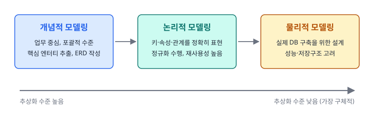
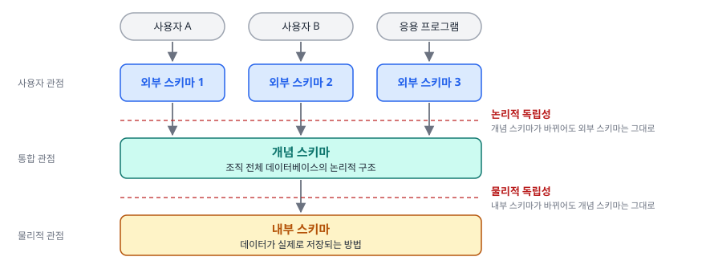
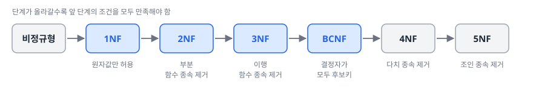
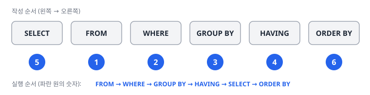
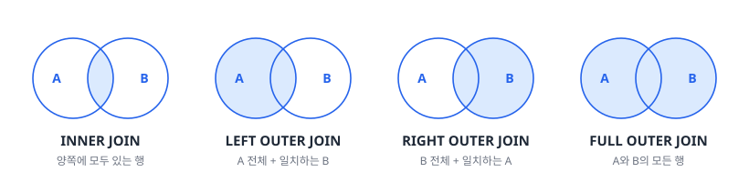
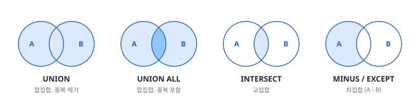
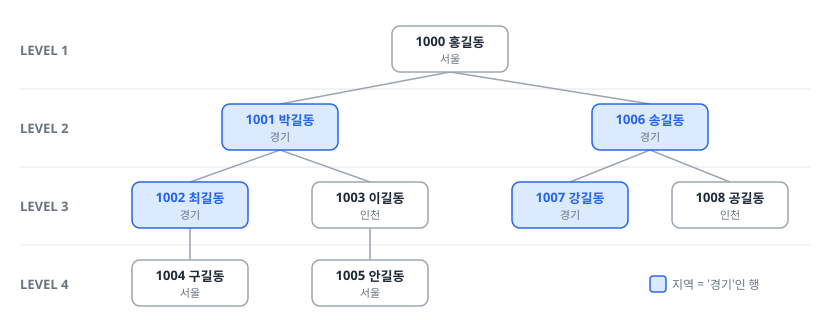
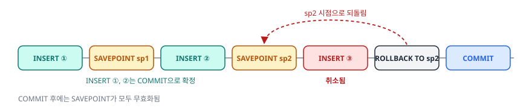
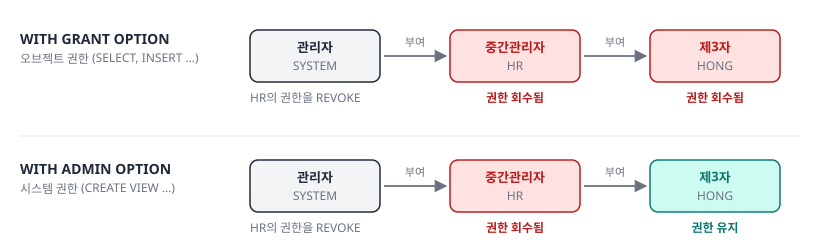

# SQLD 핵심정리노트

데이터 모델링의 이해부터 관리구문까지 SQLD 1·2과목 핵심 정리

<p class="sub">SQLD 핵심정리노트 · {teacher} 강사</p>

---
layout: section
---

# 1과목 1장. 데이터 모델링의 이해

데이터 모델의 이해 · 관계형 데이터베이스 개요 · 엔터티 · 속성 · 관계 · 식별자

---

## #01. 핵심 요약

| 주제 | 핵심 |
|:--|:--|
| 데이터 모델링 | 현실 세계의 데이터를 추상화해 표현하는 기법, **개념적 → 논리적 → 물리적** 단계로 진행 |
| 핵심 구성요소 | **엔터티**(실체), **속성**(특성), **관계**(연관성) |
| 관계형 데이터베이스 | SQL로 데이터를 정의(DDL)·조작(DML)·제어(DCL), 데이터 중복 최소화 |
| 엔터티 | 업무에 필요한 정보 집합, 유형·개념·사건 엔터티로 나뉨, **식별자와 속성 필수** |
| 속성 | 엔터티를 설명하는 최소 데이터 단위, 기본·설계·파생 속성과 PK·FK·일반 속성으로 구분 |
| 관계 | 엔터티 간 연관성, 1:1·1:M·N:M 카디널리티와 필수·선택 참여 특성을 가짐 |
| 식별자 | 인스턴스를 구분하는 속성, 주·보조 / 내부·외부 / 단일·복합 식별자 등으로 분류 |
| 좋은 데이터 모델 | 완전성, 중복 배제, 업무 규칙 반영, 데이터 재사용성, 명확한 의사소통, 통합성 |

---

## #02. 데이터 모델의 이해

<Grid cols="2">
<div>

#### 1.1 모델링의 정의

| 구분 | 설명 |
|:--|:--|
| 모델링(Modeling) | 현실 세계의 복잡한 현상이나 사물을 단순화하여 표현하는 기법 |
| 데이터진흥원 정의 | 사람이 접하는 다양한 현상(사람, 사물, 개념 등)을 약속된 방식(수식, 그림 등)으로 표현하는 것 |

</div>
<div>

#### 1.2 모델링의 종류

| 구분 | 설명 |
|:--|:--|
| 정보시스템 모델링 | 정보 모델링, 데이터 모델링, 프로세스 모델링 등 |
| 수리 모델링 | 수학적 공식으로 현상을 표현 |
| 확률/통계 모델링 | 통계적 방법론으로 미래를 예측 |
| 회로 모델링 | 전자회로를 설계하고 구성 |

</div>
</Grid>

---

### #02-1. 모델링의 특징 · 정보시스템 모델링의 세 가지 관점

<Grid cols="2">
<div>

#### 1.3 모델링의 특징

| 구분 | 설명 |
|:--|:--|
| 추상화 | 현실 세계를 일정한 형식에 맞추어 간략하게 표현 |
| 단순화 | 복잡한 현실을 기호, 문자, 그림 등으로 쉽게 이해할 수 있게 함 |
| 명확화 | 애매모호함을 제거하고 명확하게 현상을 기술 |

</div>
<div>

#### 1.4 정보시스템 모델링의 세 가지 관점

| 구분 | 설명 |
|:--|:--|
| 데이터 관점 (What, Data) | 업무가 어떤 데이터와 관련되는지 모델링 |
| 프로세스 관점 (How, Process) | 업무가 실제로 처리하는 일을 모델링 |
| 데이터와 프로세스의 상관 관점 | 업무 처리 방식에 따라 데이터가 어떤 영향을 주고받는지 모델링 |

</div>
</Grid>

---

### #02-2. 데이터 모델링의 정의

- **데이터 모델링**: 정보시스템 구축을 위해 데이터 관점에서 업무를 분석하고 현실 세계의 데이터를 약속된 표기법으로 표현하는 과정

<span class="kicker">데이터 모델이 제공하는 기능</span>

- 시스템 가시화 지원
- 시스템 구조와 행동 명세화
- 구조화된 틀 제공
- 문서화
- 다양한 관점 제공
- 상세 수준의 구체화

---

### #02-3. 데이터 모델링의 중요성 및 유의점 (1/2)

| 구분 | 설명 |
|:--|:--|
| 데이터 설계의 중요성 | 시스템 구축에서 매우 중요한 요소<br>복잡한 정보 요구사항을 간결하게 표현<br>데이터 중복/비유연성/비일관성을 줄여 품질 향상 |
| 데이터 모델링 시 유의점 | 중복된 데이터 요소 최소화<br>변화 가능성 고려 (업무 변화에 유연하게 대응)<br>데이터 모델의 단순화 추구<br>데이터 재사용성 고려<br>일관성과 통합성 유지 |

---

### #02-4. 데이터 모델링의 중요성 및 유의점 (2/2)

<Callout kind="tip" icon="➕" title="유의점 (보완)">

- 데이터의 정의를 프로세스와 분리해 **유연성**을 높임
- **프로그램과 테이블 간의 연계성을 낮춤**
  - 연계성이 높으면 사소한 업무 변화에도 데이터 모델이 크게 바뀌어 유연성이 떨어짐

</Callout>

---

### #02-5. 데이터 모델링의 3단계 (1/3)



---

### #02-6. 데이터 모델링의 3단계 (2/3)

| 구분 | 설명 |
|:--|:--|
| 개념적 데이터 모델링 | 추상화 수준이 높고 업무 중심적, 포괄적 수준의 모델링<br>전사적 관점에서 기업의 데이터 모델링 진행<br>주로 ERD 산출물 생성 |
| 논리적 데이터 모델링 | 시스템 구축을 위한 키, 속성, 관계 등을 정확하게 표현<br>재사용성이 높은 설계가 가능<br>정규화를 통해 데이터 모델 품질 향상 |
| 물리적 데이터 모델링 | 실제 DB 구축을 위한 설계 단계<br>성능, 저장 등을 고려한 실제적 구현 방법 제시<br>인덱스, 역정규화 등의 기법 사용 |

---

### #02-7. 데이터 모델링의 3단계 (3/3)

<Callout kind="tip" icon="➕" title="단계별 특징 (보완)">

| 단계 | 추상화 수준 | 보완 내용 |
|:--|:--|:--|
| 개념적 모델링 | **가장 높음** | 업무를 분석해 핵심 엔터티를 추출하는 단계, 핵심 엔터티 간의 관계를 표현하려고 **ERD 작성** |
| 논리적 모델링 |  | 개념적 모델링의 결과를 토대로 세부 속성·식별자·관계를 표현<br>같은 형태의 데이터를 쓰는 업무나 프로젝트에서 재사용 가능(쿼리도 재사용)<br>재사용성이 높으면 유지보수가 쉬움 |
| 물리적 모델링 | **가장 낮음**(가장 구체적) | 논리 모델을 직접 물리적으로 생성하는 과정<br>성능, 디스크 저장구조, 하드웨어 보안성, 가용성 고려 |

</Callout>

---

### #02-8. 데이터 독립성 (Three-Schema Architecture) (1/4)



---

### #02-9. 데이터 독립성 (Three-Schema Architecture) (2/4)

| 구분 | 설명 |
|:--|:--|
| 외부 스키마 (External Schema) | 사용자 관점의 스키마<br>개인적인 데이터베이스 뷰<br>응용 프로그램이 접근하는 영역 |
| 개념 스키마 (Conceptual Schema) | 통합 관점의 스키마<br>조직 전체의 데이터베이스를 기술<br>전체 데이터베이스의 구조 정의 |
| 내부 스키마 (Internal Schema) | 물리적 저장구조<br>실제 데이터가 저장되는 방법 정의 |

---

### #02-10. 데이터 독립성 (Three-Schema Architecture) (3/4)

<span class="kicker">독립성 종류</span>

| 구분 | 설명 |
|:--|:--|
| 논리적 독립성 | 개념 스키마가 변경되어도 외부 스키마에 영향 없음 |
| 물리적 독립성 | 내부 스키마가 변경되어도 개념 스키마에 영향 없음 |

- **매핑(사상)**: 상위 단계와 하위 단계 사이의 대응 관계

---

### #02-11. 데이터 독립성 (Three-Schema Architecture) (4/4)

<Callout kind="tip" icon="➕" title="스키마 간 독립성 (보완)">

| 구분 | 독립 관계 | 특징 | 예시 |
|:--|:--|:--|:--|
| 논리적 독립성 | **외부 스키마 ↔ 개념 스키마** | 논리 구조(테이블, 관계)를 바꿔도 애플리케이션이나 사용자 뷰에 영향 없음<br>데이터베이스 유지보수가 쉬워짐 | 테이블 구조가 바뀌어도 사용자 뷰는 그대로 |
| 물리적 독립성 | **개념 스키마 ↔ 내부 스키마** | 물리적 저장 방식(인덱싱, 파일 시스템)을 바꿔도 논리 구조에 영향 없음<br>데이터베이스 성능 최적화 지원 | 저장 파일 구조를 바꿔도 테이블이나 관계는 그대로 |

</Callout>

---

### #02-12. 데이터 모델링의 세 가지 핵심 요소

| 구분 | 설명 |
|:--|:--|
| 엔터티 (Entity) | 업무에 필요하고 유용한 정보를 저장하는 집합적 실체 |
| 속성 (Attribute) | 엔터티를 구성하는 최소 데이터 단위 |
| 관계 (Relationship) | 엔터티 간의 논리적인 연관성 |

---

### #02-13. ERD (Entity-Relationship Diagram)

- **ERD 정의**: 엔터티와 엔터티 간의 관계를 그림으로 표현한 것

<span class="kicker">ERD 작성 순서</span>

<Flow>
<li>엔터티 도출</li>
<li>엔터티 간 관계 정의</li>
<li>관계명 기술</li>
<li>관계의 참여도 기술</li>
<li>관계 필수여부 기술</li>
</Flow>

<span class="kicker">ERD 표기법 종류</span>

| 구분 | 설명 |
|:--|:--|
| Chen 표기법 | 가장 오래된 표기법, 관계를 마름모꼴로 표시 |
| IE (Information Engineering) 표기법 | 까마귀발 표기법이라고도 함, 관계를 선으로 표시 |
| Barker 표기법 | 엔터티에 주식별자를 표기하지 않음, 관계는 선으로 표시 |

---

### #02-14. 좋은 데이터 모델링의 특징

| 구분 | 설명 |
|:--|:--|
| 완전성 | 업무에 필요한 모든 데이터를 담아야 함 |
| 중복 배제 | 데이터 중복을 최소화하여 일관성 유지 |
| 업무 규칙 반영 | 현업의 업무 규칙을 정확히 표현 |
| 데이터 재사용 | 데이터 재사용이 용이하도록 설계 |
| 의사소통 | 비즈니스 요구사항을 명확히 전달 |
| 통합성 | 전체 데이터의 통합된 시각을 제공 |

---

## #03. 관계형 데이터베이스 개요

<Grid cols="2">
<div>

#### 2.1 데이터베이스의 정의

- 데이터의 집합으로 조직적으로 구성된 데이터들의 모임

<span class="kicker">여러 관점의 정의</span>

| 구분 | 설명 |
|:--|:--|
| 법적 정의 | 저작물의 소재를 체계적으로 배열 또는 구성한 편집물 |
| 기술적 정의 | 관련된 데이터의 모음으로, 중복을 통제하는 체계 |
| 산업적 정의 | 조직체의 정보 요구를 지원하는 공유 데이터 자원 |

</div>
<div>

#### 2.2 데이터베이스의 발전 과정

| 구분 | 설명 |
|:--|:--|
| 1960년대 | 파일 시스템 (파일 간 데이터 중복, 일관성/무결성 보장 어려움) |
| 1970년대 | 계층형/망형 DBMS (자료 간 관계가 복잡, 유연성 부족) |
| 1980년대 | 관계형 DBMS 등장 (오라클, DB2 등) |
| 1990년대 | 객체 관계형 DBMS로 발전 |

</div>
</Grid>

---

### #03-1. 관계형 데이터베이스의 특징

| 구분 | 설명 |
|:--|:--|
| 데이터 중복 최소화 | 정규화를 통한 중복 제거 |
| 동시성 관리 | 다중 사용자 환경에서 데이터 일관성 보장 |
| 병행제어 | 동시에 여러 사용자가 데이터 처리할 때 일관성 유지 |
| 메타데이터 관리 | 데이터에 관한 데이터(데이터 사전) 관리 |
| 보안/무결성/장애복구 기능 | 데이터 보호와 안정성 보장 |
| SQL 사용 | 표준 질의어를 통한 데이터 정의/조작/제어 |

---

### #03-2. SQL (Structured Query Language)

| 구분 | 설명 |
|:--|:--|
| SQL의 정의 | 관계형 데이터베이스에서 사용하는 표준 질의어 |
| SQL 표준화 | ANSI SQL을 통한 표준화 |

<span class="kicker">SQL 명령어 유형</span>

| 구분 | 설명 |
|:--|:--|
| DML (Data Manipulation Language) | SELECT, INSERT, UPDATE, DELETE |
| DDL (Data Definition Language) | CREATE, ALTER, DROP, TRUNCATE |
| DCL (Data Control Language) | GRANT, REVOKE |
| TCL (Transaction Control Language) | COMMIT, ROLLBACK, SAVEPOINT |

---

### #03-3. 테이블 구조와 데이터 타입 (1/2)

<span class="kicker">테이블 구성 요소</span>

| 구분 | 설명 |
|:--|:--|
| 컬럼 (Column) | 속성, 필드 |
| 행 (Row) | 레코드, 튜플 |
| 필드 (Field) | 컬럼과 행이 만나는 지점, 실제 데이터가 저장됨 |

---

### #03-4. 테이블 구조와 데이터 타입 (2/2)

<span class="kicker">주요 데이터 타입</span>

| 구분 | 설명 |
|:--|:--|
| 숫자형 | INTEGER, NUMBER, DECIMAL 등 |
| 문자형 | CHAR, VARCHAR, TEXT 등 |
| 날짜형 | DATE, TIMESTAMP |
| 이진형 | BLOB, BINARY |
| 불리언형 | BOOLEAN |

- **CHAR vs VARCHAR**: CHAR은 고정길이, VARCHAR는 가변길이 문자열 저장

---

## #04. 엔터티

<Grid cols="2">
<div>

#### 3.1 엔터티의 정의

- **엔터티**: 업무에 필요하고 유용한 정보를 저장하고 관리하기 위한 집합적인 실체 또는 객체
- 데이터베이스에서는 테이블로 구현됨

</div>
<div>

#### 3.2 엔터티의 특징

| 구분 | 설명 |
|:--|:--|
| 업무적 필요성 | 반드시 업무에서 필요하고 관리할 가치가 있어야 함 |
| 식별자 | 유일한 식별자(예: 학번, 사번)로 식별 가능해야 함 |
| 인스턴스 집합 | 2개 이상의 인스턴스(행)를 포함해야 함 |
| 업무 프로세스 참여 | 실제 업무 프로세스에 활용되어야 함 |
| 속성 포함 | 반드시 속성을 가져야 함 |
| 관계 존재 | 다른 엔터티와 최소 1개 이상의 관계가 필요 |

</div>
</Grid>

---

### #04-1. 엔터티의 분류

<span class="kicker">유무형에 따른 분류</span>

| 구분 | 설명 | 예시 |
|:--|:--|:--|
| 유형 엔터티 | 물리적 형태가 있음 | 학생, 사원, 강사 |
| 개념 엔터티 | 개념적인 정보 | 조직, 보험상품 |
| 사건 엔터티 | 업무 수행에 따라 발생 | 주문, 청구 |

<span class="kicker">발생시점에 따른 분류</span>

| 구분 | 설명 | 예시 |
|:--|:--|:--|
| 기본 엔터티 | 독립적으로 생성 가능 | 고객, 상품 |
| 중심 엔터티 | 기본 엔터티로부터 생성 | 계약, 주문 |
| 행위 엔터티 | 두 엔터티 간의 행위로 생성 | 주문목록, 사원변경이력 |

---

### #04-2. 엔터티 명명 규칙 (1/2)

- 현업업무에서 사용하는 용어 사용
- 약어 사용 지양
- 단수 명사 사용
- 모든 엔터티에서 유일한 이름 부여
- 생성 의미가 부여된 이름 사용

<span class="kicker">명명 방식</span>

| 구분 | 설명 | 예시 |
|:--|:--|:--|
| CamelCase | 각 단어의 첫 글자를 대문자로 표기 | CustomerOrder |
| SnakeCase | 단어 사이에 언더바(_) 사용 | customer_order |

---

### #04-3. 엔터티 명명 규칙 (2/2)

<Callout kind="tip" icon="➕" title="엔터티 점검 (보완)">

- 사용되지 않는 **고립 엔터티**는 추후 제거 고려
- 누락된 프로세스는 이후에 추가하거나 수정 가능

</Callout>

---

## #05. 속성

#### 속성의 정의

- **속성**: 업무에서 필요로 하는 최소한의 데이터 단위로, 더 이상 분리되지 않는 정보
- 엔터티를 설명하는 데이터 요소

---

### #05-1. 속성의 특성

| 구분 | 설명 |
|:--|:--|
| 업무 필요성 | 해당 업무에서 필요하고 관리해야 할 정보여야 함 |
| 함수적 종속성 | 정규화 이론에 따라 주식별자에 함수적 종속성을 가져야 함 |
| 단일값 원칙 | 하나의 속성은 한 개의 값만을 가짐 |
| 도메인 | 속성이 가질 수 있는 값의 범위를 정의 |

<Callout kind="tip" icon="➕" title="속성의 특성 (보완)">

- 하나의 속성에 값이 여러 개인 **다중값**이면 **별도의 엔터티로 분리**
- 엔터티에 대한 자세하고 구체적인 정보를 나타냄, 추상적인 값은 속성이 아님

</Callout>

---

### #05-2. 속성의 분류 (1/4)

<span class="kicker">특성에 따른 분류</span>

| 구분 | 설명 | 예시 |
|:--|:--|:--|
| 기본 속성 | 업무 분석 단계에서 바로 정의되는 속성 | 상품이름 |
| 설계 속성 | 업무 규칙화, DB 설계 과정에서 도출되는 속성 | 예금분류코드 |
| 파생 속성 | 다른 속성에서 계산이나 변형으로 생성되는 속성 | 이자 |

<span class="kicker">엔터티 내 역할에 따른 분류</span>

| 구분 | 설명 |
|:--|:--|
| PK(Primary Key) 속성 | 엔터티를 식별하는 속성 |
| FK(Foreign Key) 속성 | 다른 엔터티와의 관계에서 포함된 속성 |
| 일반 속성 | PK나 FK가 아닌 일반적인 속성 |

---

### #05-3. 속성의 분류 (2/4)

<Callout kind="tip" icon="➕" title="특성에 따른 분류의 예 (보완)">

| 구분 | 예시 |
|:--|:--|
| 기본 속성 | 회원 ID, 이름, 계좌번호, 주문일자, 원금 |
| 설계 속성 | 일련번호, 주문번호, 상품코드, 지점코드 |
| 파생 속성 | 합계, 평균, 전체 수 |

- 파생 속성은 조회 성능을 위해 원래 속성의 값을 계산해 저장하는 속성, **가급적 적게 정의**

</Callout>

---

### #05-4. 속성의 분류 (3/4)

<Callout kind="tip" icon="➕" title="속성값 수에 따른 분류 (보완)">

| 구분 | 설명 | 예시 |
|:--|:--|:--|
| 단일값 속성 | 하나의 값만 가지는 속성 | 나이, 이름 |
| 다중값 속성 | 여러 개의 값을 가지는 속성 | 취미 |

- 다중값 속성은 "속성은 하나의 속성값을 가져야 한다"에 어긋남, **1차 정규화**를 하거나 별도의 엔터티로 만들어 관계로 연결

</Callout>

---

### #05-5. 속성의 분류 (4/4)

<Callout kind="tip" icon="➕" title="분리 가능성에 따른 분류 (보완)">

| 구분 | 설명 | 예시 |
|:--|:--|:--|
| 단순 속성 | 다른 속성으로 구성될 수 없는 속성 | 시, 구, 동, 번지, 이름, 나이 |
| 복합 속성 | 여러 속성으로 구성된 속성 | 주소 |

</Callout>

---

### #05-6. 속성의 명명 규칙

- 현업에서 사용하는 이름 사용
- 약어 사용 지양
- 전체 시스템에서 유일한 이름 사용
- 명사형 사용
- 이름만으로도 의미 파악 가능하게

---

## #06. 관계

#### 5.1 관계의 정의

- **관계**: 엔터티의 인스턴스 간에 논리적인 연관성을 가지는 형태나 행위
- 엔터티 간의 업무적 연관성을 표현

#### 5.2 관계의 표현

- 2개의 엔터티 사이의 관계는 2개의 관계명을 가짐
  - 예: 고객은 주문을 생성한다 / 주문은 고객에 의해 생성된다

---

### #06-1. 관계의 분류 (1/2)

<span class="kicker">종류</span>

| 구분 | 설명 | 예시 |
|:--|:--|:--|
| 존재에 의한 관계 | 항상 존재하는 관계 | 사원은 부서에 속한다 |
| 행위에 의한 관계 | 특정 행위로 발생하는 관계 | 고객이 상품을 구매 |

<span class="kicker">카디널리티(참여자 수)</span>

| 구분 | 설명 |
|:--|:--|
| 1:1 관계 | 양쪽 엔터티의 인스턴스가 1:1로 대응 |
| 1:M 관계 | 한쪽 엔터티 인스턴스가 여러 인스턴스와 관계 |
| N:M 관계 | 양쪽 엔터티의 인스턴스가 다대다 관계 |

---

### #06-2. 관계의 분류 (2/2)

<Callout kind="tip" icon="➕" title="상호배타적 관계 (보완)">

- 개인회원 또는 법인회원 **둘 중 하나로만** 주문할 수 있을 때, 고객과 주문 엔터티의 관계

</Callout>

<Callout kind="tip" icon="➕" title="관계 관련 용어 (보완)">

| 용어 | 뜻 |
|:--|:--|
| 관계 | 엔터티 간의 연관성을 나타내는 개념, 페어링의 집합 |
| 관계의 차수 | 한 엔터티의 레코드가 다른 엔터티의 레코드와 연결되는 방식 |
| 관계의 페어링 | 엔터티 안의 인스턴스가 개별적으로 관계를 가지는 것 |

</Callout>

---

### #06-3. 관계의 선택성

| 구분 | 설명 |
|:--|:--|
| 필수적 관계 | 반드시 관계를 가져야 함 (실선으로 표시) |
| 선택적 관계 | 관계를 가질 수도 있고 아닐 수도 있음 (점선으로 표시) |

<Callout kind="tip" icon="➕" title="표기법별 표현 (보완)">

| 표기법 | 필수적 관계 | 선택적 관계 |
|:--|:--|:--|
| 바커 표기법 | 실선 | 점선 |
| IE 표기법 | 원을 그리지 않음 | 관계선 끝에 원을 그림 |

- 두 엔터티의 관계가 서로 필수적이면 **하나의 트랜잭션**을 형성
- 두 엔터티가 서로 독립적으로 수행될 수 있으면 선택적 관계로 표현

</Callout>

---

### #06-4. 관계명 표기 규칙 · 관계 도출 점검 항목 (보완)

<Grid cols="2">
<div>

#### 5.5 관계명 표기 규칙

- 관계의 이름은 현재형 동사 사용
- 관계 참여자의 관점에서 능동적으로 명명
- 관계는 양방향으로 명명 (능동/수동)

</div>
<div>

#### 5.6 관계 도출 점검 항목 (보완)

- 두 엔터티 사이에 **정보의 조합**이 발생하는지
- 두 엔터티 사이에 관련 있는 **연관 규칙**이 존재하는지
- 업무기술서나 장표에 관계 연결에 대한 **규칙이 서술**되어 있는지
- 업무기술서나 장표에 관계 연결을 가능하게 하는 **동사**가 있는지

</div>
</Grid>

---

## #07. 식별자

<Grid cols="2">
<div>

#### 6.1 식별자의 정의

- **식별자**: 엔터티 내에서 인스턴스를 구별하는 속성 또는 속성 조합
- 논리 모델링에서는 '식별자', 물리 모델링에서는 '키(Key)'라는 용어 사용

</div>
<div>

#### 6.2 식별자의 특성

| 구분 | 설명 |
|:--|:--|
| 유일성 | 인스턴스를 유일하게 구분할 수 있어야 함 |
| 최소성 | 필요 최소한의 속성으로 구성 |
| 불변성 | 값이 변하지 않아야 함 |
| 존재성 | 반드시 값이 존재해야 함 (NULL 허용 안됨) |

</div>
</Grid>

---

### #07-1. 식별자의 분류 (1/3)

<span class="kicker">대표성에 따른 분류</span>

| 구분 | 설명 | 예시 |
|:--|:--|:--|
| 주식별자 | 엔터티를 대표하는 식별자 | 사원번호 |
| 보조식별자 | 대체 식별 가능한 식별자 | 주민등록번호 |

<span class="kicker">생성 방식에 따른 분류</span>

| 구분 | 설명 | 예시 |
|:--|:--|:--|
| 내부식별자 | 엔터티 내에서 스스로 생성되는 식별자 | 고객번호 |
| 외부식별자 | 다른 엔터티로부터 받아오는 식별자 | 주문의 고객번호 |

---

### #07-2. 식별자의 분류 (2/3)

<span class="kicker">속성의 수에 따른 분류</span>

| 구분 | 설명 | 예시 |
|:--|:--|:--|
| 단일식별자 | 하나의 속성으로 구성된 식별자 | 고객번호 |
| 복합식별자 | 여러 속성의 조합으로 구성된 식별자 | 주문번호+상세순번 |

<span class="kicker">대체 가능성에 따른 분류</span>

| 구분 | 설명 | 예시 |
|:--|:--|:--|
| 본질식별자 | 업무적으로 자연 발생한 식별자 | 주민등록번호 |
| 인조식별자 | 시스템에서 임의로 부여한 식별자 | 일련번호 |

---

### #07-3. 식별자의 분류 (3/3)

<Callout kind="tip" icon="➕" title="키의 종류 (보완)">

| 키 | 설명 |
|:--|:--|
| 후보키(Candidate Key) | 각 행을 유일하게 식별할 수 있는 속성들의 집합, **유일성과 최소성** 모두 만족 |
| 기본키(Primary Key) | 후보키 중 엔터티를 대표하도록 선정된 키 |
| 수퍼키(Super Key) | 유일성은 만족하지만 **최소성은 만족하지 않는** 키 |
| 대체키(Alternative Key) | 후보키 중 기본키로 선정되지 않고 남은 키 |

</Callout>

---

### #07-4. 식별자 도출 기준

- 업무에서 자주 사용되는 속성 우선
- 명칭이나 내역과 같은 서술형 속성은 지양
- 속성의 수가 적은 것 우선
- 향후 변경 가능성이 적은 속성 우선

---

### #07-5. 식별자 관계와 비식별자 관계

| 구분 | 설명 |
|:--|:--|
| 식별자 관계 | 부모 엔터티의 주식별자가 자식 엔터티의 주식별자에 포함되는 관계<br>실선으로 표시 |
| 비식별자 관계 | 부모 엔터티의 주식별자가 자식 엔터티의 일반 속성으로 포함되는 관계<br>점선으로 표시 |
| 관계 설정 기준 | 자식 인스턴스가 부모 없이 독립적 존재 가능 → 비식별자 관계<br>자식 인스턴스의 존재가 부모에 종속적 → 식별자 관계<br>복합식별자가 너무 많아지면 → 비식별자 관계 고려<br>객체 재사용 필요시 → 비식별자 관계 고려<br>이력 관리 엔터티 → 식별자 관계 고려 |

---
layout: section
---

# 1과목 2장. 데이터 모델과 SQL

정규화 · 반정규화 · 트랜잭션 · NULL · 본질식별자 vs. 인조식별자 · 계층형 데이터 모델

---

## #08. 핵심 요약

| 주제 | 핵심 |
|:--|:--|
| 정규화 | 데이터 중복을 없애고 이상 현상을 막기 위해 테이블을 분해하는 과정, **1NF(원자값) → 2NF(부분종속 제거) → 3NF(이행종속 제거) → BCNF(결정자 = 후보키)** 순으로 진행 |
| 반정규화 | 성능 향상을 위해 정규화된 모델에 중복·통합·분리를 적용하는 기법, **다른 대안(뷰, 인덱스, 파티셔닝 등)을 먼저 검토**한 뒤 적용 |
| 트랜잭션 | **ACID**(원자성, 일관성, 고립성, 영속성) 특성을 가짐, 전부 수행되거나 전부 취소되는 논리적 작업 단위 |
| NULL | '값이 없음'을 뜻함, 산술 연산 결과는 NULL, 비교 연산 결과는 Unknown, NVL·NULLIF·COALESCE 등의 함수로 처리 |
| 집계 함수와 NULL | SUM·AVG·MAX·MIN·COUNT(컬럼)은 NULL을 제외하고 연산, **COUNT(\*)만 NULL을 포함**해 전체 행 수를 셈 |
| 식별자 | 본질식별자는 업무에서 자연 발생한 식별자, 인조식별자는 시스템 편의를 위해 인위적으로 부여한 식별자, **인조식별자 남용 시 중복 데이터 발생 위험** |

---

### #08-1. 핵심 요약 (2/2)

| 주제 | 핵심 |
|:--|:--|
| 계층형 데이터 모델 | 자기 자신과의 관계를 가짐, 셀프 조인이나 계층형 쿼리(START WITH / CONNECT BY, CTE)로 조회 |
| 정규화와 반정규화의 균형 | 정규화는 입력·수정·삭제 성능 향상, 반정규화는 조회 성능 향상 대신 데이터 무결성 위험 |

---

## #09. 정규화

<Grid cols="2">
<div>

#### 1.1 정규화의 정의

- **정규화(Normalization)**: 데이터의 일관성, 최소한의 데이터 중복, 최대한의 데이터 유연성을 확보하기 위한 데이터 분해 과정
- 엔터티를 상호 독립적인 관계로 분리하여 이상 현상(Anomaly)을 제거하는 것이 목적
- **함수적 종속성(Functional Dependency)**: 데이터 간의 종속 관계를 기반으로 정규화를 수행

</div>
<div>

#### 1.2 이상 현상 (Anomaly)

| 구분 | 설명 |
|:--|:--|
| 삽입 이상(Insert Anomaly) | 불필요한 데이터를 함께 삽입해야만 원하는 데이터를 추가할 수 있는 현상 |
| 갱신 이상(Update Anomaly) | 중복 데이터 중 일부만 수정하여 데이터 불일치가 발생하는 현상 |
| 삭제 이상(Delete Anomaly) | 필요한 데이터까지 함께 삭제되는 현상 |

</div>
</Grid>

---

### #09-1. 정규화 단계 (1/3)



<span class="kicker">제1정규형 (1NF)</span>

- 모든 속성의 값이 **원자값**(Atomic Value)이어야 함
- 반복 그룹이나 다중값 속성을 제거
- 하나의 속성에는 하나의 값만 존재해야 함

---

### #09-2. 정규화 단계 (2/3)

<span class="kicker">제2정규형 (2NF)</span>

- 1NF를 만족하면서 **부분 함수 종속**(Partial Dependency)을 제거
- 모든 비식별 속성이 주식별자 전체에 완전 함수 종속이어야 함
- 복합 식별자의 일부에만 종속되는 속성을 분리

<span class="kicker">제3정규형 (3NF)</span>

- 2NF를 만족하면서 **이행 함수 종속(Transitive Dependency)** 을 제거
- 비식별 속성 간의 종속 관계를 제거
- A → B → C에서 A → C의 간접 종속이 존재하면 분리

<span class="kicker">BCNF (Boyce-Codd Normal Form)</span>

- 3NF를 만족하면서 **결정자**(Determinant)가 모두 후보키이어야 함
- 후보키가 아닌 속성이 결정자인 경우를 제거
- 모든 결정자가 후보키인 상태

---

### #09-3. 정규화 단계 (3/3)

<span class="kicker">제4정규형 (4NF)</span>

- **다치 종속**(Multi-Valued Dependency)을 제거
- 하나의 속성이 여러 개의 독립적인 다중값과 관련되는 경우를 분리

<span class="kicker">제5정규형 (5NF)</span>

- **조인 종속**(Join Dependency)을 제거
- 분해된 테이블을 다시 조인했을 때 원래의 테이블과 동일해야 함

<Callout kind="tip" icon="➕" title="정규화 (보완)">

- 정규화는 **논리 모델링 단계**에서 진행
- 제1정규형: 각 컬럼은 같은 종류나 타입의 값을 가지고, 유일한 이름을 가져야 함

</Callout>

---

### #09-4. 정규화와 성능

- **정규화는 조회 성능을 저하시킬 수도, 향상시킬 수도 있음**
- 정규화를 하면 조인이 증가하여 조회 성능이 떨어질 수 있음
- 반면, 중복이 제거되어 데이터 일관성 유지 → 특정 조회 성능 향상
- **입력/수정/삭제 성능은 일반적으로 향상됨** (중복 데이터 감소로 처리량 감소)

---

## #10. 반정규화

<Grid cols="2">
<div>

#### 2.1 반정규화의 정의

- **반정규화(Denormalization)**: 정규화된 엔터티, 속성, 관계에 대해 성능 향상과 개발 운영의 단순화를 위해 **중복, 통합, 분리** 등을 수행하는 데이터 모델링 기법
- 데이터 무결성이 깨질 수 있는 위험성이 있으므로 신중한 판단 필요

</div>
<div>

#### 2.2 반정규화 적용 시 고려사항

<span class="kicker">반정규화 전에 먼저 고려할 사항</span>

- 뷰(View) 활용으로 해결 가능한지 검토
- 인덱스 조정으로 해결 가능한지 검토
- 클러스터링 적용으로 해결 가능한지 검토
- 파티셔닝이나 캐시 적용 등 다른 방안 검토

- **위 방안으로도 해결되지 않을 때 반정규화를 적용**

</div>
</Grid>

---

### #10-1. 반정규화 기법 (1/3)

<span class="kicker">테이블 반정규화</span>

- **테이블 병합**: 1:1 관계 또는 1:M 관계의 테이블을 하나로 합침

<span class="kicker ai">테이블 분할</span>

| 구분 | 설명 |
|:--|:--|
| 수직 분할 | 컬럼 단위로 테이블을 나눔 (자주 사용하는 컬럼과 그렇지 않은 컬럼을 분리) |
| 수평 분할 | 행 단위로 테이블을 나눔 (지역별, 기간별 등으로 분리) |

<span class="kicker ai">테이블 추가</span>

---

### #10-2. 반정규화 기법 (2/3)

<span class="kicker">테이블 반정규화 (계속)</span>

| 구분 | 설명 |
|:--|:--|
| 중복 테이블 추가 | 다른 업무이거나 서버가 다른 경우 중복 테이블 생성 |
| 통계 테이블 추가 | 통계 데이터를 미리 계산하여 별도 테이블에 저장 |
| 이력 테이블 추가 | 변경 이력을 관리하기 위한 테이블 추가 |
| 부분 테이블 추가 | 자주 사용하는 컬럼만 모아 별도 테이블 생성 |

---

### #10-3. 반정규화 기법 (3/3)

<span class="kicker">컬럼 반정규화</span>

| 구분 | 설명 |
|:--|:--|
| 중복 컬럼 추가 | 조인 감소를 위해 다른 테이블의 컬럼을 중복 저장 |
| 파생 컬럼 추가 | 계산값을 미리 저장하여 조회 성능 향상 (예: 합계, 평균) |
| 이력 테이블 컬럼 추가 | 최신 데이터를 빠르게 조회하기 위한 컬럼 추가 |
| PK에 의한 컬럼 추가 | PK에 포함된 정보를 별도 컬럼으로 저장하여 인덱스 접근 편의 제공 |
| 응용시스템 오동작을 위한 컬럼 추가 | 이전 데이터와의 비교를 위한 컬럼 |

<span class="kicker">관계 반정규화</span>

- **중복 관계 추가**: 조인 경로를 단축시키기 위해 이미 존재하는 관계를 중복으로 추가

---

## #11. 트랜잭션

<Grid cols="2">
<div>

#### 3.1 트랜잭션의 정의

- **트랜잭션(Transaction)**: 데이터베이스의 상태를 변환시키는 하나의 논리적 작업 단위
- 하나의 업무 단위로 묶여 있어, 전체가 수행되거나 전체가 취소되어야 함

</div>
<div>

#### 3.2 트랜잭션의 특성 (ACID)

| 구분 | 설명 |
|:--|:--|
| 원자성(Atomicity) | 트랜잭션의 연산은 전부 실행되거나 전부 취소되어야 함 (All or Nothing)<br>일부만 수행되어서는 안 됨 |
| 일관성(Consistency) | 트랜잭션 수행 전후로 데이터베이스의 상태가 일관되어야 함<br>데이터 무결성 제약 조건을 항상 만족 |
| 고립성(Isolation) | 하나의 트랜잭션이 실행 중일 때 다른 트랜잭션이 접근할 수 없음<br>각 트랜잭션은 독립적으로 수행 |
| 영속성(Durability) | 트랜잭션이 성공적으로 완료되면 그 결과는 영구적으로 반영<br>시스템 장애가 발생하더라도 결과는 보존 |

</div>
</Grid>

---

### #11-1. 트랜잭션과 데이터 모델링

- 하나의 트랜잭션에 관련된 데이터는 가능하면 하나의 엔터티에 배치
- 트랜잭션의 단위가 데이터 모델의 엔터티 도출에 영향을 줌

<Callout kind="tip" icon="➕" title="트랜잭션 처리 원칙 (보완)">

- 순차적으로 수행되는 작업 A와 B가 하나의 트랜잭션일 때, A만 실행되고 시스템 장애가 나면 **A를 ROLLBACK**
- 하나의 트랜잭션으로 구성된 작업은 **부분 COMMIT 불가**

</Callout>

---

## #12. NULL

#### NULL의 정의

| 구분 | 설명 |
|:--|:--|
| NULL | 아직 정의되지 않은 값, 값이 존재하지 않는 상태 |
| NULL ≠ 공백(빈 문자열) | NULL은 '값이 없음'이고, 공백은 '길이가 0인 문자열' |
| NULL ≠ 0 | NULL은 '값이 없음'이고, 0은 숫자 0이라는 값 |

---

### #12-1. NULL의 특성

| 구분 | 설명 |
|:--|:--|
| 산술 연산 | NULL이 포함된 산술 연산의 결과는 항상 NULL<br>예: 100 + NULL = NULL, NULL × 3 = NULL |
| 비교 연산 | NULL과의 비교 결과는 항상 Unknown(알 수 없음)<br>예: NULL = NULL → Unknown, NULL > 0 → Unknown |
| 논리 연산 | NULL은 3가지 값 논리(Three-Valued Logic)에 따름<br>TRUE AND Unknown = Unknown<br>FALSE AND Unknown = FALSE<br>TRUE OR Unknown = TRUE<br>FALSE OR Unknown = Unknown<br>NOT Unknown = Unknown |

---

### #12-2. NULL 관련 함수 (1/2)

| 구분 | 설명 |
|:--|:--|
| NVL(Oracle) / ISNULL(SQL Server) | NULL을 지정한 값으로 치환<br>NVL(컬럼, 대체값): 컬럼이 NULL이면 대체값 반환 |
| NULLIF | 두 값이 같으면 NULL 반환, 다르면 첫 번째 값 반환<br>NULLIF(값1, 값2): 값1 = 값2이면 NULL, 아니면 값1 |
| COALESCE | 인수 중 첫 번째로 NULL이 아닌 값을 반환<br>COALESCE(값1, 값2, 값3, ...): 왼쪽부터 순서대로 NULL이 아닌 첫 번째 값 반환 |

---

### #12-3. NULL 관련 함수 (2/2)

<Callout kind="tip" icon="➕" title="함수별 결과 비교 (보완)">

| COMM | NVL(COMM, 100) | NVL2(COMM, COMM, 100) | NULLIF(COMM, 100) | ISNULL(COMM, 100) |
|:--|:--|:--|:--|:--|
| 0 | 0 | 0 | 0 | 0 |
| NULL | 100 | 100 | NULL | 100 |
| 100 | 100 | 100 | NULL | 100 |

- NVL(인수1, 인수2)의 **두 인수는 타입이 같아야 함**, `NVL(100, 'NULL')`은 실행 불가
- DECODE는 기본값을 지정하지 않으면 NULL 반환

</Callout>

---

### #12-4. 집계 함수와 NULL

| 구분 | 설명 |
|:--|:--|
| SUM, AVG, COUNT(컬럼), MAX, MIN | NULL 값을 제외하고 연산 |
| COUNT(*) | NULL 포함 전체 행 수를 카운트 |
| AVG 주의 | NULL을 제외한 행의 평균이므로, 전체 행의 평균과 다를 수 있음 |

<Callout kind="tip" icon="➕" title="집계와 비교의 예외 (보완)">

- COUNT(DISTINCT 컬럼)은 NULL을 제외하고 셈, **NULL만 있으면 0** 반환
- NULL 한 건만 있는 컬럼의 SUM은 NULL 반환
- NULL은 =, <, >, ≠, ≥, ≤ 같은 비교 연산자로 비교할 수 없음, 비교하려면 **IS NULL** 또는 **IS NOT NULL** 사용

</Callout>

---

## #13. 본질식별자 vs. 인조식별자

<Grid cols="2">
<div>

#### 5.1 본질식별자

- **본질식별자(Natural Identifier)**: 업무에 의해 자연적으로 만들어진 식별자
- 업무적 의미를 가지고 있어 데이터의 의미를 직관적으로 파악 가능
- 예: 주민등록번호, 사업자등록번호, 수강신청(학번+과목번호)

</div>
<div>

#### 5.2 인조식별자

- **인조식별자(Surrogate Identifier)**: 인위적으로 부여한 식별자
- 업무적 의미는 없으나 시스템 관리를 위해 생성
- 주로 자동 증가(Auto Increment) 번호나 시퀀스를 사용
- 예: 수강신청번호(시퀀스), 주문번호(자동채번)

</div>
</Grid>

---

### #13-1. 인조식별자 사용 시 고려사항

| 구분 | 설명 |
|:--|:--|
| 불필요한 인조식별자 남용 주의 | 본질식별자만으로 충분한 경우 인조식별자 추가 지양 |
| 중복 데이터 발생 위험 | 인조식별자만으로는 업무적 중복을 방지하기 어려움<br>예: 수강신청번호만 PK로 설정 시, 동일 학생이 같은 과목을 중복 신청 가능<br>본질식별자를 유니크 제약조건으로 설정하거나 PK에 포함 필요 |
| 불필요한 인덱스 증가 | 인조식별자를 추가하면 관련 인덱스도 추가 필요 |
| 인조식별자가 적합한 경우 | 본질식별자가 너무 많은 컬럼으로 구성된 복합식별자일 때<br>자식 엔터티로 식별자가 계속 전이되어 관리가 복잡한 경우<br>본질식별자의 값이 너무 길어 인덱스 성능에 영향을 줄 때 |

---

## #14. 계층형 데이터 모델

<Grid cols="2">
<div>

#### 6.1 계층형 데이터 모델의 정의

- 엔터티 내에서 **자기 자신과의 관계(Self-Relationship)** 를 가지는 데이터 모델
- 조직도, 카테고리, 메뉴 구조 등 트리(Tree) 구조의 데이터를 표현
- 하나의 테이블 내에서 상위-하위 관계를 부모키(FK)로 표현

</div>
<div>

#### 6.2 셀프 조인 (Self Join)

- **셀프 조인**: 같은 테이블을 두 번 이상 참조하여 조인하는 방식
- 계층형 데이터에서 상위-하위 관계를 조회할 때 사용
- 테이블에 별칭(Alias)을 부여하여 마치 다른 테이블처럼 사용
- 예: 사원 테이블에서 사원과 해당 사원의 관리자 정보를 함께 조회

</div>
</Grid>

---

### #14-1. 계층형 SQL · 계층형 데이터 모델 설계 시 고려사항

<Grid cols="2">
<div>

#### 6.3 계층형 SQL

| 구분 | 설명 |
|:--|:--|
| Oracle의 계층형 쿼리 | START WITH: 계층의 시작점(루트) 지정<br>CONNECT BY PRIOR: 부모-자식 관계의 방향 지정<br>LEVEL: 현재 계층의 깊이(레벨) 반환<br>ORDER SIBLINGS BY: 같은 레벨 내에서 정렬 |
| SQL Server의 계층형 쿼리 | CTE(Common Table Expression)와 재귀 쿼리를 사용하여 구현<br>WITH RECURSIVE 구문 활용 |

</div>
<div>

#### 6.4 계층형 데이터 모델 설계 시 고려사항

- 순환 참조(Cycle)가 발생하지 않도록 주의
- 루트 노드의 부모키는 NULL로 설정
- 계층의 깊이가 깊어지면 조회 성능 저하 가능
- 필요 시 경로(PATH) 컬럼을 추가하여 탐색 성능 향상

</div>
</Grid>

---
layout: section
---

# 2과목 1장. SQL 기본

SELECT 문 · 함수 · WHERE 절 · GROUP BY 절, HAVING 절, ORDER BY 절 · JOIN

---

## #15. 핵심 요약

| 주제 | 핵심 |
|:--|:--|
| SELECT 문 실행 순서 | **FROM → WHERE → GROUP BY → HAVING → SELECT → ORDER BY**, 순서를 알아야 복잡한 쿼리에서 오류를 피함 |
| 함수 | 단일행·다중행으로 구분, 단일행 함수는 행별 결과를, 집계 함수는 그룹 전체 결과를 반환 |
| WHERE와 HAVING | WHERE는 **그룹화 이전** 필터, HAVING은 **그룹화 이후** 필터, 집계 함수 조건은 HAVING에 작성 |
| JOIN | **INNER JOIN은 교집합**, OUTER JOIN은 한쪽 테이블의 행을 모두 유지하고 없는 값은 NULL로 채움, 조인 조건 칼럼에 인덱스가 있으면 성능 개선 |
| 작성 패턴 | 동적 쿼리는 **WHERE 1=1 패턴**으로 조건을 쉽게 추가·제거, 별칭·CASE·서브쿼리로 가독성과 재사용성 확보 |
| SQL의 쓰임 | 데이터 통합·보고·품질 관리 등 거의 모든 데이터 작업의 공통 언어, 핵심 문법과 패턴은 BI·ETL·데이터 분석 도구에서도 그대로 쓰임 |

---

## #16. SELECT 문

#### SELECT 문과 SELECT DISTINCT (1/3)

<span class="kicker">SELECT 문의 기본 구조</span>

```sql
SELECT [ALL/DISTINCT] 대상 칼럼명1, 대상 칼럼명2, ...
FROM 대상 칼럼들이 있는 테이블명;
```

| 구분 | 설명 |
|:--|:--|
| ALL | 기본 옵션으로, 중복된 데이터가 있어도 모두 출력 (생략 가능) |
| DISTINCT | 중복된 데이터가 있을 때 1건으로 처리하여 출력 |
| `*` | 애스터리스크(star)로, FROM 절의 테이블에 있는 모든 칼럼을 조회 |

---

### #16-1. SELECT 문과 SELECT DISTINCT (2/3)

<span class="kicker">예시</span>

```sql
-- 특정 칼럼만 조회
SELECT EMPNO, ENAME, JOB FROM EMP;

-- 모든 칼럼 조회
SELECT * FROM EMP;

-- 중복 제거하여 조회 (JOB 칼럼의 고유 값만 출력)
SELECT DISTINCT JOB FROM EMP;
```

---

### #16-2. SELECT 문과 SELECT DISTINCT (3/3)

<Callout kind="tip" icon="➕" title="SELECT 문 유의점 (보완)">

- 오라클에서는 **FROM 절 생략 불가**
- SELECT 절에서 `*`와 컬럼명을 함께 쓸 수 없음

</Callout>

---

### #16-3. 별칭(ALIAS) 사용하기 (1/2)

- 칼럼이나 테이블에 임시 이름을 지정하는 기능
- 칼럼 이름이 길거나 이해하기 어려울 때 쿼리 결과를 더 명확하게 하기 위해 사용

```sql
-- AS 키워드 사용
SELECT EMPNO AS 사원번호, ENAME AS 사원이름 FROM EMP;

-- 공백이 있는 별칭은 큰따옴표 사용 (오라클)
SELECT EMPNO AS "사원 번호", ENAME AS "사원 이름" FROM EMP;

-- SQL Server에서는 대괄호 사용
SELECT EMPNO AS [사원 번호], ENAME AS [사원 이름] FROM EMP;
```

---

### #16-4. 별칭(ALIAS) 사용하기 (2/2)

<Callout kind="tip" icon="➕" title="별칭 유의점 (보완)">

- 컬럼 별칭의 **AS는 생략 가능**, "항상 AS를 사용한다"는 틀린 설명
- FROM 절에서 테이블 별칭을 선언했으면 **반드시 별칭으로만** 컬럼을 구분

```sql
SELECT T.COL1 C1, TABLE1.COL2 AS C2
  FROM TABLE1 T
 WHERE TABLE1.COL2 = 'A' -- TABLE1을 T로 선언했으므로 T로 구분해야 함
 ORDER BY 1, 2;
```

</Callout>

---

### #16-5. 산술 연산자와 문자 합성 연산자 (1/4)

<span class="kicker">산술 연산자</span>

| 구분 | 설명 |
|:--|:--|
| `+` | 덧셈 |
| `-` | 뺄셈 |
| `*` | 곱셈 |
| `/` | 나눗셈 |
| `%` | 나머지 (오라클에서는 MOD 함수 사용) |

---

### #16-6. 산술 연산자와 문자 합성 연산자 (2/4)

<span class="kicker">산술 연산자 (계속)</span>

```sql
-- 월급과 커미션 합산
SELECT ENAME, SAL, COMM, (SAL + NVL(COMM, 0)) AS TOTAL_COMP FROM EMP;

-- 월급에서 커미션 차감
SELECT ENAME, SAL, COMM, (SAL - NVL(COMM, 0)) AS NET_SAL FROM EMP;

-- 연봉 계산 (월급 * 12)
SELECT ENAME, SAL, (SAL * 12) AS ANNUAL_SAL FROM EMP;

-- 주급 계산 (월급 / 4)
SELECT ENAME, SAL, (SAL / 4) AS WEEKLY_SAL FROM EMP;
```

---

### #16-7. 산술 연산자와 문자 합성 연산자 (3/4)

<span class="kicker">산술 연산자 (계속)</span>

```sql
-- 짝수/홀수 판별 (오라클)
SELECT ENAME, EMPNO,
  CASE WHEN MOD(EMPNO, 2) = 0 THEN '짝수' ELSE '홀수' END AS ID_TYPE
FROM EMP;
```

---

### #16-8. 산술 연산자와 문자 합성 연산자 (4/4)

<span class="kicker">문자 합성 연산자</span>

- 오라클: `||` (두 개의 버티컬 라인)
- SQL Server: `+` 연산자

```sql
-- 오라클에서 문자열 합성
SELECT ENAME || ' is a ' || JOB AS EMPLOYEE_INFO FROM EMP;

-- SQL Server에서 문자열 합성
SELECT ENAME + ' is a ' + JOB AS EMPLOYEE_INFO FROM EMP;

-- CONCAT 함수 사용 (공통)
SELECT CONCAT(ENAME, CONCAT(' is a ', JOB)) AS EMPLOYEE_INFO FROM EMP;
```

---

## #17. 함수

#### SQL 내장 함수 개요

- 데이터베이스에 미리 정의된 함수, 단일행 함수와 다중행 함수로 나뉨

| 구분 | 설명 |
|:--|:--|
| 단일행 함수 | 각 행에 대해 하나의 결과값을 반환<br>문자형, 숫자형, 날짜형, 변환형 함수 등 |
| 다중행 함수 | 여러 행의 데이터를 집계하여 하나의 결과값을 반환<br>집계 함수, 그룹 함수, 윈도우 함수 등 |

---

### #17-1. 문자형 함수 (1/3)

| 함수 | 설명 | 예시 |
|:--|:--|:--|
| LOWER | 문자열을 소문자로 변환 | `SELECT LOWER('HELLO WORLD')` → 'hello world' |
| UPPER | 문자열을 대문자로 변환 | `SELECT UPPER('hello world')` → 'HELLO WORLD' |
| SUBSTR | 문자열의 일부분을 추출 | `SELECT SUBSTR('Hello World', 1, 5)` → 'Hello' |
| LENGTH | 문자열의 길이를 반환 | `SELECT LENGTH('Hello World')` → 11 |
| TRIM | 문자열의 양쪽 공백을 제거 | `SELECT TRIM(' Hello World ')` → 'Hello World' |
| LTRIM | 문자열의 왼쪽 공백을 제거 | `SELECT LTRIM(' Hello World')` → 'Hello World' |
| RTRIM | 문자열의 오른쪽 공백을 제거 | `SELECT RTRIM('Hello World ')` → 'Hello World' |
| CONCAT | 두 문자열을 연결 | `SELECT CONCAT('Hello', ' World')` → 'Hello World' |

---

### #17-2. 문자형 함수 (2/3)

<Callout kind="tip" icon="➕" title="문자형 함수 예제 (보완)">

| 식 | 결과 | 설명 |
|:--|:--|:--|
| `LPAD('X', 5, 'X')` | 'XXXXX' | 왼쪽에 X를 붙여 최종 5글자로 반환 |
| `LTRIM('AABABAA', 'A')` | 'BABAA' | 왼쪽부터 다른 글자를 만날 때까지 A를 지움 |
| `RTRIM('ABCAA', 'A')` | 'ABC' | 오른쪽에서 A를 지우다가 A가 아닌 문자를 만나면 멈춤 |
| `UPPER('Sql Developer')` | 'SQL DEVELOPER' | 대문자로 변환 |
| `SUBSTR('Sql Developer', -5, 2)` | 'lo' | 뒤에서 5번째 위치부터 2글자 |
| `TO_CHAR(1000, '9,999')` | '1,000' | 천 단위 콤마 |

</Callout>

---

### #17-3. 문자형 함수 (3/3)

<Callout kind="tip" icon="➕" title="문자형 함수 예제 (보완) (계속)">

- SUBSTR은 문자형 함수, **항상 문자로 반환**
- CASE 문의 축약형 문법은 비교 대상과 비교 상수의 **데이터 타입이 같아야** 함
  - `CASE SUBSTR(JUMIN, 7, 1) WHEN 1 THEN '남자' ELSE '여자' END`는 문자와 숫자를 비교하므로 오류

</Callout>

---

### #17-4. 숫자형 함수 (1/3)

| 함수 | 설명 | 예시 |
|:--|:--|:--|
| ABS | 숫자의 절댓값을 반환 | `SELECT ABS(-15)` → 15 |
| SIGN | 숫자의 부호를 반환 | `SELECT SIGN(-10), SIGN(0), SIGN(10)` → -1, 0, 1 |
| ROUND | 숫자를 반올림 | `SELECT ROUND(3.14159, 2)` → 3.14 |
| TRUNC | 숫자를 절삭 | `SELECT TRUNC(3.14159, 2)` → 3.14 |
| CEIL | 숫자보다 크거나 같은 최소 정수 | `SELECT CEIL(4.3)` → 5 |
| FLOOR | 숫자보다 작거나 같은 최대 정수 | `SELECT FLOOR(4.7)` → 4 |
| MOD | 나눗셈 후 나머지 | `SELECT MOD(17, 5)` → 2 |
| POWER | 거듭제곱 | `SELECT POWER(2, 3)` → 8 |
| SQRT | 제곱근 | `SELECT SQRT(9)` → 3 |

---

### #17-5. 숫자형 함수 (2/3)

<Callout kind="tip" icon="➕" title="CEIL과 FLOOR의 음수 처리 (보완)">

| 값 | CEIL | FLOOR |
|:--|:--|:--|
| 5 | 5 | 5 |
| 0.5 | 1 | 0 |
| 1.2 | 2 | 1 |
| 1.8 | 2 | 1 |
| 2.5 | 3 | 2 |
| -5 | -5 | -5 |
| -0.5 | 0 | -1 |
| -1.2 | -1 | -2 |

</Callout>

---

### #17-6. 숫자형 함수 (3/3)

<Callout kind="tip" icon="➕" title="CEIL과 FLOOR의 음수 처리 (보완) (계속)">

| 값 | CEIL | FLOOR |
|:--|:--|:--|
| -1.8 | -1 | -2 |
| -2.5 | -2 | -3 |

- CEIL: 소수점 값이 있으면 **무조건 올림**, 0.5 미만이어도 올림, 정수는 그대로 반환
- FLOOR: 소수점 값이 있으면 **내림**, 양수에서는 TRUNC와 비슷하게 소수점을 버림
- 음수에 FLOOR를 쓰면 **절댓값이 커지므로** 주의

</Callout>

---

### #17-7. 날짜형 함수 (1/6)

| 함수 | 설명 | 예시 |
|:--|:--|:--|
| SYSDATE | 현재 날짜와 시각 반환 | `SELECT SYSDATE FROM DUAL` |
| ADD_MONTHS | 지정한 개월 수 만큼 날짜를 더함 | `SELECT ADD_MONTHS(SYSDATE, 3)` |
| MONTHS_BETWEEN | 두 날짜 사이의 개월 수를 계산 | `SELECT MONTHS_BETWEEN(SYSDATE, '2024-01-01')` |
| NEXT_DAY | 지정한 날짜 이후의 특정 요일 날짜 | `SELECT NEXT_DAY('2024-07-20', '월요일')` |
| LAST_DAY | 해당 월의 마지막 날짜 | `SELECT LAST_DAY(SYSDATE)` |
| EXTRACT | 날짜에서 특정 부분 추출 | `SELECT EXTRACT(YEAR FROM SYSDATE)` |

---

### #17-8. 날짜형 함수 (2/6)

<Callout kind="tip" icon="➕" title="날짜 ROUND와 TRUNC (보완)">

- ROUND(날짜, 'MONTH'): 월 단위로 반올림
- TRUNC(날짜): **옵션이 없으면 시간을 절사**
- TRUNC(날짜, 옵션): 옵션으로 지정한 단위까지 남기고 나머지는 초기화

</Callout>

---

### #17-9. 날짜형 함수 (3/6)

<Callout kind="tip" icon="➕" title="날짜 ROUND와 TRUNC (보완) (계속)">

```sql
WITH temp AS (
  SELECT TO_DATE('2018-12-13 22:10:59', 'YYYY-MM-DD HH24:MI:SS') dt
    FROM dual
)
SELECT dt
     , TRUNC(dt, 'YEAR')  -- 월, 일 초기화
     , TRUNC(dt, 'MONTH') -- 일 초기화
     , TRUNC(dt, 'DAY')   -- 요일 초기화 (일요일)
  FROM temp;
```

</Callout>

---

### #17-10. 날짜형 함수 (4/6)

<Callout kind="tip" icon="➕" title="날짜 ROUND와 TRUNC (보완) (계속)">

```sql
SELECT TRUNC(TO_DATE('2024/05/14', 'YYYY/MM/DD'), 'MONTH') FROM DUAL; -- 2024/05/01
SELECT ROUND(TO_DATE('2024/05/14', 'YYYY/MM/DD'), 'MONTH') FROM DUAL; -- 2024/05/01
SELECT TO_DATE('2024/05', 'YYYY/MM') FROM DUAL;                       -- 2024/05/01
SELECT LAST_DAY(TO_DATE('2024/05/14', 'YYYY/MM/DD')) FROM DUAL;       -- 2024/05/31
```

</Callout>

---

### #17-11. 날짜형 함수 (5/6)

<Callout kind="tip" icon="➕" title="HH24와 HH (보완)">

- HH24는 24시간 표현식, HH는 12시간 표현식
- 날짜를 ROUND하면 **정오를 기준으로** '일'의 자리가 바뀜

```sql
SELECT ROUND(TO_DATE('2024-08-24 12:00:00', 'YYYY-MM-DD HH24:MI:SS')) COL1, -- 2024-08-25
       ROUND(TO_DATE('2024-08-24 12:00:01', 'YYYY-MM-DD HH:MI:SS')) COL2    -- 2024-08-25
  FROM DUAL;
```

</Callout>

---

### #17-12. 날짜형 함수 (6/6)

<Callout kind="tip" icon="➕" title="TO_DATE의 생략된 부분 (보완)">

오늘 날짜가 2024년 11월 17일일 때의 결과

| 식 | 결과 | 설명 |
|:--|:--|:--|
| `TO_DATE('12', 'MM')` | 2024/12/01 | 일을 1일로 초기화 |
| `TO_DATE('2024/12', 'YYYY/MM')` | 2024/12/01 | 일을 1일로 초기화 |
| `TO_DATE('2024', 'YYYY')` | 2024/11/01 | 현재 날짜의 월을 반영 |
| `TO_DATE('12', 'DD')` | 2024/11/12 | 현재 날짜의 연·월을 반영 |

</Callout>

---

### #17-13. 변환형 함수 · NULL 관련 함수

<Grid cols="2">
<div>

#### 2.5 변환형 함수

| 함수 | 설명 | 예시 |
|:--|:--|:--|
| TO_CHAR | 날짜/숫자를 문자열로 변환 | `SELECT TO_CHAR(SYSDATE, 'YYYY-MM-DD')` |
| TO_DATE | 문자열을 날짜로 변환 | `SELECT TO_DATE('2024-07-21', 'YYYY-MM-DD')` |
| TO_NUMBER | 문자열을 숫자로 변환 | `SELECT TO_NUMBER('12345')` |
| CAST | 데이터 타입 변환 | `SELECT CAST('12345' AS NUMBER)` |

</div>
<div>

#### 2.6 NULL 관련 함수

| 함수 | 설명 | 예시 |
|:--|:--|:--|
| NVL (오라클) | NULL인 경우 지정한 값으로 대체 | `SELECT ENAME, NVL(COMM, 0) FROM EMP` |
| COALESCE | 최초의 NULL이 아닌 값 반환 | `SELECT COALESCE(COMM, SAL, 0) FROM EMP` |
| NULLIF | 두 값이 같으면 NULL, 다르면 첫 번째 값 | `SELECT NULLIF(COMM, 0) FROM EMP` |

</div>
</Grid>

---

### #17-14. CASE 문 (1/2)

- 조건에 따라 다른 값을 반환하는 조건문

```sql
-- 간단 CASE 문
SELECT ENAME, JOB,
  CASE JOB
    WHEN 'CLERK' THEN 'Clerk Job'
    WHEN 'SALESMAN' THEN 'Sales Job'
    WHEN 'MANAGER' THEN 'Manager Job'
    ELSE 'Other Job'
  END AS JOB_DESCRIPTION
FROM EMP;
```

---

### #17-15. CASE 문 (2/2)

```sql
-- 검색 CASE 문
SELECT ENAME, SAL,
  CASE
    WHEN SAL < 1000 THEN 'Low Salary'
    WHEN SAL BETWEEN 1000 AND 3000 THEN 'Medium Salary'
    WHEN SAL > 3000 THEN 'High Salary'
    ELSE 'Unknown'
  END AS SALARY_GRADE
FROM EMP;
```

---

## #18. WHERE 절

#### WHERE 절의 개념

- SQL 쿼리에서 특정 조건을 만족하는 행만 선택하기 위해 사용
- 데이터베이스에서 원하는 데이터를 필터링하는 데 필수적
- FROM 절 다음에 위치

```sql
SELECT * FROM EMP WHERE SAL > 2000 AND DEPTNO = 10;
```

---

### #18-1. 연산자 종류와 사용법 (1/7)

<span class="kicker">비교 연산자</span>

| 구분 | 설명 |
|:--|:--|
| `=` | 같다 |
| `<>`, `!=`, `^=` | 같지 않다 |
| `>`, `<`, `>=`, `<=` | 크다, 작다, 크거나 같다, 작거나 같다 |

---

### #18-2. 연산자 종류와 사용법 (2/7)

<span class="kicker">비교 연산자 (계속)</span>

```sql
-- 급여가 3000인 직원
SELECT ENAME, JOB, SAL FROM EMP WHERE SAL = 3000;

-- 급여가 3000이 아닌 직원
SELECT ENAME, JOB, SAL FROM EMP WHERE SAL <> 3000;

-- 급여가 2000 이상인 직원
SELECT ENAME, JOB, SAL FROM EMP WHERE SAL >= 2000;
```

---

### #18-3. 연산자 종류와 사용법 (3/7)

<span class="kicker">SQL 연산자</span>

| 구분 | 설명 |
|:--|:--|
| BETWEEN a AND b | a와 b 사이의 값 |
| IN (list) | 목록에 있는 값 중 하나와 일치 |
| LIKE '패턴' | 패턴과 일치하는 문자열 |
| IS NULL | NULL 값 |
| NOT BETWEEN, NOT IN, IS NOT NULL | 위 조건들의 부정형 |

---

### #18-4. 연산자 종류와 사용법 (4/7)

<span class="kicker">SQL 연산자 (계속)</span>

```sql
-- 급여가 1500에서 3000 사이인 직원
SELECT ENAME, JOB, SAL FROM EMP WHERE SAL BETWEEN 1500 AND 3000;

-- 부서 번호가 10, 20, 30인 직원
SELECT ENAME, JOB, DEPTNO FROM EMP WHERE DEPTNO IN (10, 20, 30);

-- 이름이 'S'로 시작하는 직원
SELECT ENAME FROM EMP WHERE ENAME LIKE 'S%';

-- 이름에 'R'이 포함된 직원
SELECT ENAME FROM EMP WHERE ENAME LIKE '%R%';
```

---

### #18-5. 연산자 종류와 사용법 (5/7)

<span class="kicker">SQL 연산자 (계속)</span>

```sql
-- 이름의 두 번째 글자가 'A'인 직원
SELECT ENAME FROM EMP WHERE ENAME LIKE '_A%';

-- 커미션이 NULL인 직원
SELECT ENAME, COMM FROM EMP WHERE COMM IS NULL;
```

<span class="kicker">논리 연산자</span>

| 구분 | 설명 |
|:--|:--|
| AND | 모든 조건이 참 |
| OR | 하나 이상의 조건이 참 |
| NOT | 조건의 부정 |

---

### #18-6. 연산자 종류와 사용법 (6/7)

<span class="kicker">논리 연산자 (계속)</span>

```sql
-- 급여가 2000 이상이고 매니저인 직원
SELECT ENAME, SAL, JOB FROM EMP WHERE SAL >= 2000 AND JOB = 'MANAGER';

-- 급여가 2000 초과이거나 부서가 20인 직원
SELECT ENAME, SAL, DEPTNO FROM EMP WHERE SAL > 2000 OR DEPTNO = 20;

-- 급여가 1000 이하가 아니거나 매니저인 직원
SELECT ENAME, SAL, JOB FROM EMP WHERE NOT SAL <= 1000 OR JOB = 'MANAGER';
```

---

### #18-7. 연산자 종류와 사용법 (7/7)

<Callout kind="tip" icon="➕" title="문자열 비교 (보완)">

- 문자는 **왼쪽부터** 한 글자씩 비교, 값이 달라지는 자리에서 더 큰 쪽이 큰 문자열
- 길이가 다르고 짧은 쪽이 끝날 때까지 같으면 **긴 쪽이 큼**
- 길이가 더 길다고 무조건 큰 값은 아님

| 비교 | 결과 | 이유 |
|:--|:--|:--|
| 'BAA' > 'B' | 참 | 첫 글자가 같고 'BAA'가 더 김 |
| 'BI' > 'B' | 참 | 첫 글자가 같고 'BI'가 더 김 |
| 'ABC' > 'B' | 거짓 | 길이는 길지만 첫 글자 'A'가 'B'보다 작음 |
| 'AA' > 'B' | 거짓 | 첫 글자 'A'가 'B'보다 작음 |

</Callout>

---

### #18-8. 연산자 우선순위와 괄호 사용

<Steps>
<li>괄호 <code>()</code></li>
<li>산술 연산자</li>
<li>문자열 연산자</li>
<li>비교/SQL 연산자</li>
<li>NOT</li>
<li>AND</li>
<li>OR</li>
</Steps>

```sql
-- 괄호를 사용한 복잡한 조건
SELECT ENAME, SAL, DEPTNO FROM EMP
WHERE (SAL > 2000 AND DEPTNO = 10) OR (SAL BETWEEN 1500 AND 3000);
```

---

### #18-9. 이스케이프 문자 · 실무 팁: WHERE 1=1 사용

#### 3.4 이스케이프 문자

- LIKE 검색에서 %, _ 등의 특수문자를 값으로 검색할 때 사용

```sql
-- 파일 이름에 '%2024'가 포함된 파일 검색
SELECT FILE_NAME FROM FILES WHERE FILE_NAME LIKE 'report\%2024%' ESCAPE '\';
```

#### 3.5 실무 팁: WHERE 1=1 사용

- 동적 쿼리 생성 시 조건절을 쉽게 추가/제거할 수 있게 하는 기법

```sql
SELECT * FROM EMP
WHERE 1=1
AND SAL > 2000
AND DEPTNO = 10;
-- 조건 추가/제거가 용이함
```

---

## #19. GROUP BY 절, HAVING 절, ORDER BY 절

#### 집계 함수 개요 (1/3)

- 여러 행의 데이터를 하나의 결과값으로 집계하는 데 사용되는 함수임

| 구분 | 설명 |
|:--|:--|
| SUM | 합계 |
| AVG | 평균 |
| COUNT | 개수 |
| MAX | 최댓값 |
| MIN | 최솟값 |

---

### #19-1. 집계 함수 개요 (2/3)

```sql
-- 전체 급여 합계
SELECT SUM(SAL) FROM EMP;

-- 평균 급여
SELECT AVG(SAL) FROM EMP;

-- 직원 수
SELECT COUNT(*) FROM EMP;

-- 최고 급여
SELECT MAX(SAL) FROM EMP;
```

---

### #19-2. 집계 함수 개요 (3/3)

```sql
-- 최저 급여
SELECT MIN(SAL) FROM EMP;
```

---

### #19-3. GROUP BY 절 (1/2)

- 데이터를 그룹화하여 집계 함수를 각 그룹에 적용할 수 있게 함

```sql
-- 부서별 급여 합계와 평균
SELECT DEPTNO, SUM(SAL) AS TOTAL_SAL, AVG(SAL) AS AVG_SAL
FROM EMP
GROUP BY DEPTNO;

-- 부서와 직무별 급여 합계
SELECT DEPTNO, JOB, SUM(SAL) AS TOTAL_SAL
FROM EMP
GROUP BY DEPTNO, JOB
ORDER BY DEPTNO;
```

---

### #19-4. GROUP BY 절 (2/2)

<span class="kicker">주의사항</span>

- GROUP BY 절에서는 ALIAS를 사용할 수 없음
- SELECT 절에 GROUP BY 절에 없는 칼럼은 사용할 수 없음(집계 함수 제외)

<Callout kind="tip" icon="➕" title="GROUP BY와 NULL (보완)">

- GROUP BY 절은 NULL로만 구성된 **NULL 그룹도 반환**

</Callout>

---

### #19-5. HAVING 절 (1/2)

- GROUP BY로 그룹화된 결과에 조건을 적용할 때 사용함

```sql
-- 평균 급여가 2000을 초과하는 부서 조회
SELECT DEPTNO, AVG(SAL) AS AVG_SAL
FROM EMP
GROUP BY DEPTNO
HAVING AVG(SAL) > 2000;

-- 직원이 3명 이상인 직무 조회
SELECT JOB, COUNT(*) AS EMP_COUNT
FROM EMP
GROUP BY JOB
HAVING COUNT(*) >= 3;
```

---

### #19-6. HAVING 절 (2/2)

<span class="kicker">WHERE 절과 HAVING 절의 차이</span>

| 구분 | 설명 |
|:--|:--|
| WHERE | 그룹화 전 개별 행을 필터링 (집계 함수 사용 불가) |
| HAVING | 그룹화 후 그룹을 필터링 (집계 함수 사용 가능) |

```sql
-- WHERE와 HAVING 절 함께 사용
SELECT DEPTNO, AVG(SAL) AS AVG_SAL
FROM EMP
WHERE SAL >= 1000  -- 개별 급여 1000 이상인 직원만 대상
GROUP BY DEPTNO
HAVING AVG(SAL) > 2000;  -- 그 중 평균 급여 2000 초과 부서만 선택
```

---

### #19-7. ORDER BY 절 (1/3)

- 쿼리 결과를 특정 칼럼 기준으로 정렬할 때 사용함

```sql
-- 오름차순 정렬 (ASC 생략 가능)
SELECT ENAME, SAL
FROM EMP
ORDER BY SAL ASC;

-- 내림차순 정렬
SELECT ENAME, SAL
FROM EMP
ORDER BY SAL DESC;
```

---

### #19-8. ORDER BY 절 (2/3)

```sql
-- 여러 열로 정렬 (부서번호 오름차순, 동일 부서 내 급여 내림차순)
SELECT ENAME, JOB, SAL, DEPTNO
FROM EMP
ORDER BY DEPTNO ASC, SAL DESC;
```

---

### #19-9. ORDER BY 절 (3/3)

<span class="kicker">SQL 실행 순서</span>



<Flow>
<li>FROM</li>
<li>WHERE</li>
<li>GROUP BY</li>
<li>HAVING</li>
<li>SELECT</li>
<li>ORDER BY</li>
</Flow>

---

## #20. JOIN

#### 5.1 JOIN의 개념

- 두 개 이상의 테이블에서 관련된 데이터를 결합해 새로운 결과 집합을 만드는 과정
- 기본 목적: 테이블 간의 관계를 이용해 필요한 정보를 효율적으로 검색

#### 5.2 JOIN의 기본 문법

```sql
SELECT 별칭1.칼럼명, 별칭2.칼럼명
FROM 테이블1 AS 별칭1
JOIN 테이블2 AS 별칭2
ON 별칭1.칼럼명 = 별칭2.칼럼명;
```

---

### #20-1. JOIN의 종류 (1/5)



---

### #20-2. JOIN의 종류 (2/5)

<span class="kicker">INNER JOIN</span>

- 두 테이블에서 공통된 값을 가진 행만 반환함

```sql
SELECT E.EMPNO, E.ENAME, D.DNAME
FROM EMP E INNER JOIN DEPT D
ON E.DEPTNO = D.DEPTNO;
```

---

### #20-3. JOIN의 종류 (3/5)

<span class="kicker">LEFT OUTER JOIN</span>

- 왼쪽 테이블의 모든 행과 오른쪽 테이블의 일치하는 행을 반환함
- 일치하는 행이 없으면 NULL로 표시됨

```sql
SELECT E.EMPNO, E.ENAME, D.DNAME
FROM EMP E LEFT OUTER JOIN DEPT D
ON E.DEPTNO = D.DEPTNO;

-- 오라클 문법
SELECT E.EMPNO, E.ENAME, D.DNAME
FROM EMP E, DEPT D
WHERE E.DEPTNO = D.DEPTNO(+);
```

---

### #20-4. JOIN의 종류 (4/5)

<span class="kicker">RIGHT OUTER JOIN</span>

- 오른쪽 테이블의 모든 행과 왼쪽 테이블의 일치하는 행을 반환함

```sql
SELECT E.EMPNO, E.ENAME, D.DNAME
FROM EMP E RIGHT OUTER JOIN DEPT D
ON E.DEPTNO = D.DEPTNO;
```

---

### #20-5. JOIN의 종류 (5/5)

<span class="kicker">FULL OUTER JOIN</span>

- 양쪽 테이블의 모든 행을 반환함
- 일치하지 않는 행은 NULL로 표시됨

```sql
SELECT E.EMPNO, E.ENAME, D.DNAME
FROM EMP E FULL OUTER JOIN DEPT D
ON E.DEPTNO = D.DEPTNO;
```

<span class="kicker">CROSS JOIN</span>

- 두 테이블 간의 모든 행을 조합함(카티시안 곱)

```sql
SELECT E.ENAME, D.DNAME
FROM EMP E CROSS JOIN DEPT D;
```

---

### #20-6. 등가 JOIN과 비등가 JOIN

<span class="kicker">등가 JOIN (EQUI JOIN)</span>

- `=` 연산자를 사용하여 두 테이블의 칼럼이 같은 값인 경우를 조인함

```sql
SELECT E.ENAME, D.DNAME
FROM EMP E JOIN DEPT D
ON E.DEPTNO = D.DEPTNO;
```

<span class="kicker">비등가 JOIN (NON-EQUI JOIN)</span>

- `=` 외의 연산자(>, <, BETWEEN 등)를 사용하여 조인함

```sql
SELECT E.ENAME, E.SAL, S.GRADE
FROM EMP E JOIN SALGRADE S
ON E.SAL BETWEEN S.LOSAL AND S.HISAL;
```

---

### #20-7. NATURAL JOIN과 USING 조건절

<span class="kicker">NATURAL JOIN</span>

- 두 테이블에 동일한 이름을 가진 모든 칼럼에 대해 자동으로 조인함

```sql
SELECT ENAME, DNAME
FROM EMP NATURAL JOIN DEPT;
```

<span class="kicker">USING 조건절</span>

- 조인할 특정 칼럼을 명시함
- 동일한 이름의 칼럼이 하나 이상 있을 때 유용함

```sql
SELECT ENAME, DNAME, DEPTNO
FROM EMP JOIN DEPT USING (DEPTNO);
```

---

### #20-8. 3개 이상 테이블 JOIN · 실무 주의사항

#### 5.6 3개 이상 테이블 JOIN

```sql
SELECT E.ENAME, D.DNAME, L.CITY
FROM EMP E
JOIN DEPT D ON E.DEPTNO = D.DEPTNO
JOIN LOCATIONS L ON D.LOC_ID = L.LOC_ID;
```

#### 5.7 실무 주의사항

- JOIN 시 카디널리티(유일성)가 낮은 칼럼으로 조인하면 결과 행 수가 급격히 증가할 수 있음
- 적절한 인덱스가 있는 칼럼으로 JOIN해야 성능이 좋음
- 대용량 테이블 JOIN 시 실행 계획을 확인하고 최적화해야 함

---
layout: section
---

# 2과목 2장. SQL 활용

서브쿼리 · 집합 연산자 · 그룹 함수 · 윈도우 함수 · Top N 쿼리 · 셀프 조인과 계층형 질의 · PIVOT 절과 UNPIVOT 절 · 정규표현식

---

## #21. 핵심 요약

| 주제 | 핵심 |
|:--|:--|
| 서브쿼리 | **위치(SELECT·FROM·WHERE·HAVING)마다 역할이 다름**, 인라인 뷰는 복잡한 조인 대신 임시 테이블처럼 써서 가독성을 높임 |
| 집합 연산자 | **칼럼 수와 데이터형이 일치**해야 함, UNION ALL은 UNION보다 빠르지만 중복을 제거하지 않음, ORDER BY는 전체 결과에 마지막 한 번만 작성 |
| 그룹 함수 | **ROLLUP은 계층적 합계, CUBE는 모든 조합 합계, GROUPING SETS는 선택적 합계**, GROUPING 함수로 '총계' 표시를 제어 |
| 윈도우 함수 | **행을 지우지 않고 통계 열을 추가**, ORDER BY만 있고 PARTITION BY가 없으면 전체 행을 한 그룹으로 봄, 프레임 범위도 성능에 영향 |
| Top N 쿼리 | **ROWNUM은 정렬 후에 매겨야 정확**, 표준 SQL의 FETCH FIRST n ROWS ONLY를 쓰면 DBMS 이식성 확보 |
| 셀프 조인과 계층형 질의 | 셀프 조인은 한 테이블 안의 부모·자식 관계나 시간대별 이전 상태 비교에 필요, 계층형 질의에서는 LEVEL·SYS_CONNECT_BY_PATH 등 의사 컬럼 사용 |

---

### #21-1. 핵심 요약 (2/2)

| 주제 | 핵심 |
|:--|:--|
| PIVOT과 정규표현식 | **PIVOT/UNPIVOT은 집계 함수가 필수**, 열 이름은 IN 절에 미리 명시, 정규표현식은 오라클의 REGEXP_LIKE·REGEXP_REPLACE·REGEXP_SUBSTR과 함께 데이터 정제에 사용 |

---

## #22. 서브쿼리

#### 서브쿼리 개요

<span class="kicker">서브쿼리의 기초 개념</span>

- 쿼리(Query)는 하나의 명령 문장을 의미하며, 이를 메인쿼리(Mainquery)라고 함
- 그 명령 문장 안에 또 다른 쿼리가 있는데, 이를 서브쿼리(Subquery) 또는 부질의라고 함
- 메인쿼리 내부에 괄호로 감싸진 형태로 존재하며, 다양한 절(WHERE, FROM, SELECT 등)에서 사용될 수 있음

<span class="kicker">서브쿼리 사용 시점</span>

- 복잡한 조건 필터링
- 계산된 칼럼 생성
- 임시 테이블(INLINE-VIEW) 활용
- 조인보다 간단한 존재 여부 판정(예: EXISTS, IN)

---

### #22-1. 서브쿼리 종류 (1/6)

<span class="kicker">동작 방식에 따른 분류</span>

<span class="kicker ai">연관 서브쿼리(Correlated Subquery)</span>

- 메인 쿼리의 각 행과 관련되어 처리
- 메인 쿼리 한 행을 읽을 때마다 서브 쿼리가 실행됨

```sql
SELECT ENAME, DEPTNO, SAL
FROM EMP E1
WHERE SAL > (SELECT AVG(SAL)
             FROM EMP E2
             WHERE E1.DEPTNO = E2.DEPTNO);
```

<span class="kicker ai">비연관 서브쿼리(Un-Correlated Subquery)</span>

- 메인 쿼리와 독립적으로 실행
- 한 번만 실행되어 결과를 메인 쿼리에 전달

---

### #22-2. 서브쿼리 종류 (2/6)

<span class="kicker">동작 방식에 따른 분류 (계속)</span>

```sql
SELECT ENAME, SAL
FROM EMP
WHERE SAL > (SELECT AVG(SAL) FROM EMP);
```

---

### #22-3. 서브쿼리 종류 (3/6)

<span class="kicker">반환 형태에 따른 분류</span>

<span class="kicker ai">단일행 서브쿼리(Single Row Subquery)</span>

- 하나의 행만 반환
- 단일행 비교 연산자(=, >, <, >=, <=, <>) 사용

```sql
SELECT ENAME, SAL
FROM EMP
WHERE SAL > (SELECT AVG(SAL) FROM EMP);
```

<span class="kicker ai">다중행 서브쿼리(Multiple Row Subquery)</span>

- 여러 행을 반환
- 다중행 비교 연산자(IN, ANY, ALL, EXISTS) 사용

---

### #22-4. 서브쿼리 종류 (4/6)

<span class="kicker">반환 형태에 따른 분류 (계속)</span>

```sql
SELECT ENAME, SAL
FROM EMP
WHERE DEPTNO IN (SELECT DEPTNO FROM DEPT WHERE LOC = 'NEW YORK');
```

<span class="kicker ai">다중칼럼 서브쿼리(Multiple Column Subquery)</span>

- 여러 칼럼을 반환
- 복합 조건 비교에 사용

```sql
SELECT *
FROM EMP
WHERE (JOB, DEPTNO) IN (SELECT JOB, DEPTNO FROM EMP WHERE ENAME = 'SMITH');
```

---

### #22-5. 서브쿼리 종류 (5/6)

<Callout kind="tip" icon="➕" title="서브쿼리 유의점 (보완)">

- 단일행 서브쿼리는 실행 결과가 **항상 한 건 이하**, 대소 비교 연산자뿐 아니라 다중행 서브쿼리 비교 연산자도 사용 가능
- 연관 서브쿼리는 **메인쿼리의 컬럼을 가지는** 서브쿼리, 보통 메인쿼리가 먼저 수행된 뒤 서브쿼리에서 조건이 맞는지 확인
- 비연관 서브쿼리는 메인쿼리의 컬럼을 갖지 않음, 메인쿼리에 값을 제공하는 목적으로 사용
- 스칼라 서브쿼리이면서 연관 서브쿼리일 수 있음

</Callout>

---

### #22-6. 서브쿼리 종류 (6/6)

<Callout kind="tip" icon="➕" title="서브쿼리와 NULL (보완)">

- NOT IN 서브쿼리의 결과에 **NULL이 포함되면 데이터가 출력되지 않음**
  - NULL을 비교하는 연산 때문에 전체 조건이 거짓이 됨
- 서브쿼리의 결과가 NULL이면 메인쿼리의 결과도 없음
- 서브쿼리가 NULL을 반환해도 메인쿼리에서 결과를 만들려면 **NOT EXISTS** 사용

```sql
SELECT DEPTNO, EMPNO
  FROM EMPLOYEE
 WHERE DEPTNO IN (SELECT DNO FROM EMPLOYEE WHERE EMPNO = 500); -- NOT IN도 같음
```

</Callout>

---

### #22-7. 서브쿼리 활용법 (1/4)

<span class="kicker">WHERE 절에서의 서브쿼리</span>

```sql
SELECT ENAME, SAL
FROM EMP
WHERE SAL > (SELECT AVG(SAL) FROM EMP)
ORDER BY SAL DESC;
```

<span class="kicker">HAVING 절에서의 서브쿼리</span>

```sql
SELECT DEPTNO, AVG(SAL)
FROM EMP
GROUP BY DEPTNO
HAVING AVG(SAL) > (SELECT AVG(SAL) FROM EMP);
```

---

### #22-8. 서브쿼리 활용법 (2/4)

<span class="kicker">SELECT 절에서의 서브쿼리</span>

```sql
SELECT ENAME, SAL,
       (SELECT AVG(SAL) FROM EMP) AS AVG_SAL
FROM EMP
ORDER BY SAL DESC;
```

<span class="kicker">FROM 절에서의 서브쿼리(인라인 뷰)</span>

```sql
SELECT E.ENAME, E.SAL, A.AVG_SAL
FROM EMP E,
     (SELECT AVG(SAL) AS AVG_SAL FROM EMP) A
WHERE E.SAL > A.AVG_SAL
ORDER BY SAL DESC;
```

---

### #22-9. 서브쿼리 활용법 (3/4)

<span class="kicker">DML에서의 서브쿼리 활용</span>

<span class="kicker ai">INSERT와 서브쿼리</span>

```sql
INSERT INTO EMP (EMPNO, ENAME, SAL)
VALUES ((SELECT MAX(EMPNO) + 1 FROM EMP), 'NEW_EMP', 3000);
```

<span class="kicker ai">UPDATE와 서브쿼리</span>

```sql
UPDATE EMP
SET SAL = SAL * 1.1
WHERE DEPTNO = (SELECT DEPTNO FROM DEPT WHERE DNAME = 'SALES');
```

<span class="kicker ai">DELETE와 서브쿼리</span>

---

### #22-10. 서브쿼리 활용법 (4/4)

<span class="kicker">DML에서의 서브쿼리 활용 (계속)</span>

```sql
DELETE FROM EMP
WHERE SAL < (SELECT AVG(SAL) FROM EMP);
```

---

### #22-11. 뷰(VIEW)의 개념과 활용법 (1/3)

<span class="kicker">뷰의 개념</span>

- 하나 이상의 테이블에 있는 데이터의 부분집합을 논리적으로 표현한 가상 테이블임
- 실제 데이터를 가지고 있지 않고, 데이터를 추출하는 SQL문을 저장하고 있음

<span class="kicker">뷰의 장점</span>

- 복잡한 쿼리 단순화
- 데이터 보안 강화(필요한 칼럼만 제공)
- 데이터 독립성 확보
- 동일 데이터에 대한 다양한 관점 제공

---

### #22-12. 뷰(VIEW)의 개념과 활용법 (2/3)

<span class="kicker">뷰의 생성과 활용</span>

```sql
CREATE VIEW EMP_DEPT_V AS
SELECT E.EMPNO, E.ENAME, D.DNAME, E.SAL
FROM EMP E, DEPT D
WHERE E.DEPTNO = D.DEPTNO;

-- 뷰 사용
SELECT * FROM EMP_DEPT_V WHERE SAL > 2000;
```

---

### #22-13. 뷰(VIEW)의 개념과 활용법 (3/3)

<Callout kind="tip" icon="➕" title="뷰의 특징 (보완)">

- 뷰를 생성한 뒤에는 **뷰 정의를 변경할 수 없음**(컬럼 정의 포함)
- 뷰를 통해 원본 테이블의 데이터를 변경할 수 있으나 제한이 있음
- 뷰에 **인덱스를 직접 생성할 수 없음**
- 서브쿼리나 조인을 사용한 복잡한 쿼리로도 뷰 생성 가능
- 가상의 테이블이라 물리적으로 구현되어 있지 않고 **저장공간을 차지하지 않음**
- 원본 테이블이 노출되지 않아 데이터를 안전하게 보호
- 뷰를 참조하는 또 다른 뷰 생성 가능
- 기본 테이블이 삭제되면 그 테이블을 참조해 만든 **뷰도 삭제**

</Callout>

---

## #23. 집합 연산자

#### 집합 연산자 개념

- 두 개 이상의 SELECT 문 결과를 하나의 결과로 결합하는 연산자
- 회계나 통계 분석에서 자주 사용

---

### #23-1. 집합 연산자 종류 (1/4)



---

### #23-2. 집합 연산자 종류 (2/4)

<span class="kicker">UNION (합집합, 중복 제거)</span>

- 두 개의 SELECT 문 결과를 하나로 합치고, 중복된 행은 제거함

```sql
SELECT DEPTNO, DNAME FROM DEPT
UNION
SELECT DEPTNO, JOB FROM EMP;
```

<span class="kicker">UNION ALL (합집합, 중복 포함)</span>

- 두 개의 SELECT 문 결과를 하나로 합치고, 중복된 행도 그대로 포함함

```sql
SELECT DEPTNO FROM DEPT
UNION ALL
SELECT DEPTNO FROM EMP;
```

---

### #23-3. 집합 연산자 종류 (3/4)

<span class="kicker">INTERSECT (교집합)</span>

- 두 SELECT 문의 결과에 모두 포함된 행만 반환함

```sql
SELECT DEPTNO FROM DEPT
INTERSECT
SELECT DEPTNO FROM EMP;
```

---

### #23-4. 집합 연산자 종류 (4/4)

<span class="kicker">MINUS / EXCEPT (차집합)</span>

- 첫 번째 SELECT 문의 결과에서 두 번째 SELECT 문의 결과에 포함된 행을 제외한 나머지를 반환함
- (Oracle은 MINUS, SQL Server는 EXCEPT 사용)

```sql
SELECT DEPTNO FROM DEPT
MINUS
SELECT DEPTNO FROM EMP;
```

---

### #23-5. 집합 연산자 사용 조건

- 각 SELECT 문의 칼럼 수가 동일해야 함
- 대응되는 칼럼의 데이터 타입이 같거나 호환 가능해야 함
- 결과는 첫 번째 SELECT 문의 칼럼 이름을 따름
- ORDER BY 절은 전체 결과에 대해 마지막에 한 번만 사용함

<Callout kind="tip" icon="➕" title="정렬 여부 (보완)">

| 연산자 | 정렬 |
|:--|:--|
| UNION | 정렬함 |
| UNION ALL | 정렬하지 않음 |

</Callout>

---

## #24. 그룹 함수

#### 그룹 함수 개념

- 데이터를 다차원으로 집계하는 함수
- GROUP BY 절과 함께 써서 그룹별 합계·소계·총계 같은 통계 정보를 산출

---

### #24-1. 다차원 집계 (1/5)

<span class="kicker">ROLLUP</span>

- GROUP BY 절과 함께 사용하여 지정된 칼럼의 소계와 총계를 자동으로 산출함
- 계층적 구조로 집계를 생성함

```sql
SELECT DEPTNO, JOB, SUM(SAL) AS TOTAL_SALARY
FROM EMP
GROUP BY ROLLUP(DEPTNO, JOB)
ORDER BY DEPTNO;
```

- 집계 그룹: 부서와 직무 조합, 부서별, 전체 총합

---

### #24-2. 다차원 집계 (2/5)

<span class="kicker">CUBE</span>

- ROLLUP과 유사하지만, 지정된 칼럼들의 가능한 모든 조합에 대해 집계를 수행함

```sql
SELECT DEPTNO, JOB, SUM(SAL)
FROM EMP
GROUP BY CUBE(DEPTNO, JOB);
```

- 집계 그룹: 부서와 직무 조합, 부서별, 직무별, 전체 총합

---

### #24-3. 다차원 집계 (3/5)

<span class="kicker">GROUPING SETS</span>

- 원하는 특정 그룹의 집계만 수행
- ROLLUP이나 CUBE의 일부 기능만 필요할 때 사용

```sql
SELECT DEPTNO, JOB, SUM(SAL)
FROM EMP
GROUP BY GROUPING SETS((DEPTNO, JOB), (DEPTNO), (JOB), ());
```

- 집계 그룹: 부서와 직무 조합, 부서별, 직무별, 전체 총합

---

### #24-4. 다차원 집계 (4/5)

<Callout kind="tip" icon="➕" title="그룹 함수 비교 (보완)">

| 표현식 | 출력값 | 인수 순서 |
|:--|:--|:--|
| ROLLUP(A, B) | A와 B별 소계, A별 소계, 총계 | **순서에 따라 결과가 달라짐**(계층 구조) |
| CUBE(A, B) | A와 B별 소계, A별 소계, B별 소계, 총계 | 순서 무관(평등 관계) |
| GROUPING SETS(A, B) | A별 소계, B별 소계 | 순서 무관(평등 관계) |
| GROUPING SETS(A, B, NULL) | A별 소계, B별 소계, 총계 | 순서 무관(평등 관계) |
| GROUPING SETS(A, B, ()) | A별 소계, B별 소계, 총계 | 순서 무관(평등 관계) |

</Callout>

---

### #24-5. 다차원 집계 (5/5)

<Callout kind="tip" icon="➕" title="그룹 함수 비교 (보완) (계속)">

- UNION ALL로 된 쿼리를 그룹 함수 쿼리로 바꾸는 문제에서는 **GROUP BY 절**을 확인
  - GROUP BY DEPTNO: DEPTNO 소계
  - GROUP BY DEPTNO, JOB: DEPTNO와 JOB으로 묶은 소계

</Callout>

---

### #24-6. GROUPING/CASE/DECODE 활용 (1/4)

<span class="kicker">GROUPING 함수</span>

- 특정 칼럼이 집계에 사용되었는지 여부를 반환함
- 집계에 사용되었으면 0, 그렇지 않으면 1을 반환함

```sql
SELECT
    CASE GROUPING(DEPTNO) WHEN 1 THEN '전체 부서' ELSE TO_CHAR(DEPTNO) END AS DEPTNO,
    CASE GROUPING(JOB) WHEN 1 THEN '전체 직무' ELSE JOB END AS JOB,
    SUM(SAL) AS TOTAL_SALARY
FROM EMP
GROUP BY ROLLUP(DEPTNO, JOB);
```

---

### #24-7. GROUPING/CASE/DECODE 활용 (2/4)

<span class="kicker">CASE와 DECODE 활용</span>

- CASE 표현식이나 DECODE 함수를 사용하여 집계 결과의 가독성을 높일 수 있음

```sql
-- Oracle DECODE 예시
SELECT
    DECODE(GROUPING(DEPTNO), 1, '전체 부서', TO_CHAR(DEPTNO)) AS DEPTNO,
    DECODE(GROUPING(JOB), 1, '전체 직무', JOB) AS JOB,
    SUM(SAL) AS TOTAL_SALARY
FROM EMP
GROUP BY ROLLUP(DEPTNO, JOB);
```

---

### #24-8. GROUPING/CASE/DECODE 활용 (3/4)

<span class="kicker">CASE와 DECODE 활용 (계속)</span>

```sql
-- CASE 문 예시
SELECT
    CASE
        WHEN GROUPING(DEPTNO) = 1 THEN '전체 부서'
        ELSE TO_CHAR(DEPTNO)
    END AS DEPTNO,
    CASE
        WHEN GROUPING(JOB) = 1 THEN '전체 직무'
        ELSE JOB
    END AS JOB,
    SUM(SAL) AS TOTAL_SALARY
```

---

### #24-9. GROUPING/CASE/DECODE 활용 (4/4)

<span class="kicker">CASE와 DECODE 활용 (계속)</span>

```sql
FROM EMP
GROUP BY ROLLUP(DEPTNO, JOB);
```

---

## #25. 윈도우 함수

#### 윈도우 함수 개념

- 행과 행 간의 관계를 쉽게 정의하기 위해 제공되는 함수임
- 특정 윈도우(파티션)에 대해 계산을 수행함
- 집계 함수와 달리 행이 그대로 유지되면서 값이 추가됨

---

### #25-1. 윈도우 함수 기본 구문 (1/2)

```sql
윈도우함수(인자) OVER (
    [PARTITION BY 칼럼]
    [ORDER BY 칼럼]
    [ROWS | RANGE BETWEEN 시작점 AND 끝점]
)
```

| 구분 | 설명 |
|:--|:--|
| PARTITION BY | 계산을 적용할 행 그룹 지정 |
| ORDER BY | 파티션 내에서 행 순서 지정 |
| ROWS \| RANGE | 프레임 지정(현재 행을 기준으로 계산할 범위) |

---

### #25-2. 윈도우 함수 기본 구문 (2/2)

<Callout kind="tip" icon="➕" title="ROWS와 RANGE (보완)">

| 구분 | 범위 기준 | 행 인식 |
|:--|:--|:--|
| ROWS | 조회된 데이터의 물리적 위치(ROWNUM) | 모든 행을 각각 1개의 행으로 인식 |
| RANGE | 윈도우 함수 안 ORDER BY 절에 명시된 컬럼으로 만든 논리적 행 집합 | 집합으로 묶인 그룹을 1개의 행으로 인식 |

</Callout>

---

### #25-3. 윈도우 함수 종류 (1/9)

<span class="kicker">순위 관련 함수</span>

<span class="kicker ai">ROW_NUMBER()</span>

- 파티션 내에서 순차적인 번호 부여(중복 값에도 순차적인 번호)

```sql
SELECT ENAME, SAL,
       ROW_NUMBER() OVER(ORDER BY SAL DESC) AS RN
FROM EMP;
```

<span class="kicker ai">RANK()</span>

- 파티션 내에서 순위를 매기되, 동일한 값은 동일한 순위(다음 순위는 건너뜀)

---

### #25-4. 윈도우 함수 종류 (2/9)

<span class="kicker">순위 관련 함수 (계속)</span>

```sql
SELECT ENAME, SAL,
       RANK() OVER(ORDER BY SAL DESC) AS RANK_SAL
FROM EMP;
```

<span class="kicker ai">DENSE_RANK()</span>

- RANK와 유사하나, 동일한 순위 다음에 순차적인 값을 부여(건너뛰지 않음)

```sql
SELECT ENAME, SAL,
       DENSE_RANK() OVER(ORDER BY SAL DESC) AS DENSE_RANK_SAL
FROM EMP;
```

---

### #25-5. 윈도우 함수 종류 (3/9)

<span class="kicker">집계 관련 함수</span>

<span class="kicker ai">SUM() OVER</span>

- 파티션별 합계 계산

```sql
SELECT ENAME, DEPTNO, SAL,
       SUM(SAL) OVER(PARTITION BY DEPTNO) AS DEPT_SUM
FROM EMP;
```

<span class="kicker ai">AVG() OVER</span>

- 파티션별 평균 계산

---

### #25-6. 윈도우 함수 종류 (4/9)

<span class="kicker">집계 관련 함수 (계속)</span>

```sql
SELECT ENAME, DEPTNO, SAL,
       AVG(SAL) OVER(PARTITION BY DEPTNO) AS DEPT_AVG
FROM EMP;
```

<span class="kicker ai">MAX() OVER, MIN() OVER</span>

- 파티션별 최댓값, 최솟값 계산

```sql
SELECT ENAME, DEPTNO, SAL,
       MAX(SAL) OVER(PARTITION BY DEPTNO) AS DEPT_MAX,
       MIN(SAL) OVER(PARTITION BY DEPTNO) AS DEPT_MIN
FROM EMP;
```

---

### #25-7. 윈도우 함수 종류 (5/9)

<span class="kicker">행 이동 관련 함수</span>

<span class="kicker ai">LAG()</span>

- 이전 행의 값을 참조

```sql
SELECT ENAME, HIREDATE, SAL,
       LAG(SAL) OVER(ORDER BY HIREDATE) AS PREV_SAL
FROM EMP;
```

<span class="kicker ai">LEAD()</span>

- 다음 행의 값을 참조

---

### #25-8. 윈도우 함수 종류 (6/9)

<span class="kicker">행 이동 관련 함수 (계속)</span>

```sql
SELECT ENAME, HIREDATE, SAL,
       LEAD(SAL) OVER(ORDER BY HIREDATE) AS NEXT_SAL
FROM EMP;
```

---

### #25-9. 윈도우 함수 종류 (7/9)

<span class="kicker">누적 관련 함수</span>

<span class="kicker ai">CUME_DIST()</span>

- 누적 분포 값을 계산(현재 행보다 작거나 같은 값의 누적 개수 / 전체 행 수)

```sql
SELECT ENAME, SAL,
       CUME_DIST() OVER(ORDER BY SAL) AS CUM_DIST
FROM EMP;
```

<span class="kicker ai">PERCENT_RANK()</span>

- 백분위 순위 계산((현재 행 순위 - 1) / (전체 행 수 - 1))

---

### #25-10. 윈도우 함수 종류 (8/9)

<span class="kicker">누적 관련 함수 (계속)</span>

```sql
SELECT ENAME, SAL,
       PERCENT_RANK() OVER(ORDER BY SAL) AS PCT_RANK
FROM EMP;
```

<Callout kind="tip" icon="➕" title="순위 함수 비교 (보완)">

| 함수 | 동점 처리 | 순위 예 |
|:--|:--|:--|
| RANK | 같은 등수 부여, 다음 순위는 동점인 수만큼 건너뜀 | 1, 1, 3 |
| DENSE_RANK | 같은 등수 부여, 다음 순위가 바로 이어짐 | 1, 1, 2 |
| ROW_NUMBER | 동점을 인정하지 않고 순서대로 번호 부여 | 1, 2, 3 |

</Callout>

---

### #25-11. 윈도우 함수 종류 (9/9)

<Callout kind="tip" icon="➕" title="비율 함수 (보완)">

| 함수 | 설명 |
|:--|:--|
| RATIO_TO_REPORT | 총합을 기준으로 해당 값이 차지하는 비율 |
| CUME_DIST | 순서대로 각 행의 상대적 **누적 위치** |
| PERCENT_RANK | 순서대로 각 행의 누적 분위수(0~1), 값의 상대적 비율이 아니라 **위치를 백분율로** 출력 |

</Callout>

---

## #26. Top N 쿼리

#### ROWNUM 슈도 칼럼

- Oracle에서 제공하는 가상 칼럼(pseudo column)으로 쿼리 결과의 각 행에 1부터 시작하는 순차적인 번호를 부여함

```sql
SELECT ROWNUM, ENAME, SAL
FROM EMP
WHERE ROWNUM <= 5;
```

---

### #26-1. Top N 쿼리 활용법 (1/4)

<span class="kicker">Oracle에서의 Top N 쿼리(ROWNUM 활용)</span>

```sql
-- 잘못된 방법 (원하는 결과가 나오지 않음)
SELECT ROWNUM, ENAME, SAL
FROM EMP
WHERE ROWNUM <= 5
ORDER BY SAL DESC;

-- 올바른 방법 (인라인 뷰 활용)
SELECT ROWNUM, E.*
FROM (SELECT ENAME, SAL
      FROM EMP
      ORDER BY SAL DESC) E
WHERE ROWNUM <= 5;
```

---

### #26-2. Top N 쿼리 활용법 (2/4)

<span class="kicker">SQL Server에서의 Top N 쿼리</span>

```sql
-- SQL Server의 TOP 사용
SELECT TOP 5 ENAME, SAL
FROM EMP
ORDER BY SAL DESC;
```

<span class="kicker">표준 SQL의 FETCH 절 사용</span>

```sql
-- 표준 SQL의 FETCH 문 사용(Oracle 12c 이상, SQL Server 2012 이상)
SELECT ENAME, SAL
FROM EMP
ORDER BY SAL DESC
FETCH FIRST 5 ROWS ONLY;
```

---

### #26-3. Top N 쿼리 활용법 (3/4)

<span class="kicker">페이징 처리</span>

```sql
-- 11~20번째 행 조회
SELECT *
FROM (
    SELECT ROWNUM AS RN, E.*
    FROM (SELECT * FROM EMP ORDER BY SAL DESC) E
    WHERE ROWNUM <= 20
)
WHERE RN >= 11;
```

---

### #26-4. Top N 쿼리 활용법 (4/4)

<Callout kind="tip" icon="➕" title="Top N 쿼리 유의점 (보완)">

- 윈도우 함수로도 상위 N개를 추출할 수 있으나 **단일 쿼리로는 표현 불가**
- FETCH 절을 쓰면 단일 쿼리로 정렬 순서대로 상위 N개 추출 가능
- SQL Server의 TOP(N)에 **WITH TIES**를 붙이면 동순위까지 포함해 N개보다 많은 행 추출 가능

</Callout>

<Callout kind="tip" icon="➕" title="OFFSET과 FETCH (보완)">

```sql
ORDER BY {정렬 대상 컬럼}
  OFFSET {건너뛸 행의 수} ROWS
  FETCH NEXT {가져올 행의 수} ROWS ONLY
```

- `OFFSET 2 ROWS`: 2개의 행을 건너뜀
- `FETCH FIRST 2 ROWS ONLY`: 그다음인 3번째 행부터 2개의 행을 가져옴

</Callout>

---

## #27. 셀프 조인과 계층형 질의

#### 셀프 조인 개념 및 활용 (1/2)

- 하나의 테이블을 마치 두 개의 테이블인 것처럼 조인하는 기법임
- 주로 계층적 관계나 순차적 관계를 조회할 때 사용됨

---

### #27-1. 셀프 조인 개념 및 활용 (2/2)

```sql
-- 사원과 관리자 정보 함께 조회
SELECT E.EMPNO, E.ENAME AS EMP_NAME,
       M.EMPNO AS MGR_EMPNO, M.ENAME AS MGR_NAME
FROM EMP E, EMP M
WHERE E.MGR = M.EMPNO;

-- 또는 JOIN 문법 사용
SELECT E.EMPNO, E.ENAME AS EMP_NAME,
       M.EMPNO AS MGR_EMPNO, M.ENAME AS MGR_NAME
FROM EMP E LEFT JOIN EMP M
ON E.MGR = M.EMPNO;
```

---

### #27-2. 계층형 질의 개념 및 문법 (1/7)

- 테이블에 저장된 계층적 구조의 데이터를 조회하는 방법임
- Oracle에서는 START WITH와 CONNECT BY 절을 사용함

```sql
-- 기본 구문
SELECT [컬럼 목록], LEVEL
FROM [테이블]
START WITH [최상위 조건]
CONNECT BY [PRIOR 부모키 = 자식키 | 자식키 = PRIOR 부모키];
```

---

### #27-3. 계층형 질의 개념 및 문법 (2/7)

<span class="kicker">계층형 질의 주요 요소</span>

| 구분 | 설명 |
|:--|:--|
| START WITH | 계층 구조의 시작점(루트 노드) 지정 |
| CONNECT BY | 부모-자식 관계를 정의 |
| LEVEL | 계층의 깊이를 나타내는 의사 컬럼 |
| CONNECT_BY_ROOT | 현재 행의 최상위 조상 노드를 반환 |
| SYS_CONNECT_BY_PATH | 루트부터 현재 노드까지의 경로를 문자열로 반환 |
| CONNECT_BY_ISLEAF | 현재 행이 리프 노드인지 여부(1 또는 0) |

---

### #27-4. 계층형 질의 개념 및 문법 (3/7)

<span class="kicker">계층형 질의 예제</span>

```sql
-- 조직도 조회(최상위 관리자부터)
SELECT ENAME, EMPNO, MGR, LEVEL,
       LPAD(' ', (LEVEL-1)*2) || ENAME AS ORG_CHART
FROM EMP
START WITH MGR IS NULL
CONNECT BY PRIOR EMPNO = MGR
ORDER SIBLINGS BY ENAME;
```

---

### #27-5. 계층형 질의 개념 및 문법 (4/7)

<Callout kind="tip" icon="➕" title="계층형 질의 전개 예 (보완)">



</Callout>

---

### #27-6. 계층형 질의 개념 및 문법 (5/7)

<Callout kind="tip" icon="➕" title="계층형 질의 전개 예 (보완) (계속)">

| 사원번호 | 이름 | 상위관리자코드 | 지역 | LEVEL |
|:--|:--|:--|:--|:--|
| 1000 | 홍길동 | NULL | 서울 | 1 |
| 1001 | 박길동 | 1000 | 경기 | 2 |
| 1002 | 최길동 | 1001 | 경기 | 3 |
| 1003 | 이길동 | 1001 | 인천 | 3 |
| 1004 | 구길동 | 1002 | 서울 | 4 |
| 1005 | 안길동 | 1003 | 서울 | 4 |
| 1006 | 송길동 | 1000 | 경기 | 2 |
| 1007 | 강길동 | 1006 | 경기 | 3 |

</Callout>

---

### #27-7. 계층형 질의 개념 및 문법 (6/7)

<Callout kind="tip" icon="➕" title="계층형 질의 전개 예 (보완) (계속)">

| 사원번호 | 이름 | 상위관리자코드 | 지역 | LEVEL |
|:--|:--|:--|:--|:--|
| 1008 | 공길동 | 1006 | 인천 | 3 |

| 순서 | 절 | 동작 |
|:--|:--|:--|
| 1 | `START WITH 상위관리자코드 IS NULL` | 상위관리자코드가 NULL인 1000 홍길동이 LEVEL 1 |
| 2 | `CONNECT BY 상위관리자코드 = PRIOR 사원번호` | 앞 단계 행의 사원번호를 상위관리자코드로 갖는 행을 차례로 출력 |
| 3 | `WHERE 지역 = '경기'` | 전개가 끝난 뒤 조건에 맞는 행만 출력, **LEVEL 값은 그대로** |

</Callout>

---

### #27-8. 계층형 질의 개념 및 문법 (7/7)

<Callout kind="tip" icon="➕" title="계층형 질의 전개 예 (보완) (계속)">

- 결과: 1001 박길동(2), 1002 최길동(3), 1006 송길동(2), 1007 강길동(3)
- START WITH 조건에 맞는 행이 여러 개면 **모두 LEVEL 1**
  - 예: 1001과 1006에서 시작해 상위 방향으로 전개하면 두 행 모두 1000 홍길동에 연결되어 **홍길동이 두 번 출력**
- 연결 조건에 맞는 다음 행이 없으면 LEVEL 1 행만 출력

</Callout>

---

## #28. PIVOT 절과 UNPIVOT 절

#### PIVOT 절 개념 및 문법 (1/2)

- 행을 열로 변환하는 기능
- 보고서 형태의 출력이나 교차 테이블을 만들 때 사용

```sql
-- 기본 구문
SELECT *
FROM (기준 테이블)
PIVOT (
    집계함수(집계대상컬럼)
    FOR 피벗컬럼 IN (피벗값1, 피벗값2, ...)
);
```

---

### #28-1. PIVOT 절 개념 및 문법 (2/2)

<span class="kicker">PIVOT 활용 예제</span>

```sql
-- 부서별, 직무별 사원 수 피벗 테이블
SELECT *
FROM (SELECT DEPTNO, JOB FROM EMP)
PIVOT (
    COUNT(*)
    FOR JOB IN ('CLERK' AS CLERK, 'MANAGER' AS MANAGER, 'ANALYST' AS ANALYST, 'SALESMAN' AS SALESMAN)
)
ORDER BY DEPTNO;
```

---

### #28-2. UNPIVOT 절 개념 및 문법 (1/2)

- PIVOT의 반대 기능으로, 열을 행으로 변환함

```sql
-- 기본 구문
SELECT *
FROM (피벗된 테이블)
UNPIVOT (
    값을_저장할_컬럼이름
    FOR 컬럼을_저장할_컬럼이름 IN (컬럼1, 컬럼2, ...)
);
```

---

### #28-3. UNPIVOT 절 개념 및 문법 (2/2)

<span class="kicker">UNPIVOT 활용 예제</span>

```sql
-- 피벗된 테이블을 다시 원래 형태로 변환
SELECT *
FROM (피벗된 테이블 또는 서브쿼리)
UNPIVOT (
    EMP_COUNT
    FOR JOB_TYPE IN (CLERK, MANAGER, ANALYST, SALESMAN)
);
```

---

## #29. 정규표현식

#### 8.1 정규표현식 개념

- 문자열에서 특정 패턴을 검색·추출·변환하는 데 쓰는 표현식

#### 8.2 정규표현식 연산자

| 연산자 | 설명 | 예시 |
|:--|:--|:--|
| . | 임의의 단일 문자 | 'a.c'는 'abc', 'adc' 등과 일치 |
| \| | OR 연산자 | 'a \|b'는 'a' 또는 'b'와 일치 |
| * | 앞 요소가 0회 이상 반복 | 'ab*'는 'a', 'ab', 'abb' 등과 일치 |
| + | 앞 요소가 1회 이상 반복 | 'ab+'는 'ab', 'abb' 등과 일치(단, 'a'는 미포함) |
| ? | 앞 요소가 0회 또는 1회 반복 | 'ab?'는 'a', 'ab'와 일치 |
| {n} | 앞 요소가 정확히 n회 반복 | 'ab{3}'는 'abbb'와 일치 |
| {n,} | 앞 요소가 n회 이상 반복 | |

---

### #29-1. 정규표현식 문자 클래스와 함수 (보완) (1/5)

<span class="kicker">문자 클래스와 위치 지정</span>

| 표현 | 뜻 | 예 |
|:--|:--|:--|
| `\w` | word, 알파벳·숫자·_ 중 한 문자 |  |
| `\W` | not word, 알파벳·숫자·_가 아닌 문자 |  |
| `\d` | digit, 숫자 |  |
| `\D` | non digit, 숫자가 아닌 것 |  |
| `\s` | space, 공백 문자 |  |
| `\S` | non space, 공백 문자가 아닌 것 |  |
| `^` | 문자열의 시작 | `^http`는 http로 시작할 때만 일치, ahttp는 불일치 |
| `$` | 문자열의 끝 | `tmp$`는 tmp로 끝날 때만 일치 |

---

### #29-2. 정규표현식 문자 클래스와 함수 (보완) (2/5)

<span class="kicker">문자 클래스와 위치 지정 (계속)</span>

| 표현 | 뜻 | 예 |
|:--|:--|:--|
| `+` | 1개 이상 | `n\d+`는 n 뒤에 숫자가 1개 이상 |
| `?` | 바로 앞 글자나 그룹이 0개 또는 1개 | `apples?`는 apple, apples 모두 일치 |

- `\w|\d+`에서 `+`의 범위는 `\d`에만 적용, 한 글자의 단어 또는 숫자의 연속을 뜻함

---

### #29-3. 정규표현식 문자 클래스와 함수 (보완) (3/5)

<span class="kicker">함수 형식</span>

| 함수 | 형식 |
|:--|:--|
| REGEXP_LIKE | `REGEXP_LIKE(문자열, 정규표현식, 일치옵션)` |
| REGEXP_SUBSTR | `REGEXP_SUBSTR(문자열, 정규표현식, 시작위치, 찾은횟수, 대소문자구분, 그룹순번)` |

- 시작위치부터 뒤의 항목은 필요 없으면 생략 가능
- `( )`로 묶은 서브 패턴에 매칭된 문자열을 **그룹**이라고 함

---

### #29-4. 정규표현식 문자 클래스와 함수 (보완) (4/5)

<span class="kicker">예제 해석</span>

| 식 | 해석 |
|:--|:--|
| `REGEXP_LIKE(COL1, '[XY-]+Z?')` | X, Y, - 중 하나가 여러 번 반복되고 그 뒤에 Z가 오거나 오지 않는 문자열을 가진 행 출력 |
| `REGEXP_LIKE(ID, '^A\|B.+A$')` | `^A\|B`는 A로 시작하거나 B로 시작, `.+`는 가운데 1개 이상의 문자, `A$`는 A로 끝남 |
| `REGEXP_REPLACE(COL1, 'A(X\|Y)+\.')` | A 뒤에 X 또는 Y가 여러 개 오고 맨 뒤에 점이 붙는 문자열을 제거 |
| `REGEXP_REPLACE('REGEXP \. ESCAPE CHARACTER, A\|B : A OR B', '[A-z\|0-9\. ]')` | A-z, 0-9, \|, \\, 점, 공백을 모두 지움, 결과에는 `,`와 `:`만 남음 |
| `REGEXP_SUBSTR('ORA-00933: SQL command not properly ended', '[A-z]+', 1, 3)` | 문자로 이루어진 부분을 시작점(1)부터 찾아 3번째 것을 반환, 결과는 command |

---

### #29-5. 정규표현식 문자 클래스와 함수 (보완) (5/5)

<span class="kicker">서브그룹 추출</span>

```sql
SELECT REGEXP_SUBSTR('123-234-4545-233', '((\d+)-(\d+))-((\d+)-(\d+))', 1, 1, NULL, 4)
  FROM DUAL;
```

- 패턴 구조: `((A)-(B))-((C)-(D))`
- 그룹 순서: (A)-(B) → (A) → (B) → (C)-(D) → (C) → (D)
- 시작점 1부터 1번째로 찾은 문자열에서 **4번째 그룹** (C)-(D)를 추출, 결과는 4545-233

---
layout: section
---

# 2과목 3장. 관리구문

DML (데이터 조작어) · TCL (트랜잭션 제어어) · DDL (데이터 정의어) · DCL (데이터 제어어)

---

## #30. 핵심 요약

| 주제 | 핵심 |
|:--|:--|
| DML | 행 단위 데이터 조작에 사용, **MERGE로 삽입·갱신을 한 번에 처리**, 대량 작업 시 서브쿼리·버퍼 캐싱을 쓰면 성능 향상 |
| TCL | 트랜잭션의 일관성 보장, **COMMIT은 변경사항을 영구 반영**, ROLLBACK은 트랜잭션 시작점 또는 SAVEPOINT까지 복원 |
| DDL | 객체 구조를 다룸, **TRUNCATE는 DELETE보다 빠르지만 롤백 불가**, DROP은 구조·데이터·연관 객체를 모두 제거 |
| DCL | 접근 제어 담당, GRANT로 권한 부여, REVOKE로 회수, ROLE로 여러 권한을 묶어 다수 사용자에게 일괄 적용 |
| 실무 원칙 | **권한 최소화 원칙**(Principle of Least Privilege)으로 보안 사고 예방, 트랜잭션 관리 규칙을 문서화해 데이터 무결성 유지 |

---

## #31. DML (데이터 조작어)

- 데이터베이스의 테이블에 데이터를 **추가**, **수정**, **삭제**하는 명령어임
- 주요 명령어로는 INSERT, UPDATE, DELETE, MERGE가 있음

---
class: dense tight
---

### #31-1. INSERT 문 (1/6)

- 데이터베이스 테이블에 새로운 데이터를 추가할 때 사용하는 SQL 명령어임

<span class="kicker">1.1.1 단일행 INSERT 문</span>

```sql
-- 기본 형식
INSERT INTO 테이블명 (칼럼1, 칼럼2, ...)
VALUES (값1, 값2, ...);
```

- 모든 칼럼에 값을 삽입할 경우 칼럼 이름을 생략할 수 있음

```sql
INSERT INTO 테이블명
VALUES (값1, 값2, ...);
```

---
class: dense tight
---

### #31-2. INSERT 문 (2/6)

<span class="kicker">1.1.1 단일행 INSERT 문 (계속)</span>

```sql
-- 특정 칼럼만 지정하여 삽입
INSERT INTO EMP (EMPNO, ENAME, JOB, HIREDATE)
VALUES (101, 'YONGMOON', 'MANAGER', '2023-08-01');

-- 모든 칼럼 값 지정하여 삽입
INSERT INTO EMP
VALUES (102, 'YONGMOON2', 'CLERK', '7902', '2023-08-03', 2000, NULL, 20);
```

<span class="kicker">1.1.2 서브쿼리를 이용한 다중행 INSERT 문</span>

- 다른 테이블에서 데이터를 추출해 새로운 테이블에 삽입할 때 유용함

---
class: dense tight
---

### #31-3. INSERT 문 (3/6)

<span class="kicker">1.1.2 서브쿼리를 이용한 다중행 INSERT 문 (계속)</span>

```sql
-- EMP_MNG 테이블 생성
CREATE TABLE EMP_MNG (
    EMPNO NUMBER(4,0),
    ENAME VARCHAR2(10),
    JOB VARCHAR2(9),
    MGR NUMBER(4,0),
    HIREDATE DATE,
    SAL NUMBER(7,2),
    COMM NUMBER(7,2),
    DEPTNO NUMBER(2,0)
);
```

---
class: dense tight
---

### #31-4. INSERT 문 (4/6)

<span class="kicker">1.1.2 서브쿼리를 이용한 다중행 INSERT 문 (계속)</span>

```sql
-- 서브쿼리를 이용한 다중행 INSERT
INSERT INTO EMP_MNG (
    EMPNO,
    ENAME,
    JOB,
    HIREDATE,
    DEPTNO
)
```

---
class: dense tight
---

### #31-5. INSERT 문 (5/6)

<span class="kicker">1.1.2 서브쿼리를 이용한 다중행 INSERT 문 (계속)</span>

```sql
SELECT
    EMPNO,
    ENAME,
    JOB,
    HIREDATE,
    DEPTNO
FROM
    EMP
WHERE
    DEPTNO = 20;
```

---

### #31-6. INSERT 문 (6/6)

<span class="kicker">1.1.2 서브쿼리를 이용한 다중행 INSERT 문 (계속)</span>

- 서브쿼리를 쓰면 조건에 맞는 여러 행을 한 번에 다른 테이블로 삽입 가능
- 위 예시는 부서 번호가 20인 사원 정보만 삽입

---

### #31-7. UPDATE 문 (1/5)

- 테이블에 이미 존재하는 데이터를 수정할 때 사용함

```sql
-- 기본 형식
UPDATE 테이블명
SET 칼럼1 = 값1, 칼럼2 = 값2, ...
WHERE 조건;
```

---

### #31-8. UPDATE 문 (2/5)

```sql
-- 여러 칼럼을 동시에 UPDATE
UPDATE EMP
SET SAL = 200, COMM = 300
WHERE ENAME = 'YONGMOON';

-- 서브쿼리를 이용한 UPDATE
UPDATE EMP
SET SAL = (SELECT AVG(SAL) FROM EMP WHERE DEPTNO = 10)
WHERE ENAME = 'YONGMOON';
```

- 두 번째 예시는 서브쿼리를 사용하여 DEPTNO가 10인 부서의 평균 급여를 계산하고, 그 값을 사용하여 YONGMOON의 SAL 값을 업데이트함

---

### #31-9. UPDATE 문 (3/5)

<Callout kind="tip" icon="➕" title="다중 컬럼 UPDATE (보완)">

- 여러 컬럼을 괄호로 묶어 한 번에 수정하는 UPDATE는 **서브쿼리로만** 가능

```sql
-- 1. 가능
UPDATE EMP
   SET SAL = 5000, COMM = 300
 WHERE ENAME = 'SMITH';

-- 2. 불가능
UPDATE EMP
   SET (SAL, COMM) = (5000, 300)
 WHERE ENAME = 'SMITH';
```

</Callout>

---

### #31-10. UPDATE 문 (4/5)

<Callout kind="tip" icon="➕" title="다중 컬럼 UPDATE (보완) (계속)">

```sql
-- 3. 가능
UPDATE EMP
   SET (SAL, COMM) = (SELECT MAX(SAL), MAX(COMM)
                        FROM EMP)
 WHERE ENAME = 'SMITH';
```

</Callout>

---

### #31-11. UPDATE 문 (5/5)

<Callout kind="tip" icon="➕" title="다중 컬럼 UPDATE (보완) (계속)">

```sql
-- 4. 가능
UPDATE EMP E1
   SET SAL = (SELECT MAX(SAL)
                FROM EMP
               WHERE DEPTNO = E1.DEPTNO)
 WHERE ENAME = 'SMITH';
```

</Callout>

---

### #31-12. DELETE 문 (1/2)

- 테이블의 특정 행을 삭제할 때 사용함

```sql
-- 기본 형식
DELETE FROM 테이블명
WHERE 조건;
```

```sql
DELETE FROM EMP
WHERE ENAME = 'YONGMOON2';
```

---

### #31-13. DELETE 문 (2/2)

<span class="kicker">DELETE와 TRUNCATE의 차이점</span>

| 특성 | DELETE | TRUNCATE |
|:--|:--|:--|
| 작동 방식 | 행 단위로 데이터를 삭제 | 테이블 구조를 유지한 채 모든 데이터를 한 번에 제거 |
| 속도 | 각 행을 개별적으로 삭제하므로 상대적으로 느림 | 전체 테이블을 한 번에 비우므로 일반적으로 더 빠름 |
| 트랜잭션 로그 | 각 삭제 작업을 트랜잭션 로그에 기록 | 최소한의 트랜잭션 로그만 생성 |
| 롤백 가능성 | 트랜잭션 내에서 롤백이 가능 | 일반적으로 롤백이 불가능 |
| WHERE 절 사용 | WHERE 절을 사용하여 특정 조건의 데이터만 삭제할 수 있음 | WHERE 절을 사용할 수 없으며, 항상 전체 테이블을 비움 |
| 인덱스 영향 | 인덱스를 유지 | 인덱스를 재설정 |

---

### #31-14. MERGE 문 (1/3)

- 데이터의 삽입·업데이트·삭제 작업을 하나의 명령문으로 처리하는 명령어
- 주로 소스 테이블의 데이터를 타깃 테이블에 반영할 때 사용

```sql
-- 기본 형식
MERGE INTO 타깃_테이블 타깃(별칭)
USING 소스_테이블 소스(별칭)
ON (타깃.조건_칼럼 = 소스.조건_칼럼)
WHEN MATCHED THEN
  UPDATE SET 타깃.칼럼1 = 소스.칼럼1, ...
WHEN NOT MATCHED THEN
  INSERT (칼럼1, 칼럼2, ...)
  VALUES (소스.칼럼1, 소스.칼럼2, ...);
```

---

### #31-15. MERGE 문 (2/3)

```sql
MERGE INTO EMP_MNG M
USING EMP E
ON (M.EMPNO = E.EMPNO)
WHEN MATCHED THEN
  UPDATE SET
    M.SAL = E.SAL,
    M.COMM = E.SAL
WHEN NOT MATCHED THEN
  INSERT (EMPNO, ENAME, JOB, MGR, HIREDATE, SAL, COMM, DEPTNO)
  VALUES (E.EMPNO, E.ENAME, E.JOB, E.MGR, E.HIREDATE, E.SAL, E.COMM, E.DEPTNO);
```

---

### #31-16. MERGE 문 (3/3)

- 이 예시에서는 EMP_MNG와 EMP 테이블에서 EMPNO가 일치하는 행이 있을 경우, EMP 테이블의 SAL 값을 EMP_MNG 테이블의 SAL과 COMM 칼럼에 UPDATE함
- 일치하지 않는 EMP 테이블의 행들은 EMP_MNG 테이블에 새로운 행으로 INSERT됨

---

## #32. TCL (트랜잭션 제어어)

- 여러 DML 명령어로 구성된 트랜잭션을 관리하는 명령어임
- 주요 명령어로는 COMMIT, ROLLBACK, SAVEPOINT가 있음

#### 2.1 트랜잭션의 기본 개념

- 트랜잭션이란 데이터베이스 내에서 실행되는 하나의 논리적 작업 단위를 말하며, 여러 개의 연산을 포함할 수 있음

<span class="kicker">트랜잭션의 ACID 속성</span>

| 구분 | 설명 |
|:--|:--|
| 원자성(Atomicity) | 모든 연산이 성공적으로 완료되거나 아무것도 실행되지 않은 상태를 유지 |
| 일관성(Consistency) | 트랜잭션은 데이터베이스의 일관성을 유지 |
| 고립성(Isolation) | 다른 트랜잭션의 영향을 받지 않고 독립적으로 실행 |
| 지속성(Durability) | 성공적으로 수행된 트랜잭션의 결과는 시스템 오류가 발생해도 유지 |

---

### #32-1. COMMIT (1/3)

- COMMIT을 실행하면 트랜잭션이 종료되고, 해당 트랜잭션에서 이루어진 모든 변경 사항이 데이터베이스에 영구적으로 저장됨

---

### #32-2. COMMIT (2/3)

```sql
-- 1. 직원 삭제
DELETE FROM EMP WHERE ENAME = 'YONGMOON' OR ENAME = 'YONGMOON2';

-- 2. 새로운 직원 추가
INSERT INTO EMP (EMPNO, ENAME, JOB, MGR, HIREDATE, SAL, COMM, DEPTNO)
VALUES (7935, 'JAMESBOND', 'ANALYST', 7566, TO_DATE('2023-08-19', 'YYYY-MM-DD'), 3500, NULL, 20);

-- 3. 급여 10% 인상
UPDATE EMP SET SAL = SAL * 1.1 WHERE EMPNO = 7935;

-- 4. 부서 번호 변경
UPDATE EMP SET DEPTNO = 30 WHERE EMPNO = 7902;
```

---

### #32-3. COMMIT (3/3)

```sql
-- 5. 모든 변경 사항 확정
COMMIT;
```

- COMMIT 이후에는 해당 트랜잭션에 대한 ROLLBACK이 불가능함

---

### #32-4. ROLLBACK

- 트랜잭션의 모든 변경 사항을 취소하고, 트랜잭션 시작 시점으로 되돌리는 명령어임

```sql
-- 1. JAMESBOND(7935) 급여 40% 인상
UPDATE EMP SET SAL = SAL * 1.4 WHERE EMPNO = 7935;

-- 2. JAMESBOND 부서 번호를 30으로 수정
UPDATE EMP SET DEPTNO = 30 WHERE EMPNO = 7935;

-- 3. 변경사항 전부 취소
ROLLBACK;
```

- ROLLBACK 실행 후에는 트랜잭션 시작 전 상태로 되돌아감

---

### #32-5. SAVEPOINT (1/4)



- 트랜잭션 내에서 특정 지점을 지정하고, 후에 해당 지점까지만 롤백할 수 있게 하는 명령어임

---

### #32-6. SAVEPOINT (2/4)

```sql
-- 트랜잭션 시작
BEGIN;

-- 1. 첫 번째 INSERT
INSERT INTO EMP (EMPNO, ENAME, JOB, SAL, DEPTNO)
VALUES (8001, 'AAAAA', 'CLERK', 1500, 10);

-- 2. SAVEPOINT sp1
SAVEPOINT sp1;
```

---

### #32-7. SAVEPOINT (3/4)

```sql
-- 3. 두 번째 INSERT
INSERT INTO EMP (EMPNO, ENAME, JOB, SAL, DEPTNO)
VALUES (8002, 'BBBBB', 'MANAGER', 2500, 20);
-- 4. SAVEPOINT sp2
SAVEPOINT sp2;

-- 5. 세 번째 INSERT
INSERT INTO EMP (EMPNO, ENAME, JOB, SAL, DEPTNO)
VALUES (8003, 'CCCCC', 'ANALYST', 3000, 30);

-- 6. 오류로 sp2로 롤백
ROLLBACK TO sp2;
```

---

### #32-8. SAVEPOINT (4/4)

```sql
-- 7. 나머지 작업 확정
COMMIT;
```

- 위 예시에서 세 번째 INSERT는 취소되지만, 첫 번째와 두 번째 INSERT는 커밋됨
- COMMIT 후에는 SAVEPOINT가 모두 무효화됨

---

## #33. DDL (데이터 정의어)

- 데이터베이스에서 테이블, 인덱스, 뷰, 스키마 등 데이터베이스 객체를 정의하고 관리하기 위한 SQL 명령어들의 집합임

---

### #33-1. CREATE TABLE (1/6)

- 새로운 테이블을 생성하는 SQL 명령어임

```sql
-- 기본 형식
CREATE TABLE 테이블명 (
  칼럼1 데이터타입 [제약조건],
  칼럼2 데이터타입 [제약조건],
  ...
);
```

---

### #33-2. CREATE TABLE (2/6)

```sql
CREATE TABLE STUDENT (
  STUDENT_ID NUMBER(5) PRIMARY KEY,
  NAME VARCHAR2(50) NOT NULL,
  AGE NUMBER(3),
  ENROLL_DATE DATE DEFAULT SYSDATE,
  DEPT_ID NUMBER(3) REFERENCES DEPARTMENT(DEPT_ID)
);
```

---

### #33-3. CREATE TABLE (3/6)

<span class="kicker">참조 무결성 옵션</span>

- 외래 키를 사용할 때 참조 무결성을 유지하기 위한 옵션을 지정할 수 있음

| 구분 | 설명 |
|:--|:--|
| ON DELETE CASCADE | 부모 테이블의 행이 삭제되면 자식 테이블의 참조하는 행도 함께 삭제 |
| ON DELETE SET NULL | 부모 테이블의 행이 삭제되면 자식 테이블의 참조하는 열을 NULL로 설정 |
| ON DELETE SET DEFAULT | 부모 테이블의 행이 삭제되면 자식 테이블의 참조하는 열을 기본값으로 설정 |
| ON DELETE NO ACTION | 부모 테이블의 행을 삭제하려고 할 때 자식 테이블에 참조하는 행이 있으면 삭제 불가 |
| ON DELETE RESTRICT | NO ACTION과 유사하게 동작 |

---

### #33-4. CREATE TABLE (4/6)

<span class="kicker">참조 무결성 옵션 (계속)</span>

```sql
CREATE TABLE CHILD_TABLE_CASCADE (
  CHILD_ID NUMBER PRIMARY KEY,
  PARENT_ID NUMBER,
  CONSTRAINT FK_PARENT_CASCADE FOREIGN KEY (PARENT_ID)
    REFERENCES PARENT_TABLE (PARENT_ID) ON DELETE CASCADE
);
```

<Callout kind="tip" icon="➕" title="테이블 생성 규칙 (보완)">

- 테이블명은 **숫자로 시작할 수 없음**
- 테이블명에 특수기호 `_` 사용 가능
- 테이블 소유자를 명시하지 않으면 CREATE TABLE을 실행한 유저의 소유가 됨

</Callout>

---

### #33-5. CREATE TABLE (5/6)

<Callout kind="tip" icon="➕" title="테이블 복제 (보완)">

- `CREATE TABLE 테이블명 AS SELECT` 문으로 테이블 복제 가능

| 항목 | 복제 여부 |
|:--|:--|
| 컬럼 순서와 데이터 유형 | 복제됨 |
| PRIMARY KEY | **복제 안 됨** |
| PRIMARY KEY나 UNIQUE 없이 부여한 NOT NULL | 복제됨 |
| PRIMARY KEY나 UNIQUE 때문에 생긴 NOT NULL | 복제 안 됨 |

</Callout>

---

### #33-6. CREATE TABLE (6/6)

<Callout kind="tip" icon="➕" title="외래키 (보완)">

- 외래키를 만들려면 참조키에 **기본키 또는 고유키가 먼저** 있어야 함
- 외래키 설정 후에는 참조키에 생성된 제약조건을 삭제할 수 없음
- 외래키를 생성한 경우 부모 테이블의 참조키 컬럼을 삭제할 수 없음
- 외래키 설정 후 부모 테이블을 삭제하는 방법
  - **CASCADE CONSTRAINTS**로 외래키를 함께 삭제
  - 자식 테이블을 먼저 삭제한 뒤 부모 테이블 삭제
- 부모 데이터를 삭제할 때 그 부모키를 참조하는 자식 데이터도 함께 삭제하려면 외래키를 **ON DELETE CASCADE** 옵션으로 생성

</Callout>

---

### #33-7. ALTER TABLE (1/4)

- 기존 테이블의 구조를 수정할 때 사용하는 SQL 명령어임

| 구분 | 설명 |
|:--|:--|
| 칼럼 추가 | `ALTER TABLE 테이블명 ADD 칼럼명 데이터타입 [제약조건]` |
| 칼럼 삭제 | `ALTER TABLE 테이블명 DROP COLUMN 칼럼명` |
| 칼럼명 변경 | `ALTER TABLE 테이블명 RENAME COLUMN 기존칼럼명 TO 새칼럼명` |
| 데이터 타입 변경 | `ALTER TABLE 테이블명 MODIFY 칼럼명 새데이터타입` |
| 제약 조건 추가 | `ALTER TABLE 테이블명 ADD CONSTRAINT 제약조건명 제약조건타입 (칼럼명)` |
| 제약 조건 삭제 | `ALTER TABLE 테이블명 DROP CONSTRAINT 제약조건명` |
| 기본값 설정 | `ALTER TABLE 테이블명 MODIFY 칼럼명 데이터타입 DEFAULT 기본값` |

---

### #33-8. ALTER TABLE (2/4)

```sql
-- 칼럼 추가
ALTER TABLE EMPLOYEE ADD PHONE_NUMBER VARCHAR2(15) NOT NULL;

-- 칼럼 삭제
ALTER TABLE EMPLOYEE DROP COLUMN PHONE_NUMBER;

-- 칼럼명 변경
ALTER TABLE EMPLOYEE RENAME COLUMN NAME TO FULL_NAME;

-- 데이터 타입 변경
ALTER TABLE EMPLOYEE MODIFY SALARY NUMBER(10, 2);
```

---

### #33-9. ALTER TABLE (3/4)

```sql
-- 제약 조건 추가
ALTER TABLE EMPLOYEE ADD CONSTRAINT CHK_SALARY CHECK (SALARY > 0);

-- 제약 조건 삭제
ALTER TABLE EMPLOYEE DROP CONSTRAINT CHK_SALARY;

-- 기본값 설정
ALTER TABLE EMPLOYEE MODIFY JOIN_DATE DATE DEFAULT SYSDATE;
```

---

### #33-10. ALTER TABLE (4/4)

<Callout kind="tip" icon="➕" title="제약조건 추가 규칙 (보완)">

- 제약조건을 추가할 때 제약조건 이름을 명시하지 않아도 됨
- 이미 존재하는 컬럼에 NOT NULL 제약조건을 추가할 때는 **반드시 MODIFY**로 처리
- NULL 값이 들어 있어도 중복된 값만 없으면 UNIQUE 제약조건 추가 가능

</Callout>

---

### #33-11. RENAME TABLE · DROP TABLE

#### 3.3 RENAME TABLE

- 테이블 이름을 변경하는 명령어임

```sql
-- 오라클 예시
RENAME EMP TO EMP_BACKUP;
```

```sql
-- SQL Server 예시
sp_rename 'EMP', 'EMP_BACKUP';
```

#### 3.4 DROP TABLE

- 테이블을 삭제하는 명령어로, 테이블의 모든 데이터와 구조를 함께 제거함

```sql
DROP TABLE EMP_BACKUP;
```

---

### #33-12. TRUNCATE TABLE

- 테이블의 모든 데이터를 빠르게 삭제하나 테이블 구조는 유지함

```sql
TRUNCATE TABLE EMP_BACKUP;
```

<span class="kicker">DROP TABLE과 TRUNCATE TABLE의 차이점</span>

| 특성 | DROP TABLE | TRUNCATE TABLE |
|:--|:--|:--|
| 구조 삭제 | 테이블 구조와 데이터 모두 삭제 | 데이터만 삭제, 구조 유지 |
| 복구 가능성 | 일반적으로 복구 불가능 | 일반적으로 복구 불가능 |
| 관련 객체 | 인덱스, 트리거, 제약 조건 등 모두 삭제 | 인덱스, 트리거, 제약 조건은 유지 |
| 공간 할당 | 테이블 공간 반환 | 테이블 공간 초기화 |

---

## #34. DCL (데이터 제어어)

- 데이터베이스에 대한 접근 권한을 관리하는 명령어임
- 주요 명령어로는 GRANT와 REVOKE가 있음

#### 4.1 사용자 계정과 권한

- 데이터베이스 시스템에서는 사용자 계정을 생성하고 해당 계정에 필요한 권한을 부여함

```sql
-- 사용자 생성 예시 (Oracle)
CREATE USER username IDENTIFIED BY password;
```

---

### #34-1. 권한의 종류

| 구분 | 설명 | 예시 |
|:--|:--|:--|
| 시스템 권한 | 데이터베이스 전체에 대한 권한 | CREATE TABLE, CREATE VIEW |
| 객체 권한 | 특정 객체에 대한 권한 | SELECT, INSERT, UPDATE, DELETE |

---

### #34-2. GRANT

- 사용자에게 권한을 부여함

```sql
-- 객체 권한 부여 형식
GRANT 권한1, 권한2, ... ON 객체명 TO 사용자명 [WITH GRANT OPTION];
```

- **WITH GRANT OPTION**: 부여받은 권한을 다른 사용자에게 부여할 수 있는 권한까지 부여

```sql
-- SELECT와 INSERT 권한 부여
GRANT SELECT, INSERT ON EMP TO bbigter;

-- 권한 전달 옵션 포함
GRANT SELECT ON EMP TO bbigter WITH GRANT OPTION;
```

---

### #34-3. REVOKE

- 사용자에게 부여한 권한을 회수함

```sql
-- 형식
REVOKE 권한1, 권한2, ... ON 객체명 FROM 사용자명;
```

```sql
REVOKE SELECT, INSERT ON EMP FROM bbigter;
```

---

### #34-4. ROLE을 이용한 권한 관리 (1/2)

- 여러 권한을 묶어 그룹화한 것으로, 권한 관리를 효율적으로 할 수 있음

```sql
-- ROLE 생성
CREATE ROLE hr_role;

-- ROLE에 권한 부여
GRANT SELECT, INSERT, UPDATE ON EMP TO hr_role;
GRANT SELECT ON DEPT TO hr_role;

-- 사용자에게 ROLE 부여
GRANT hr_role TO user1, user2;
```

---

### #34-5. ROLE을 이용한 권한 관리 (2/2)

```sql
-- ROLE 삭제
DROP ROLE hr_role;
```

- ROLE을 사용하면 여러 사용자에게 동일한 권한을 부여하고 관리하는 작업을 간소화할 수 있음

---

### #34-6. 권한 회수 범위 (보완) (1/3)



| 옵션 | 대상 권한 | 중간관리자의 권한을 회수하면 |
|:--|:--|:--|
| WITH GRANT OPTION | 오브젝트 권한, DML(SELECT, INSERT, UPDATE, DELETE) | 제3자의 권한도 **함께 회수** |
| WITH ADMIN OPTION | 시스템 권한, DDL(CREATE, ALTER, DROP, TRUNCATE) | 제3자의 권한은 **회수되지 않음** |

- WITH GRANT OPTION으로 부여된 경우 관리자가 제3자의 권한을 직접 회수할 수는 없음

---

### #34-7. 권한 회수 범위 (보완) (2/3)

```sql
-- 관리자가 중간관리자에게 WITH GRANT OPTION으로 SELECT, INSERT 권한 부여
SYSTEM) GRANT SELECT, INSERT ON SCOTT.EMP TO HR WITH GRANT OPTION;

-- 관리자가 중간관리자에게 WITH ADMIN OPTION으로 CREATE VIEW 권한 부여
SYSTEM) GRANT CREATE VIEW TO HR WITH ADMIN OPTION;

-- 중간관리자가 HONG(제3자)에게 SELECT, INSERT 권한 부여
HR) GRANT SELECT, INSERT ON SCOTT.EMP TO HONG;

-- 중간관리자가 HONG(제3자)에게 CREATE VIEW 권한 부여
HR) GRANT CREATE VIEW TO HONG;
```

---

### #34-8. 권한 회수 범위 (보완) (3/3)

```sql
-- 관리자가 중간관리자에게 WITH GRANT OPTION으로 부여했던 INSERT 권한 회수
-- 중간관리자가 HONG에게 부여한 INSERT 권한 자동 회수
SYSTEM) REVOKE INSERT ON SCOTT.EMP FROM HR;

-- 관리자가 중간관리자에게 WITH ADMIN OPTION으로 부여했던 CREATE VIEW 권한 회수
-- 중간관리자가 HONG에게 부여한 CREATE VIEW 권한은 자동 회수되지 않음
SYSTEM) REVOKE CREATE VIEW FROM HR;

-- 중간관리자: SELECT 권한 소유
-- HONG: SELECT, CREATE VIEW 권한 소유
```

---

### #34-9. 권한 부여 규칙 (보완)

- 자신이 소유한 테이블의 조회, INSERT, UPDATE, DELETE 권한은 **언제나 다른 사용자에게 부여 가능**
- SYSTEM 계정에서 테이블을 생성하더라도 소유자를 지정할 수 있음
- 여러 테이블에 대한 조회 권한을 **동시에 부여할 수 없음**
- 같은 권한을 여러 사용자에게 **동시에 부여할 수 있음**

---
layout: cover
hideInToc: true
---

# 감사합니다

질문과 토론 환영

<p class="sub">SQLD 핵심정리노트 · {teacher} 강사</p>
