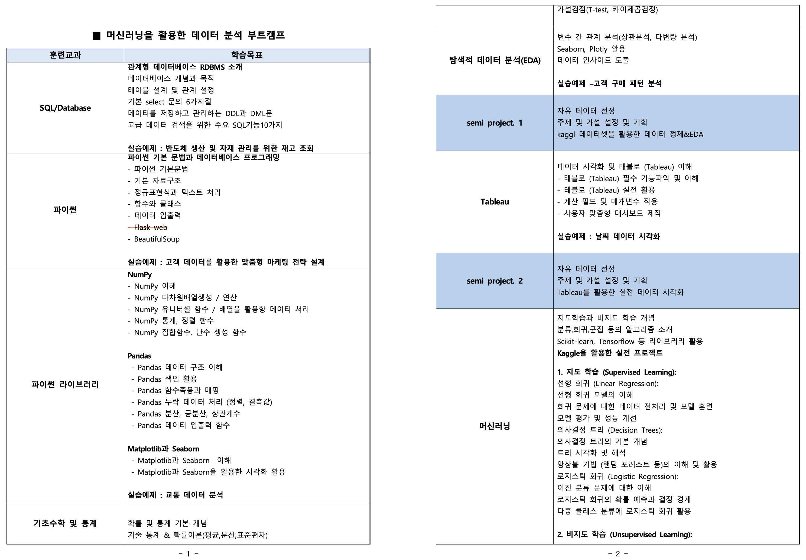
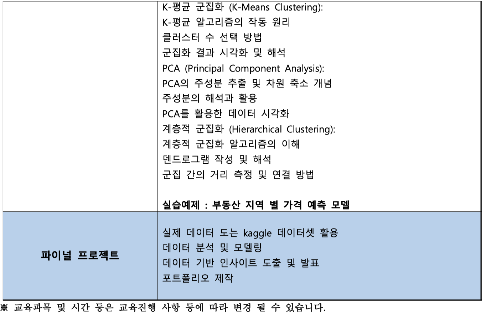
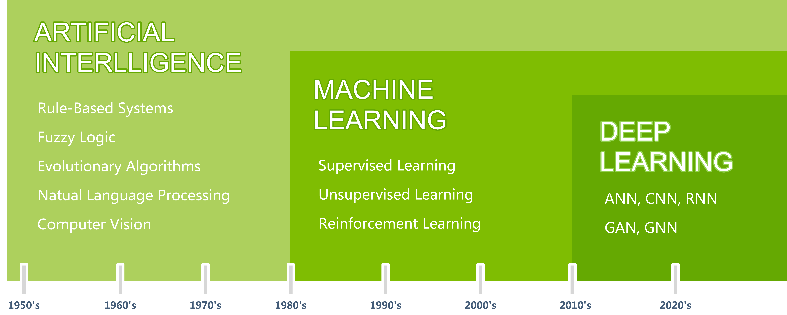
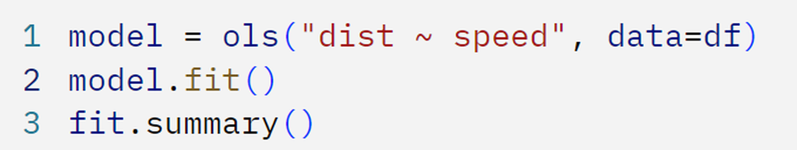
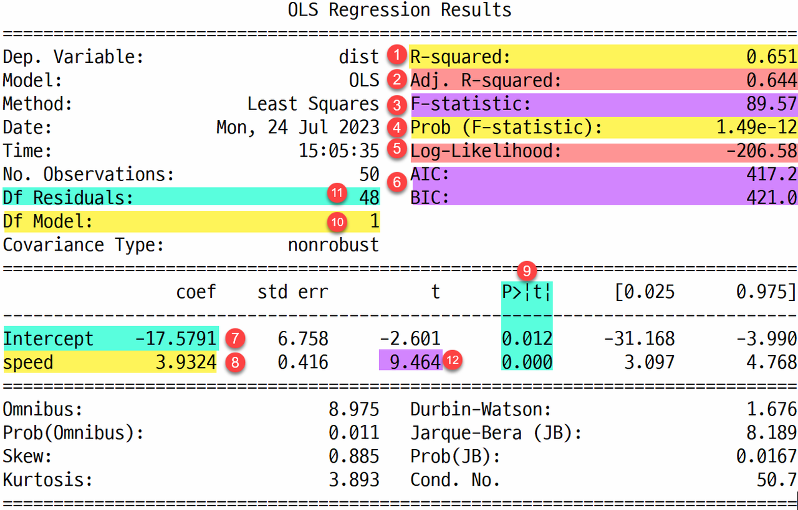
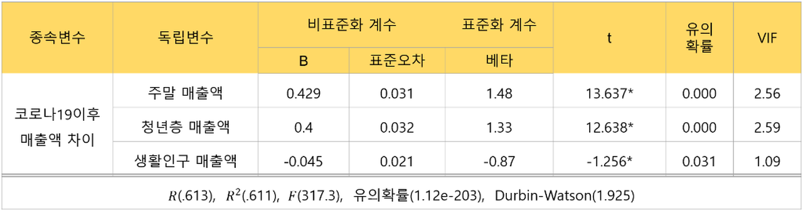
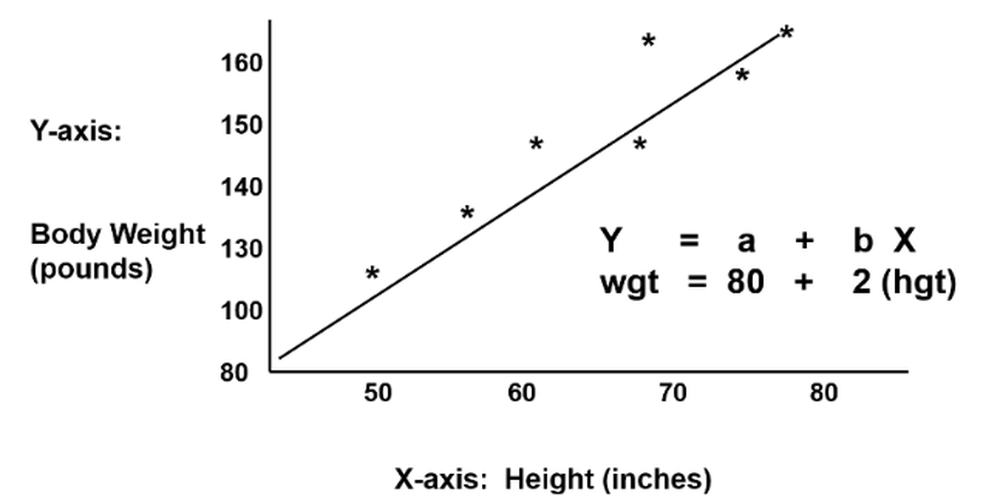
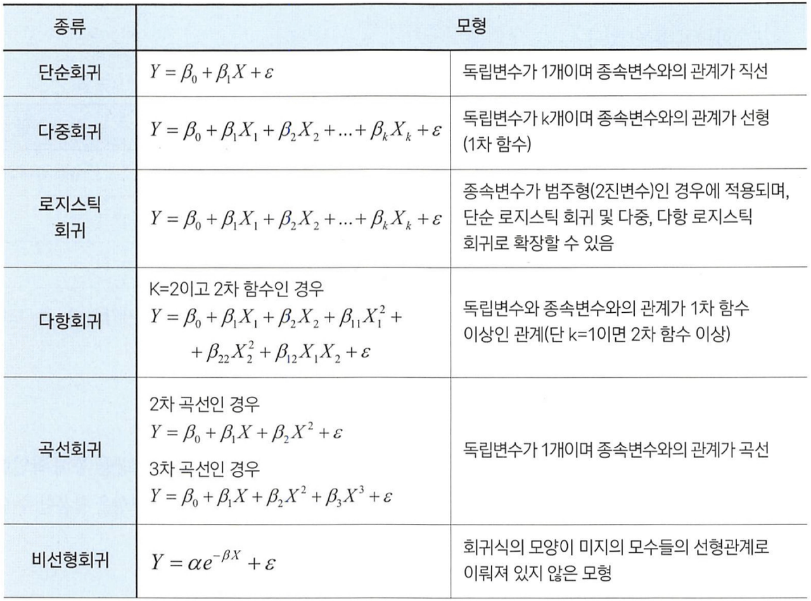
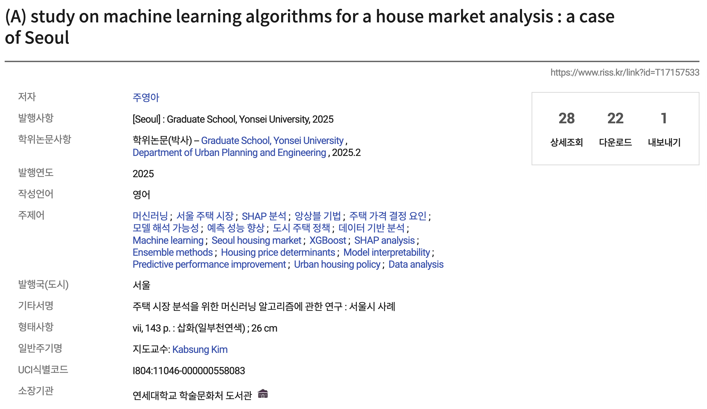

# 빅데이터 분석 전문가 56기 **Kick-Off**

---
layout: magazine
---

# 반갑습니다

이 광 호 leekh4232@yonsei.ac.kr

- 연세대학교 공학석사
- 아이티윌 - 데이터분석/머신러닝 강의
- 메가스터디IT아카데미 - 프론트엔드/백엔드/데이터 분석 강의
- KT, U+ 프로젝트 다수 참여

---
layout: section
part: 1
eyebrow: Chapter 1
---

# Background

수업 참여에 필요한 기본 배경 지식

---
part: 1
eyebrow: Chapter 1 · Background
---

# **교육** 안내

등록 상담 과정에서 이 내용 받으셨나요?

<Grid cols="1.9fr 1fr" gap="28" align="center">
<Figure h="440">

</Figure>
<Figure h="300">

</Figure>
</Grid>

---
part: 1
eyebrow: Chapter 1 · Background
---

# 데이터 분석을 위한 **머신러닝 분류 방식** (1)

<Figure paper>

</Figure>

---
part: 1
eyebrow: Chapter 1 · Background
---

# 데이터 분석을 위한 **머신러닝 분류 방식** (2)

사회 문제 해결을 위한 인공지능 → 주로 머신러닝을 의미 (Lundberg et al., 2024)

<Kicker lead><b>데이터 분석, 예측 모델 구축, 패턴 인식</b> 사회 문제 해결(사회 과학)에 인공지능을 활용하기 위해서는 특히 머신러닝에 대한 이해가 필요 (Rahal et al., 2024)</Kicker>

<Grid cols="1fr 1.25fr" gap="20" align="stretch">
<Card k="deep learning" t="DeepLearning의 등장">

- 데이터가 점차 복잡해짐 (텍스트, 이미지 등)
- 다층 신경망(deep neural networks)을 사용하여 복잡한 패턴을 학습하는 기술
- 이미지, 음성, 자연어와 같은 비정형 데이터를 다루는 데 강점

</Card>
<Card acc k="conclusion" t="가장 좋은 것은 보완하여 사용하는 것">

- 얼마전까지 딥러닝이 무조건 성능이 좋은 것으로 여겨짐
- 최근 개발된 머신러닝 알고리즘들은 예측에 있어 상대적으로 더 좋은 성능을 보여줌
- 특히 표 형식의 데이터에서 압도적인 성능 차이를 보여줌 (Grinsztajn, Oyallon, & Varoquaux, 2022; Shwartz-Ziv & Armon, 2022)

</Card>
</Grid>

---
part: 1
eyebrow: Chapter 1 · Background
---

# 데이터 분석을 위한 **머신러닝 분류 방식** (3)

AI, ML, DL, XAI

<Grid cols="4" gap="18" align="stretch">
<Card lg acc k="Artificial Intelligence" t="AI">인간의 지적 능력을 모방하는 기술</Card>
<Card lg acc k="Machine Learning" t="ML">대규모 데이터를 분석하고 학습하여 패턴을 예측하는 기술</Card>
<Card lg acc k="Deep Learning" t="DL">인공신경망을 기반으로 복잡한 데이터에서 고차원 패턴을 자동으로 학습하는 기술</Card>
<Card lg acc k="Explainable AI" t="XAI">AI의 의사결정 과정을 사람이 이해할 수 있도록 설명해주는 기술 또는 접근 방법</Card>
</Grid>

---
part: 1
eyebrow: Chapter 1 · Background
class: dense
---

# 사회과학 연구와 **데이터 분석**

<Grid cols="1fr 1.1fr" gap="36" align="start">

### 사회과학

- 인간의 사회적 행동과 상호작용, 그리고 이를 이루는 집단과 제도를 과학적으로 탐구하는 분야
- 자연과학이 자연현상의 법칙을 탐구한다면, 사회과학은 인간과 사회 현상을 설명・예측하고 개선하는 것을 목표로 함
- 사회 현상을 이해·설명·예측하기 위해 질문 → 데이터 → 증거 기반 답변 을 도출하는 체계적 탐구

### 사회과학 분야의 연구 예시

일반적으로 말하는 데이터 분석 과정을 "연구"라고 함

<Card sm acc>기후 변화 인식이 에너지 소비 행동에 미치는 영향: 설문조사와 스마트미터 데이터를 활용한 혼합 방법 연구</Card>

<NumList>
<Item title="질문">기후 위기에 대한 인식 수준이 가정의 에너지 절약 행동에 영향을 주는가?</Item>
<Item title="데이터">전국 설문조사 응답, 스마트미터 전력 사용 기록, 기상 자료</Item>
<Item title="증거 기반 답변">통계 분석 + 머신러닝으로 인식–행동 간 관계를 설명하고 정책 시뮬레이션 제공</Item>
</NumList>

</Grid>

---
part: 1
eyebrow: Chapter 1 · Background
class: dense
---

# **데이터 분석 프로세스** (1)

본 훈련 과정을 통해 이 프로세스를 단계별로 습득하는 것을 목표로 함

<Grid cols="2" gap="20" align="stretch">
<Card acc k="01" t="데이터 수집・가공">

DATABASE (SQL) API, Crawling (Python)

- 데이터 구조 점검
- 데이터 정제 (품질 문제 해결)
- 데이터 정리/병합
- 데이터 재구조화(Re-shaping)
- 정보 조합
- 파생변수 생성
- 범주형 변수 인코딩
- 수학적 변환(로그변환, 스케일링)

</Card>
<Card acc k="02" t="탐색적 데이터 분석">

- 기초 통계량
- 단변량 분석
- 이변량 분석
- 기본 다변량 분석(pairplot, heatmap)
- 시계열 패턴 분석
- 통계적 검정 방법 선택(t-test, ANOVA, 카이제곱 등)
- 변수 간 상관관계 분석
- 데이터 분포 형태 관찰
- 데이터 구조 이해 및 시각적 요약

</Card>
</Grid>

---
part: 1
eyebrow: Chapter 1 · Background
class: dense
---

# **데이터 분석 프로세스** (2)

본 훈련 과정을 통해 이 프로세스를 단계별로 습득하는 것을 목표로 함

<Grid cols="3" gap="20" align="stretch">
<Card lg acc k="03" t="모델링">

- 통계적 분석 모델(회귀, 분류)
- 머신러닝 분석 모델(Linear, D-Tree, Random Forest, XGBoost, LightGBM,CatBoost 등)

</Card>
<Card lg acc k="04" t="성능평가">

- 설명력, 에러율 점검
- 일반화 성능 확인

</Card>
<Card lg acc k="05" t="해석 및 결론">

- 결과 해석 및 결론 도출
- 활용 방안
- 한계점
- 제언

</Card>
</Grid>

---
part: 1
eyebrow: Chapter 1 · Background
nodemap:
  w: 1000
  h: 582.5
  nodes:
    - { label: '연구주제 선정', x: 0.0, y: 15.7, w: 171.7, h: 43.2, kind: term }
    - { label: '데이터 수집', x: 0.0, y: 89.1, w: 171.7, h: 58.9, kind: io }
    - { label: '탐색적 데이터 분석', x: 0.0, y: 174.4, w: 171.7, h: 58.9, kind: box }
    - { label: 'K-Fold / GridSearchCV', x: 290.7, y: 249.2, w: 204.1, h: 71.6, kind: box }
    - { label: 'LinearRegression', x: 545.9, y: 0.0, w: 152.9, h: 58.9, kind: box }
    - { label: 'KNN Regression', x: 545.9, y: 77.3, w: 152.9, h: 58.9, kind: box }
    - { label: 'Decision Tree  Regression', x: 545.9, y: 154.5, w: 152.9, h: 58.9, kind: box }
    - { label: 'SGD Regression', x: 545.9, y: 225.7, w: 152.9, h: 58.9, kind: box }
    - { label: 'Random Forest', x: 545.9, y: 296.8, w: 152.9, h: 58.9, kind: box }
    - { label: 'Surport  Vector Machine', x: 545.9, y: 367.9, w: 152.9, h: 58.9, kind: box }
    - { label: 'LightGBM', x: 545.9, y: 439.0, w: 152.9, h: 58.9, kind: box }
    - { label: 'CatBoost', x: 545.9, y: 510.2, w: 152.9, h: 58.9, kind: box }
    - { label: '성능평가 (R^2, MSE, RMSE / Over, Under Fitting)', x: 748.1, y: 248.2, w: 189.1, h: 72.6, kind: box }
    - { label: '요인선정 (상관분석/분산분석)', x: 0.0, y: 255.6, w: 171.7, h: 58.9, kind: box }
    - { label: '분위수 분할', x: 177.2, y: 349.0, w: 171.7, h: 58.9, kind: box }
    - { label: '군집분석 (KMeans/DBScan)', x: 116.4, y: 439.0, w: 171.7, h: 58.9, kind: box }
    - { label: '차원축소 (PCA)', x: 65.4, y: 523.7, w: 171.7, h: 58.9, kind: box }
    - { label: 'Votting', x: 830.4, y: 6.1, w: 98.1, h: 58.9, kind: box }
    - { label: 'Bagging', x: 830.4, y: 89.1, w: 98.1, h: 58.9, kind: box }
    - { label: 'feature importance SHAP', x: 748.1, y: 385.8, w: 189.1, h: 60.1, kind: box }
    - { label: '결과해석', x: 756.8, y: 504.5, w: 171.7, h: 58.9, kind: io }
    - { label: 'Boosting', x: 830.4, y: 168.7, w: 98.1, h: 58.9, kind: box }
  edges:
    - 'M85.8,58.9 L85.8,89.1'
    - 'M85.8,148.0 L85.8,174.4'
    - 'M698.9,29.4 L724.7,29.4 L724.7,284.5 L747.2,284.5'
    - 'M698.9,106.7 L724.7,106.7 L724.7,284.5 L747.2,284.5'
    - 'M698.9,184.0 L724.4,184.0 L724.4,286.0 L748.8,286.0'
    - 'M698.9,286.0 L724.4,286.0 L724.4,255.1 L748.8,255.1'
    - 'M698.9,326.2 L724.4,326.2 L724.4,285.0 L748.8,285.0'
    - 'M698.9,397.4 L724.7,397.4 L724.7,284.5 L747.2,284.5'
    - 'M698.9,468.5 L724.7,468.5 L724.7,284.5 L747.2,284.5'
    - 'M698.9,539.6 L724.7,539.6 L724.7,284.5 L747.2,284.5'
    - 'M85.8,233.3 L85.8,255.6'
    - 'M171.7,285.0 L290.7,285.0'
    - 'M141.8,314.4 L141.8,378.5 L177.2,378.5'
    - 'M348.9,378.5 L392.7,378.5 L392.7,320.8'
    - 'M288.1,468.5 L419.6,468.5 L419.6,320.8'
    - 'M33.0,314.4 L33.0,553.1 L65.4,553.1'
    - 'M237.1,568.3 L452.9,568.3 L452.9,320.8'
    - 'M842.7,320.8 L842.7,385.8'
    - 'M842.7,445.9 L842.7,504.5'
    - 'M776.3,248.2 L776.3,35.6 L830.4,35.6'
    - 'M790.1,248.2 L790.1,118.5 L830.4,118.5'
    - 'M804.8,248.2 L804.8,198.1 L830.4,198.1'
    - 'M928.5,35.6 L1000.0,35.6 L1000.0,305.5 L937.2,305.5'
    - 'M928.5,118.5 L981.4,118.5 L981.4,284.5 L937.2,284.5'
    - 'M928.5,198.1 L962.7,198.1 L962.7,264.3 L937.2,264.3'
    - 'M85.8,314.4 L85.8,468.5 L116.4,468.5'
    - 'M151.2,523.7 L151.2,510.9 L202.2,510.9 L202.2,497.9'
    - 'M202.2,439.0 L202.2,425.6 L263.1,425.6 L263.1,407.9'
    - 'M237.1,541.8 L323.4,541.8 L323.4,407.9'
    - 'M494.7,285.0 L521.6,285.0 L521.6,106.7 L545.9,106.7'
    - 'M494.7,285.0 L521.6,285.0 L521.6,184.0 L545.9,184.0'
    - 'M494.7,285.0 L521.6,285.0 L521.6,29.4 L545.9,29.4'
    - 'M494.7,285.0 L521.6,285.0 L521.6,326.2 L545.9,326.2'
    - 'M494.7,285.0 L521.6,285.0 L521.6,397.4 L545.9,397.4'
    - 'M494.7,285.0 L521.6,285.0 L521.6,468.5 L545.9,468.5'
    - 'M494.7,285.0 L521.6,285.0 L521.6,255.1 L545.9,255.1'
    - 'M494.7,285.0 L521.6,285.0 L521.6,539.6 L545.9,539.6'
  height: 470
---

# **데이터 분석 프로세스** (상세)

<NodeMap v-bind="$frontmatter.nodemap" />

---
layout: section
part: 2
eyebrow: Chapter 2
---

# Curriculum Roadmap

커리큘럼 로드맵

---
part: 2
eyebrow: Chapter 2 · Curriculum Roadmap
roadmap:
  stages: ['데이터 수집・가공', '탐색적 데이터 분석', '모델링', '성능평가', '해석 및 결론']
  bands:
    - { label: 데이터 분석가, from: 0, to: 2.6 }
    - { label: 데이터 사이언티스트, from: 2.45, to: 4 }
  rows:
    - { label: SQL/Database, from: 0.08, to: 1.08 }
    - { label: Python / Library, from: 0.08, to: 4.92 }
    - { label: 기초 수학 및 통계, from: 1, to: 3.18 }
    - { label: EDA / Tablueau, from: 1, to: 2.07 }
    - { label: 머신러닝, from: 2.07, to: 4.92 }
---

# 데이터 분석 프로세스에 따른 **교과목 학습 계획**

<Roadmap v-bind="$frontmatter.roadmap" />

---
part: 2
eyebrow: Chapter 2 · Curriculum Roadmap
---

# 교과목별 **연관 자격증**

| 교과목 | 관련 자격증 |
|:--|:--|
| SQL / Database | SQLD |
| 기초 수학 / 통계 / 머신러닝 | ADSP, ADP, 빅데이터 분석 기사, 사회조사분석사 |

---
part: 2
eyebrow: Chapter 2 · Curriculum Roadmap
---

# 데이터 분석 **수업 예시**

이런걸 합니다…

<Grid cols="1fr 1.1fr" gap="28" align="start">

<Figure h="90">

</Figure>
<Figure h="330">

</Figure>

<Figure h="130">

</Figure>
<Figure h="290">

</Figure>

</Grid>

---
part: 2
eyebrow: Chapter 2 · Curriculum Roadmap
---

# 데이터 분석 **수업 예시**

그래서 이렇게 설명을 합니다.

<Grid cols="1.35fr 1fr" gap="32" align="center">
<Figure h="450">

</Figure>
<Figure h="340">

</Figure>
</Grid>

---
part: 2
eyebrow: Chapter 2 · Curriculum Roadmap
---

# 데이터 분석 **수업 예시**

이만큼을 공부해야 합니다.

<Figure paper>

</Figure>

---
part: 2
eyebrow: Chapter 2 · Curriculum Roadmap
---

# **최종 수업 목표**

<Figure>

</Figure>

---
layout: section
part: 3
eyebrow: Chapter 3
---

# 당부의 말

---
layout: section
part: 1
eyebrow: 당부의 말 · 01 / 07
---

# 마음 단단히 먹으세요. 어렵습니다.

---
layout: section
part: 2
eyebrow: 당부의 말 · 02 / 07
---

# 전공 수준의 이론(수학적 접근)을 다루지는 않습니다.

---
layout: section
part: 3
eyebrow: 당부의 말 · 03 / 07
---

# 컴퓨터 기초 활용 능력은 각자의 몫 입니다.

---
layout: section
part: 4
eyebrow: 당부의 말 · 04 / 07
---

# GPT등의 AI를 올바르게 사용하세요.

---
layout: section
part: 1
eyebrow: 당부의 말 · 05 / 07
---

# 총 2~3번의 프로젝트가 있습니다. (중간, 파이널)

---
layout: section
part: 2
eyebrow: 당부의 말 · 06 / 07
---

# 훈련기간이 깁니다. 1주 이상 슬럼프가 올 수 도 있어요.

---
layout: section
part: 3
eyebrow: 당부의 말 · 07 / 07
---

# 지각, 결석, 조퇴로 인한 훈련 공백은 본인의 몫입니다.

---
eyebrow: communication
---

# **Communication**

<Grid cols="2" gap="80">
<Figure h="400" caption="단톡방">

</Figure>
<Figure h="400" caption="1:1 톡방">

</Figure>
</Grid>
